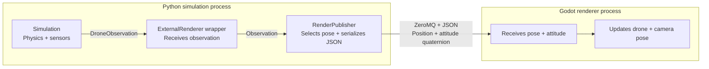

# Bullet Drone

A PyBullet quadcopter simulation library for physics, sensors, flight control and
Betaflight SITL integration. Package version: **0.1.0**.

## Overview

Bullet Drone is a quadcopter simulation for exploring physics, flight control,
sensors, and firmware integration. PyBullet advances the drone and environment
one fixed step at a time, and each step returns a `DroneObservation` with
ground-truth state and configured sensor readings. Example programs generate
commands using either the internal controller or Betaflight SITL. Rendering is
optional and consumes pose data without owning the physics, so the same
simulation can run headless or with a viewer.

## Features

- Caller-owned fixed-step physics with immutable state and sensor observations.
- Internal Angle/Acro control and Betaflight SITL motor feedback.
- Configurable IMU, barometer, opt-in GPS, aerodynamics and wind.
- Headless operation, PyBullet GUI and an optional packaged Godot viewer.
- Runnable altitude, position, terrain-following and GPS mission examples.

## Architecture

The application owns the execution loop, pacing and cleanup. `RcSimulation`
connects RC commands to the selected control backend and physics. PyBullet owns
rigid-body motion and contacts; sensors sample state without changing it.
Rendering consumes observations independently.



The simulation produces observations. The ExternalRenderer wrapper passes them
to RenderPublisher, which selects position and attitude and sends JSON to Godot
over ZeroMQ. Godot updates the drone and camera pose without importing Python.


## Requirements

- **Python:** 3.12 or newer, with **uv** for dependency management and execution.
- **Core dependencies:** PyBullet, Click, Loguru and PyYAML.
- **Optional extras:** `render` adds ZeroMQ and workspace protocol packages;
  `mavlink` adds pymavlink. `sitl` is an empty compatibility extra.
- **Display:** PyBullet GUI needs a desktop/X11 session; headless physics needs none.
- **Packaged renderer:** Ubuntu 24.04/Linux x86_64, OpenGL drivers and runtime
  libraries. Building it requires the Godot version/export templates and sibling
  sources documented in [external_render/README.md](external_render/README.md).
- **SITL:** examples require a separately built Betaflight executable.
- **Hardware:** no physical flight controller required. NVIDIA offloading is
  configured by the VS Code task, not required by headless physics.

## Installation

From this repository's directory in the uv workspace:

```bash
uv sync --locked --all-packages --all-extras --all-groups
```

## Quick Start

Run the internal altitude-hold mission without a display:

```bash
uv run --locked python -m examples.altitude_hold.main --headless
```

The drone takes off to 3 m, holds, then lands. Remove `--headless` for the PyBullet
viewer. The example owns its loop and cleanup; Ctrl+C releases resources.

## Usage

| Example | Description | Control backend |
| --- | --- | --- |
| [Altitude hold](#altitude-hold-example) | Internal Angle-mode flight, take off to 3 m, hold, then land. | Internal |
| [Altitude hold with packaged renderer](#altitude-hold-with-the-packaged-renderer) | The altitude-hold mission with the external Godot viewer. | Internal |
| [Rendered takeoff with camera viewer](examples/takeoff_image_viewer/README.md) | Take off, hold and land with Godot plus a separate SHM camera window. | Internal |
| [Live wind control](examples/wind_control/README.md) | Rendered takeoff with a UI for applying world XYZ wind. | Internal |
| [Betaflight SITL altitude hold](#betaflight-sitl-altitude-hold-example) | Altitude hold using Betaflight firmware for stabilization and motor output. | Betaflight SITL |
| [Position square](#position-square-example) | Fly a square using internal position and velocity control with Angle mode. | Internal |
| [Acro position square](#acro-position-square-example) | Fly a square using position navigation and Betaflight Acro rate control. | Betaflight SITL |
| [Terrain following](examples/terrain_following_bt/README.md) | Follow uneven ground at 3 m rangefinder clearance and return to home. | Betaflight SITL |
| [Terrain following with MAVLink](examples/terrain_following_mavlink/README.md) | Monitor Betaflight MAVLink telemetry while commanding Acro flight over MSP. | Betaflight SITL |
| [GPS point-to-point with MAVLink](examples/gps_point_to_point_mavlink/README.md) | Fly 400 m using firmware GPS/attitude feedback, then land on mapped terrain. | Betaflight SITL |

### Altitude hold example

```bash
uv run --locked python -m examples.altitude_hold.main
uv run --locked python -m examples.altitude_hold.main --headless
```

The example owns its feedback loop through `RcSimulation.step()`. Each observation
supplies ground-truth altitude and vertical speed to the altitude PID. RC angle
mode keeps roll and pitch level. GUI mode is paced to wall time; headless mode
runs the same sequence faster. There is no horizontal position hold.

See [the example README](examples/altitude_hold/README.md) for gains, timing,
sequence and state-flow diagrams, and verification.

### Betaflight SITL altitude hold example

Setup installs runnable firmware at `bin/betaflight_SITL.elf`. The MAVLink
variant uses `bin/betaflight_mavlink_SITL.elf`. Sources and compiler outputs
remain under `.sitl/`; `--sitl-binary PATH` overrides the installed default.

`altitde_hold_bt` independently flies the same 3 m takeoff, 10-second hold and
landing mission with Betaflight stabilization/motor mixing and PyBullet physics.
It owns the firmware process and uses no Godot or other example code.

```bash
tools/setup_betaflight_sitl.sh
uv run --locked --extra sitl python -m examples.altitde_hold_bt.main
uv run --locked --extra sitl python -m examples.altitde_hold_bt.main --headless
```

Both modes remain paced for SITL timing. See the
[example README](examples/altitde_hold_bt/README.md) for feedback sources, startup,
ports, mission states and live verification.

### Altitude hold with the packaged renderer

Build the Linux viewer and launch a complete automatic flight:

```bash
uv run --locked python external_render/build.py
uv run --locked --extra render python -m examples.altitude_hold_external_render.main
```

The example owns headless PyBullet physics and the exported Godot viewer. It
waits for the first camera image, then climbs to 3 m, holds for 10 seconds and
lands without a Start button. The Godot editor and sibling renderer sources are
needed only when building the package. See the [example and communication
diagram](examples/altitude_hold_external_render/README.md) and
[package instructions](external_render/README.md). Choose **Altitude hold
(external renderer)** in the VS Code example dropdown after building.

### Position square example

```bash
uv run --locked --all-packages --all-extras --all-groups python -m examples.position_square.main
uv run --locked --all-packages --all-extras --all-groups python -m examples.position_square.main --headless
```

The example automatically opens the packaged external Godot viewer, takes off
to 3 m, flies a settled 3 m square while holding heading, holds home for
10 seconds, then lands and disarms. Build the viewer first with
`uv run --locked python external_render/build.py`.
Use `--headless` for an automatic flight without windows. Separate XY
position and velocity PIDs feed the existing RC angle-mode simulation. See
[the example and diagrams](examples/position_square/README.md) and
[controller interfaces and migration](docs/design/position-control.md).

### Acro position square example

```bash
uv run --locked --all-packages --all-extras --all-groups python -m examples.position_square_acro.main
uv run --locked --all-packages --all-extras --all-groups python -m examples.position_square_acro.main --headless
```

This independent example launches unmodified Betaflight SITL and the packaged
Godot viewer, flies the same square with Acro RC body-rate commands, holds home
for 10 seconds, lands, disarms, and closes both child processes. Betaflight owns
rate stabilization, mixing, and motor output; the example owns XYZ navigation.
Build firmware first with `tools/setup_betaflight_sitl.sh`. See
[the Acro example and diagrams](examples/position_square_acro/README.md).

### VS Code tasks

Press **Ctrl+Shift+B** or choose **Tasks: Run Build Task → Bullet: Build Godot
renderer** to build the packaged viewer. The task has a blue tools icon and runs
`uv run --locked python external_render/build.py` from the project folder, with
output in a dedicated terminal. It does not launch a flight. Install the
[renderer build prerequisites](external_render/README.md#build) first.

Open **Tasks: Run Task → Bullet: Run example** and select a mission from the
picker. Choices include internal and rendered altitude hold, camera viewer,
wind control, Betaflight altitude hold, Angle/Iris/Acro squares, terrain following,
MAVLink/GPS missions. In the multi-folder workspace, the task
appears under `bullet_drone`.

The task runs the selected module through `uv run --frozen` with its existing display defaults
and NVIDIA graphics offloading: `__NV_PRIME_RENDER_OFFLOAD=1` and
`__GLX_VENDOR_LIBRARY_NAME=nvidia`. These settings also reach child renderer
processes. For the equivalent launch from a terminal:

```bash
__NV_PRIME_RENDER_OFFLOAD=1 __GLX_VENDOR_LIBRARY_NAME=nvidia uv run --locked --extra sitl python -m examples.altitde_hold_bt.main
```

NVIDIA is used for the OpenGL viewer; Bullet physics still runs on the CPU.
All altitude-hold choices start automatically and exit after landing. The
external-render choice opens the packaged Godot viewer with PyBullet headless.
The Betaflight choice requires a built SITL binary and uses its fixed UDP/MSP
ports; the internal choice uses no transport ports. Both square choices start
their packaged viewers and flights automatically; Acro square also requires the
built SITL binary. The shared task
includes rendering/SITL dependencies for the other choices, but the internal altitude-hold
CLI does not require the render extra. Run only one transport-based example at a time.

### PX4 Iris vehicle profile

```bash
uv run --locked --all-extras python -m examples.position_square.main --profile custom/iris.yaml
```

This selects the Iris vehicle profile for the internal Angle square example;
it does not run PX4 firmware. The same choice appears in the VS Code picker.

## Configuration

### Aerodynamics and wind

New aerodynamic effects default to enabled, with calm ambient wind. Configure
independent drag, damping, inflow, flapping, gyroscopic, ground-effect and local
propwash settings through Python or the commented `configs/basic.yaml` loader.
Wind supports a world velocity vector and repeatable smooth gusts. Configuration loading is example-specific: the position-square CLI accepts
`--profile`; other examples use their own defaults. For exact ideal-rotor
experiments, select `ForcesSettings.ideal()` and disable ambient wind.
See [models, defaults and compatibility](docs/design/aerodynamics.md).

### Sensor pose and live wind

Programmatic rendering adapters accept sensor-derived pose selection. See
[sensor pose settings](docs/design/sensors.md#sensor-pose-selection-and-attitude-estimation).
The [wind-control example](examples/wind_control/README.md) provides local wind editing.
GPS remains opt-in; see [GPS configuration](docs/design/sensors.md#opt-in-gps).

## Project Structure

```text
src/bullet_drone/  Library: physics, controls, sensors and adapters
examples/          Application-owned missions and CLIs
configs/           Physics and firmware profiles
custom/            Custom vehicle profiles and assets
libs/              Workspace protocol packages
external_render/   Godot viewer packaging and configuration
tests/             Automated checks
docs/              Design guides and simulation references
plan/              Implementation records
```

## Development

### Library interfaces

`DroneEnvironment.reset()` and `step()` return immutable `DroneObservation`
records containing ground truth and configured sensor readings. `RcSimulation` owns RC
translation, stabilization, mixing, and physics; the caller owns its execution
loop. Call `reset()` before stepping and `close()` when finished.

Optional `drone.drone_id` in YAML defaults to `drone_1`. It is retained in
`DroneState` across resets and appears in render and observation data.
See [drone identity](docs/design/drone-identity.md).

`AltitudeController` supplies collective thrust in newtons from world Z altitude
and vertical speed. `PositionController` supplies world XY velocity targets;
`VelocityController` supplies roll/pitch and tilt-compensated thrust from velocity
feedback and vertical force. The caller composes altitude/yaw and RC encoding.
`RcSimulation` enables IMU and barometer readings with zero noise by default.
Configure Gaussian noise, fixed biases and seeds through Python or YAML; disable
each sensor independently. Direct `DroneEnvironment` callers inject sensors
explicitly. Read `observation.sensors.imu` and `observation.sensors.barometer`.
Sensor noise never modifies ground truth or current controller feedback.
See [sensor configuration and measurement semantics](docs/design/sensors.md).

`create_flight_command_provider()` connects a caller-supplied high-level command
source to internal stabilization. Angle roll/pitch commands use radians; Acro
commands use body rates in rad/s. The RC yaw channel is a rate in both modes.
Motor targets and actual speeds use rad/s. Configuration selects the `internal`
backend by default. `control.backend: betaflight` selects the managed SITL path:
physics sends noisy IMU and barometer FDM on UDP 9003 and consumes normalized
motor outputs on UDP 9002. MSP RC and estimator feedback remain application-owned.
Build unmodified pinned Betaflight 2026.6.2 with `tools/setup_betaflight_sitl.sh`.
The bridge encodes measured barometer pressure into FDM `position_xyz[2]` so
upstream Gazebo mode reconstructs that pressure. The firmware profile selects MSP
RC and disables GPS and magnetometer use. Existing patched/modified firmware
checkouts must be preserved and moved aside before setup can create a clean one.
Use the standalone Betaflight examples listed above.
See the [bridge reference](docs/design/betaflight-sitl-bridge.md) for ports,
packet fields, sensor mappings and motor order.

Rendering adapters support GUI/headless selection and UDP pose publication through
library composition. The flight examples expose PyBullet GUI and `--headless`;
the square example accepts the optional ZeroMQ render profile described below.
The older library render profiles are not bundled in this checkout. Physics and headless execution remain independent
of any external viewer. Callers own observation-consumer reset/consume/close.

### Build and debugging

Use the installation command above for development dependencies. Firmware and
viewer build commands are under Usage. Use `uv run --locked python -m
examples.altitude_hold.main --help` for CLI options, or inspect the VS Code task
in [.vscode/tasks.json](.vscode/tasks.json). Formatting and static-analysis commands
are not specified in `pyproject.toml`.

## Testing

```bash
uv run --locked --all-packages --all-extras --all-groups pytest -q
```

Tests cover lifecycle and cleanup, configuration, gravity/contact, force and torque
directions, mixer limits, PID control, RC translation and arming, rendering adapters,
and both flight missions. Sensor tests cover reading values, timestamps, noise,
filtering and lifecycle while keeping measured data separate from ground truth.

Implementation records are in [the plan menu](plan/README.md).

## Documentation

- [Simulation I/O: connections, topics and ports](docs/simulation/io.md)

- [Design menu](docs/design/index.md)
- [Simulation and Betaflight bridge](docs/design/betaflight-sitl-bridge.md)
- [SITL FDM, ports and motor-to-thrust reference](docs/simulation/sitl_fd.md)
- [Sensor models and configuration](docs/design/sensors.md)
- [Aerodynamics and wind](docs/design/aerodynamics.md)
- [External renderer package](external_render/README.md)

## Troubleshooting

### Viewer missing or no display

Build the packaged viewer before rendered examples. Use `--headless` where
supported to skip windows. Runtime packages do not need the Godot editor.

### SITL startup or port conflicts

Build firmware before launch and run one transport-based example at a time.
Preserve and move aside modified firmware checkouts before clean setup.

### Godot controls

Use `--headless` to skip the viewer while retaining paced Betaflight execution.
The Acro CLI has no Start/Stop/Reset command channel. Override packaged paths
with `--renderer`, `--render-config`, or `--sitl-binary`. Only one transport-based
example can own the fixed ports at a time. See
[the transport design](docs/design/zmq-rendering.md).

## Roadmap

Future commitments are unspecified. The [plan menu](plan/README.md) records
implementation work; unimplemented proposals are not supported features.

## Contributing

A dedicated contribution policy is unspecified. Follow [AGENTS.md](AGENTS.md),
keep design documentation aligned with interface changes, and run checks
appropriate to the change.

## License

A project-wide license is not specified in `pyproject.toml`, and no root LICENSE
file is present. The racer asset is adapted from MIT-licensed gym-pybullet-drones;
see its [asset notes](src/bullet_drone/assets/racer/README.md) and
[upstream license](src/bullet_drone/assets/racer/LICENSE.upstream).
