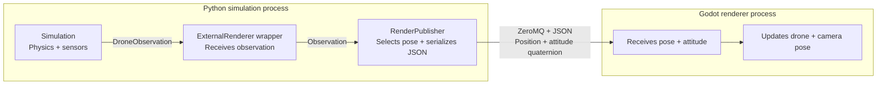

# Bullet Drone

Bullet Drone is a quadcopter simulation for exploring physics, flight control,
sensors, and firmware integration. PyBullet advances the drone and environment
one fixed step at a time, and each step returns a `DroneObservation` with
ground-truth state and configured sensor readings. Example programs generate
commands using either the internal controller or Betaflight SITL. Rendering is
optional and consumes pose data without owning the physics, so the same
simulation can run headless or with a viewer.

## Setup and run

Use Python 3.12 and uv:

```bash
uv sync --locked --all-packages --all-extras --all-groups
```

The package is a library. Runnable examples provide their own entry points and
own their execution loops, pacing, diagnostics, and cleanup. GUI mode uses
PyBullet's built-in viewer and requires a desktop/X11 display. Headless mode
needs no display or wall-time pacing. Ctrl+C releases simulation resources.

---

## Examples



The simulation produces observations. The ExternalRenderer wrapper passes them
to RenderPublisher, which selects position and attitude and sends JSON to Godot
over ZeroMQ. Godot updates the drone and camera pose without importing Python.

| Example | Description | Control backend |
| --- | --- | --- |
| [Altitude hold](#altitude-hold-example) | Internal Angle-mode flight, take off to 3 m, hold, then land. | Internal |
| [Altitude hold with packaged renderer](#altitude-hold-with-the-packaged-renderer) | The altitude-hold mission with the external Godot viewer. | Internal |
| [Rendered takeoff with camera viewer](examples/takeoff_image_viewer/README.md) | Take off, hold and land with Godot plus a separate SHM camera window. | Internal |
| [Betaflight SITL altitude hold](#betaflight-sitl-altitude-hold-example) | Altitude hold using Betaflight firmware for stabilization and motor output. | Betaflight SITL |
| [Position square](#position-square-example) | Fly a square using internal position and velocity control with Angle mode. | Internal |
| [Acro position square](#acro-position-square-example) | Fly a square using position navigation and Betaflight Acro rate control. | Betaflight SITL |
| [Terrain following](examples/terrain_following_bt/README.md) | Follow uneven ground at 3 m rangefinder clearance and return to home. | Betaflight SITL |
| [Terrain following with MAVLink](examples/terrain_following_mavlink/README.md) | Monitor Betaflight MAVLink telemetry while commanding Acro flight over MSP. | Betaflight SITL |
| [External RC](docs/design/app-flight-channel.md) | Connect an external app that sends RC commands and receives flight feedback. | Betaflight SITL |

## Altitude hold example

```bash
uv run --locked python -m examples.altitude_hold.main
uv run --locked python -m examples.altitude_hold.main --headless
```

The example owns its feedback loop through `RcSimulation.step()`. Each observation
supplies ground-truth altitude and vertical speed to the altitude PID. RC angle
mode keeps roll and pitch level. GUI mode is paced to wall time; headless mode
runs the same sequence faster. There is no horizontal position hold.

See [the example README](examples/altitude_hold/README.md) for gains, timing,
sequence and state-flow diagrams, and verification.

## Betaflight SITL altitude hold example

`altitde_hold_bt` independently flies the same 3 m takeoff, 10-second hold and
landing mission with Betaflight stabilization/motor mixing and PyBullet physics.
It owns the firmware process and uses no Godot or other example code.

```bash
tools/setup_betaflight_sitl.sh
uv run --locked --extra sitl python -m examples.altitde_hold_bt.main
uv run --locked --extra sitl python -m examples.altitde_hold_bt.main --headless
```

Both modes remain paced for SITL timing. See the
[example README](examples/altitde_hold_bt/README.md) for feedback sources, startup,
ports, mission states and live verification.

## Altitude hold with the packaged renderer

Build the Linux viewer and launch a complete automatic flight:

```bash
uv run --locked python external_render/build.py
uv run --locked --extra render python -m examples.altitude_hold_external_render.main
```

The example owns headless PyBullet physics and the exported Godot viewer. It
waits for the first camera image, then climbs to 3 m, holds for 10 seconds and
lands without a Start button. The Godot editor and sibling renderer sources are
needed only when building the package. See the [example and communication
diagram](examples/altitude_hold_external_render/README.md) and
[package instructions](external_render/README.md). Choose **Altitude hold
(external renderer)** in the VS Code example dropdown after building.

## Position square example

```bash
uv run --locked --all-packages --all-extras --all-groups python -m examples.position_square.main
uv run --locked --all-packages --all-extras --all-groups python -m examples.position_square.main --headless
```

The example automatically opens the packaged external Godot viewer, takes off
to 3 m, flies a settled 3 m square while holding heading, holds home for
10 seconds, then lands and disarms. Build the viewer first with
`uv run --locked python external_render/build.py`.
Use `--headless` for an automatic flight without windows. Separate XY
position and velocity PIDs feed the existing RC angle-mode simulation. See
[the example and diagrams](examples/position_square/README.md) and
[controller interfaces and migration](docs/design/position-control.md).

## Acro position square example

```bash
uv run --locked --all-packages --all-extras --all-groups python -m examples.position_square_acro.main
uv run --locked --all-packages --all-extras --all-groups python -m examples.position_square_acro.main --headless
```

This independent example launches unmodified Betaflight SITL and the packaged
Godot viewer, flies the same square with Acro RC body-rate commands, holds home
for 10 seconds, lands, disarms, and closes both child processes. Betaflight owns
rate stabilization, mixing, and motor output; the example owns XYZ navigation.
Build firmware first with `tools/setup_betaflight_sitl.sh`. See
[the Acro example and diagrams](examples/position_square_acro/README.md).

## VS Code tasks

Open **Tasks: Run Task → Bullet: Run example**, then select **Altitude hold**,
**Altitude hold (external renderer)**, **Altitude hold (Betaflight SITL)**, **Position square (Angle)**,
**Position square (Acro)** or **External RC
(app-controlled)** from the dropdown. In the multi-folder workspace, the task
appears under `bullet_drone`.

The task runs the selected module through `uv` with its existing display defaults
and NVIDIA graphics offloading: `__NV_PRIME_RENDER_OFFLOAD=1` and
`__GLX_VENDOR_LIBRARY_NAME=nvidia`. These settings also reach child renderer
processes. For the equivalent launch from a terminal:

```bash
__NV_PRIME_RENDER_OFFLOAD=1 __GLX_VENDOR_LIBRARY_NAME=nvidia uv run --locked --extra sitl python -m examples.altitde_hold_bt.main
```

NVIDIA is used for the OpenGL viewer; Bullet physics still runs on the CPU.
All altitude-hold choices start automatically and exit after landing. The
external-render choice opens the packaged Godot viewer with PyBullet headless.
The Betaflight choice requires a built SITL binary and uses its fixed UDP/MSP
ports; the internal choice uses no transport ports. Both square choices start
their packaged viewers and flights automatically; Acro square also requires the
built SITL binary. External RC requires the app. The shared task
includes rendering/SITL dependencies for the other choices, but the internal altitude-hold
CLI does not require the render extra. Use **Bullet: Run all** for the managed
application/renderer workflow. Run only one transport-based example at a time.

## Library interfaces

`DroneEnvironment.reset()` and `step()` return immutable `DroneObservation`
records containing ground truth and configured sensor readings. `RcSimulation` owns RC
translation, stabilization, mixing, and physics; the caller owns its execution
loop. Call `reset()` before stepping and `close()` when finished.

Optional `drone.drone_id` in YAML defaults to `drone_1`. It is retained in
`DroneState` across resets and appears in render and observation data.
See [drone identity](docs/design/drone-identity.md).

`AltitudeController` supplies collective thrust in newtons from world Z altitude
and vertical speed. `PositionController` supplies world XY velocity targets;
`VelocityController` supplies roll/pitch and tilt-compensated thrust from velocity
feedback and vertical force. The caller composes altitude/yaw and RC encoding.
`RcSimulation` enables IMU and barometer readings with zero noise by default.
Configure Gaussian noise, fixed biases and seeds through Python or YAML; disable
each sensor independently. Direct `DroneEnvironment` callers inject sensors
explicitly. Read `observation.sensors.imu` and `observation.sensors.barometer`.
Sensor noise never modifies ground truth or current controller feedback.
See [sensor configuration and measurement semantics](docs/design/sensors.md).

`create_flight_command_provider()` connects a caller-supplied high-level command
source to internal stabilization. Angle roll/pitch commands use radians; Acro
commands use body rates in rad/s. The RC yaw channel is a rate in both modes.
Motor targets and actual speeds use rad/s. Configuration selects the `internal`
backend by default. `control.backend: betaflight` selects the managed SITL path:
physics sends noisy IMU and barometer FDM on UDP 9003 and consumes normalized
motor outputs on UDP 9002. MSP RC and estimator feedback remain application-owned.
Build unmodified pinned Betaflight 2026.6.2 with `tools/setup_betaflight_sitl.sh`.
The bridge encodes measured barometer pressure into FDM `position_xyz[2]` so
upstream Gazebo mode reconstructs that pressure. The firmware profile selects MSP
RC and disables GPS and magnetometer use. Existing patched/modified firmware
checkouts must be preserved and moved aside before setup can create a clean one.
Then launch it through `bullet_render/tools/run_flight.py --physics-config configs/basic.yaml`
with `control.backend: betaflight` in the selected physics YAML.
See the [bridge reference](docs/design/betaflight-sitl-bridge.md) for ports,
packet fields, sensor mappings and motor order.

Rendering adapters support GUI/headless selection and UDP pose publication through
library composition. The flight examples expose PyBullet GUI and `--headless`;
the square example now accepts the optional ZeroMQ render profile described below.
The older library render profiles are not bundled in this checkout. Physics and headless execution remain independent
of any external viewer. Callers own observation-consumer reset/consume/close.

## Aerodynamics and wind

New aerodynamic effects default to enabled, with calm ambient wind. Configure
independent drag, damping, inflow, flapping, gyroscopic, ground-effect and local
propwash settings through Python or the commented `configs/basic.yaml` loader.
Wind supports a world velocity vector and repeatable smooth gusts. Existing
example CLIs use Python defaults and do not load YAML. For exact ideal-rotor
experiments, select `ForcesSettings.ideal()` and disable ambient wind.
See [models, defaults and compatibility](docs/design/aerodynamics.md).

## Assets and verification

The racer model is adapted from MIT-licensed gym-pybullet-drones. Front propellers
are orange and rear propellers are blue. See the bundled
[asset notes and license](src/bullet_drone/assets/racer/README.md).

```bash
uv run --locked --all-packages --all-extras --all-groups pytest -q
```

Tests cover lifecycle and cleanup, configuration, gravity/contact, force and torque
directions, mixer limits, PID control, RC translation and arming, rendering adapters,
and both flight missions. Sensor tests cover reading values, timestamps, noise,
filtering and lifecycle while keeping measured data separate from ground truth.

Implementation records are in [the plan menu](plan/README.md).

## Godot / ZeroMQ camera

Install the workspace dependencies, build SITL and the packaged viewer, then run
`uv run --locked --extra render --extra sitl python -m examples.position_square_acro.main`.
The example owns Godot and Betaflight and starts after the first rendered image.
See [the Acro square guide](examples/position_square_acro/README.md).

## Godot controls

Use `--headless` to skip the viewer while retaining paced Betaflight execution.
The Acro CLI has no Start/Stop/Reset command channel. Override packaged paths
with `--renderer`, `--render-config`, or `--sitl-binary`. Only one transport-based
example can own the fixed ports at a time. See
[the transport design](docs/design/zmq-rendering.md).

## Sensor pose for Godot and app feedback

Run the external-RC example with `--config configs/basic.yaml` to load physics
sensor noise and pose settings. Set `pose_sources.altitude: barometer` and
`pose_sources.attitude: imu` to use measured render height and an IMU complementary
filter for both camera and app attitude. Existing launches retain their defaults.
See [configuration, noise and estimator limits](docs/design/sensors.md#sensor-pose-selection-and-attitude-estimation).

The external-RC runner prints a `bullet_drone loaded configuration` banner to
stdout once at startup. Its indented JSON contains the effective simulation
settings (including defaults and the headless override), flight control, vehicle,
render, transport and advertised platform configuration, plus configuration paths.
`physics_config_path: null` means the built-in defaults were used. Diagnostics
continue on stderr; the banner precedes physics initialization.

The barometer in `configs/basic.yaml` uses `filter_enabled: true` and
`filter_time_constant_s: 0.1` under `sensors.barometer`. It smooths pressure before
altitude conversion for rendering and app feedback. Set `filter_enabled: false`
for direct noisy readings. Omitted flags default to false in the library.

The IMU demo now uses an ICM-42688-P density profile with sensor filtering:
`sensors.imu.noise_model: density`, `filter_enabled: true`, acceleration cutoff
30 Hz and gyro cutoff 60 Hz. Fixed bias and residual bias drift remain zero as a
calibrated baseline. See [IMU fields, units and model limits](docs/design/sensors.md#icm-42688-p-density-based-imu-profile).
Omitted options preserve the legacy per-sample noise model and disable filtering.

### Live wind in Godot

With the external-RC/LOS workflow, click **Wind** beside **Scenario**, edit world
XYZ mean velocity (m/s), gust standard deviations (m/s), correlation time (s)
and seed, then **Apply wind**. +Z points up; the vector points toward air travel.
Opening/closing the panel does not change wind. Apply works while stopped without
stepping, or live during flight. Start, Reset and spawn changes retain settings
and restart gust history; restarting physics reloads YAML defaults. The spectator
windsock shows actual mean-plus-gust velocity and is excluded from drone images.
See [runtime wind behavior](docs/design/aerodynamics.md#runtime-wind-updates).
