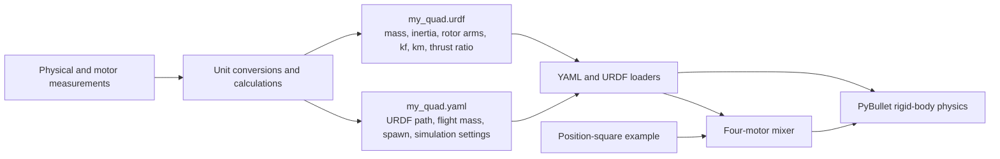

# Add a custom quadrotor to the simulation

This guide walks from physical measurements to a running custom quadrotor. It
assumes you are new to the model and explains what the quantities mean, how to
calculate the values the simulator needs, which files to create, and how to run
the result.

The loader currently supports **four identical rotors** in a balanced layout.
It does not support hexacopters, different motors on each arm, tilt-rotors, or
an arbitrary rotor order. The simulator uses a simple squared-speed motor model;
it is useful for simulation and control experiments, but it is not a complete
electrical or hardware model.

## What you will create

Create one URDF for the vehicle geometry and actuator data, and one YAML file
that selects the URDF and configures a simulation:

```text
custom/
├── my_quad.urdf       # body, rotor locations, and motor coefficients
└── my_quad.yaml       # simulation settings and path to my_quad.urdf
```

The repository already contains a complete pair you can copy and edit:

```bash
cp custom/iris.urdf custom/my_quad.urdf
cp custom/iris.yaml custom/my_quad.yaml
```

Keep the files together. A relative value such as `urdf: my_quad.urdf` is
resolved relative to the YAML file, so the profile will keep finding its model
when the repository is moved.

## How the pieces connect



The URDF describes one rigid vehicle and the four actuator locations. The YAML
profile tells the application which URDF to load and how heavy the simulated
vehicle should be. The mixer turns requested lift and torques into four rotor
thrusts. PyBullet applies the resulting forces to the URDF body.

## Step 1: collect the physical data

Use a CAD model, measured dimensions, component weights, and motor/propeller
data. Record SI units before editing either file.

| Quantity | Unit | Why the simulator needs it |
| --- | --- | --- |
| Ready-to-fly mass, including battery and payload | kg | Determines the gravity load and the acceleration produced by a force. |
| Center-of-mass location | m | Defines the origin from which the rotor arms and inertia are measured. |
| Body dimensions and shape | m | Used for the URDF collision and visual geometry. |
| Body inertia about its center of mass | kg·m² | Determines how much torque is needed to rotate the vehicle. |
| Four rotor centers relative to the center of mass | m | Determines the roll and pitch torque from each rotor. |
| Maximum thrust per motor and motor speed | N and rad/s or RPM | Determines the actuator limit. |
| Thrust coefficient and torque-to-thrust ratio | SI or RPM convention | Determines lift and yaw reaction torque at each motor speed. |

Do not measure rotor positions from the body edge. Measure each rotor center
from the vehicle center of mass. Use the body axes below, and convert
millimetres to metres by dividing by 1000.

| Body axis | Direction |
| --- | --- |
| +X | Forward |
| +Y | Left |
| +Z | Up |

World Z also points upward. The vehicle starts level, with its body axes aligned
to the world axes.

### Choose a mass consistently

The URDF `base_link` mass is the **nominal mass** used to interpret the motor
thrust-to-weight ratio. The YAML `drone.mass_kg` is the mass used for the actual
simulated flight. Usually set them to the same ready-to-fly mass.

PyBullet scales the URDF base mass and inertia by

```text
mass_scale = drone.mass_kg / URDF base_link mass
```

The motor thrust limit is derived separately from the URDF nominal mass and
`thrust2weight`. Changing only `drone.mass_kg` makes the vehicle heavier or
lighter without changing the motors' maximum thrust. This can be useful for a
payload study, but recalculate `thrust2weight` if your motor data or nominal
vehicle definition changes.

## Step 2: calculate the mass and inertia

Mass is the sum of the vehicle parts:

```text
m_total = m_frame + m_motors + m_electronics + m_battery + m_payload
```

Use the center of mass of the assembled vehicle as the model origin. For a
uniform rectangular body centered at that origin, with X length `a`, Y width
`b`, Z height `c`, and mass `m`, the diagonal inertia values are

```text
Ixx = m * (b² + c²) / 12
Iyy = m * (a² + c²) / 12
Izz = m * (a² + b²) / 12
```

For a vehicle assembled from parts, add each part's inertia about the vehicle
center of mass. If a part has mass `mi`, center-of-mass inertia `Ixx_i`, and its
center is offset by `(dx, dy, dz)`, its diagonal contribution is

```text
Ixx += Ixx_i + mi * (dy² + dz²)
Iyy += Iyy_i + mi * (dx² + dz²)
Izz += Izz_i + mi * (dx² + dy²)
```

This is the parallel-axis theorem: mass farther from an axis is harder to
rotate about that axis. For accurate inertia, use CAD or sum the components;
the rectangular-body formula is only an approximation. In URDF, inertia must
be positive and physically plausible, and the `<inertial><origin>` should place
the inertial frame at the vehicle's center of mass.

The current simulator scales all three inertia components by the same mass
ratio. It does not recompute inertia when payload placement changes. If adding a
payload significantly changes the center of mass or rotational inertia, update
the URDF values instead of relying on mass scaling alone.

## Step 3: place and balance the four rotors

Write each rotor center as `(x, y, z)` in metres, relative to the center of mass.
The quadrotor mixer assumes the layout is balanced:

```text
x0 + x1 + x2 + x3 = 0
y0 + y1 + y2 + y3 = 0
```

The rotor order is part of the contract. The URDF must contain `prop0_link`,
`prop1_link`, `prop2_link`, and `prop3_link`. This simulator assigns reaction
torque signs `(+, -, +, -)` in that order. Put each rotor's coordinates in that
link's inertial origin, and make the physical rotor spin directions agree with
the same positive/negative yaw convention. Do not reorder the links just to
match a drawing or a manufacturer's numbering; make an explicit mapping.

When a rotor pushes upward with force `F = (0, 0, T)` at arm
`r = (x, y, z)`, the body torque from the arm is the cross product

```text
τ = r × F = (y*T, -x*T, 0)
```

So a rotor left of the center (`y > 0`) creates positive roll torque, and a
rotor forward of the center (`x > 0`) creates negative pitch torque under this
coordinate convention. The mixer uses these arm torques plus signed reaction
torques to produce roll, pitch, yaw and collective thrust.

### Iris rotor positions as a worked example

The custom Iris file stores these four centers:

| Link | X (m) | Y (m) | Z (m) | Reaction sign |
| --- | ---: | ---: | ---: | ---: |
| `prop0_link` | +0.13 | -0.22 | +0.023 | + |
| `prop1_link` | +0.13 | +0.22 | +0.023 | - |
| `prop2_link` | -0.13 | +0.20 | +0.023 | + |
| `prop3_link` | -0.13 | -0.20 | +0.023 | - |

Check balance: X sums to `0.13 + 0.13 - 0.13 - 0.13 = 0`; Y sums to
`-0.22 + 0.22 + 0.20 - 0.20 = 0`. The two positive and two negative yaw signs
also cancel at equal rotor speed.

## Step 4: calculate motor thrust and torque

For this simulator, each rotor follows a simple ideal model:

```text
T = kf_SI * ω²       thrust in newtons
Q = km_SI * ω²       reaction torque in newton-metres
```

Here `ω` is rotor angular speed in rad/s. Both coefficients are properties of
the motor and propeller combination. `kf_SI` has units N/(rad/s)² and `km_SI`
has units N·m/(rad/s)².

Some motor sources provide coefficients using RPM instead. Since
`ω = RPM * 2π/60`, the equivalent RPM-based law is

```text
T = kf_URDF * RPM²       where kf_URDF = kf_SI * (2π/60)²
Q = km_URDF * RPM²       where km_URDF = km_SI * (2π/60)²
```

The loader converts them back to SI by multiplying by `(60/(2π))²`. Do not put
an SI coefficient directly in the URDF: that would make the motor far too
strong because the numeric units would be wrong.

If the motor source gives a moment-to-thrust ratio `b = Q/T` in metres, then

```text
km_SI = kf_SI * b
km_URDF = kf_URDF * b
```

If it gives maximum per-motor thrust `Tmax`, nominal vehicle mass `m_nom`, and
there are four identical rotors, calculate the thrust-to-weight ratio as

```text
thrust2weight = (4 * Tmax) / (m_nom * g)
```

where standard gravity is `g = 9.81 m/s²`. The loader then reconstructs the
per-rotor limit as

```text
Tmax = m_nom * g * thrust2weight / 4
```

At level hover, each motor must provide approximately `m_total*g/4`. A ratio of
1.0 only balances weight in this ideal model and leaves no thrust for climbing
or controlling tilt. Use measured thrust data with enough margin for the
maneuvers you intend to simulate. The simulator assumes the same coefficients
and maximum thrust for all four motors.

### Iris motor calculation

The published Iris motor constant is `kf_SI = 5.84e-6 N/(rad/s)²`; its
moment-to-thrust ratio is `b = 0.06 m`; maximum speed is `1100 rad/s`; and
nominal mass is `1.5 kg`.

```text
RPM per rad/s = 60 / (2π) = 9.5492966
kf_URDF = 5.84e-6 / (60/(2π))² = 6.4042766e-8 N/RPM²
km_URDF = (5.84e-6 * 0.06) / (60/(2π))² = 3.8425660e-9 N·m/RPM²
Tmax = 5.84e-6 * 1100² = 7.0664 N per rotor
thrust2weight = (4 * 7.0664) / (1.5 * 9.81) = 1.92087
hover thrust per rotor = (1.5 * 9.81) / 4 = 3.67875 N
```

These are the values used by [`iris.urdf`](iris.urdf). The published Iris
geometry and actuator data are documented in the
[PX4 SITL Gazebo Iris model](https://github.com/PX4/PX4-SITL_gazebo-classic/blob/main/models/iris/iris.sdf.jinja)
and its [motor plugin](https://github.com/PX4/PX4-SITL_gazebo-classic/blob/main/src/gazebo_motor_model.cpp).

## Step 5: create the URDF

The URDF tells PyBullet the body mass, inertia, collision shape and visual
shape. It also carries the four rotor positions and the motor constants the
loader reads. Start from `iris.urdf` so the required names and structure are
already present.

At the top level, preserve the `properties` element and replace the values with
your calculations:

```xml
<robot name="my_quad">
  <properties kf="YOUR_KF_URDF"
              km="YOUR_KM_URDF"
              thrust2weight="YOUR_THRUST_TO_WEIGHT" />
```

Replace the `base_link` inertial mass and inertia with your nominal mass and
center-of-mass inertia. Replace the visual and collision geometry with a
reasonable body shape. Geometry numbers are in metres. Collision geometry
affects contact with the ground; visual geometry only affects appearance.

For each motor, edit the corresponding rotor link. This abbreviated example
shows where rotor coordinates belong:

```xml
<link name="prop0_link">
  <inertial>
    <origin xyz="X0 Y0 Z0" rpy="0 0 0" />
    <mass value="0" />
    <inertia ixx="0" ixy="0" ixz="0" iyy="0" iyz="0" izz="0" />
  </inertial>
  <visual>
    <origin xyz="X0 Y0 Z0" />
    <!-- Optional propeller-disc visual geometry, in metres. -->
  </visual>
</link>
<joint name="prop0_joint" type="fixed">
  <parent link="base_link" />
  <child link="prop0_link" />
</joint>
```

Repeat for indices 1, 2 and 3, preserving each link/joint name and rotor order.
In the current contract the rotor link's inertial origin is the actuator
position read by the loader. Keep visual/collision origins aligned with it.
The Iris example uses massless fixed rotor links: the simulator applies thrust
at the vehicle-level rotor positions and does not model spinning propeller
bodies. Optional `prop_radius` metadata is not one of the three required
actuator properties read by the vehicle loader.

## Step 6: create the YAML profile

Copy `iris.yaml` to `my_quad.yaml`. It already lists every supported
configuration field with comments. In the `drone` section, set:

```yaml
drone:
  # Stable identity used by observations and telemetry.
  drone_id: my_quad
  # URDF filename, relative to this YAML file.
  urdf: my_quad.urdf
  # Actual simulated ready-to-fly mass in kg.
  mass_kg: 1.5
  # World-frame XYZ spawn location in metres; start above the ground.
  initial_position_m: [0.0, 0.0, 0.055]
```

Use your actual mass and set initial Z high enough that the base collision shape
rests above the flat ground. For a centered box of height `h`, the starting
center height is usually about `h/2`. Keep the copied simulation rate and
physics settings unless you know why they should change. `control.backend:
internal` is the easiest first setup because it does not require Betaflight
SITL.

The other YAML sections configure RC channels, sensors, aerodynamic effects,
wind, telemetry, pose sources, attitude estimation, and terrain. They do not
define the vehicle's rotor geometry or motor constants. Every key has a comment
beside it; retain those comments when editing values.

## Step 7: validate before flying

From the repository root, run this inspection command after replacing the
example name with your profile:

```bash
uv run --locked python - <<'PY'
from bullet_drone.config import YamlConfigLoader
from bullet_drone.vehicle import load_vehicle_parameters

config = YamlConfigLoader().load("custom/my_quad.yaml")
vehicle = load_vehicle_parameters(config.drone.urdf)
print("URDF:", config.drone.urdf)
print("Mass (kg):", config.drone.mass_kg)
print("Rotor positions (m):", vehicle.rotor_positions_m)
print("Thrust coefficient (N/(rad/s)^2):", vehicle.thrust_coefficient)
print("Torque coefficient (N*m/(rad/s)^2):", vehicle.torque_coefficient)
print("Maximum thrust per rotor (N):", vehicle.max_thrust_per_rotor_n)
print("Maximum rotor speed (rad/s):", vehicle.max_speed_rad_s)
PY
```

Then check these items:

1. All distances are in metres, mass in kg, inertia in kg·m², force in newtons,
   and angular speed used by the simulator in rad/s.
2. The four rotor positions are measured from the center of mass and their X
   and Y sums are zero.
3. The rotor labels and physical spin directions match `(+, -, +, -)`.
4. Hover thrust per motor, `mass_kg * 9.81 / 4`, is below the calculated motor
   limit, with additional thrust available for climb and tilt.
5. `drone.urdf` points to the file next to the YAML profile.

Missing files, malformed XML, missing named links, or missing actuator
properties fail during loading. A structurally valid URDF can still have bad
physical values, so compare its mass, inertia and motor limit against your
source data before running a flight.

## Step 8: run the design

### First run: headless position square

This runs the mission without windows or a renderer. It still uses the custom
URDF for vehicle physics:

```bash
uv run --locked python -m examples.position_square.main \
  --headless --profile custom/my_quad.yaml
```

The example takes off to 3 m, flies a 3 m square, returns home, holds, lands and
disarms. It is a useful integration check, not a substitute for validating the
model values against measurements.

### View the actual URDF in PyBullet

The position-square command-line interface always runs its simulation with the
PyBullet GUI disabled. To inspect and fly the actual custom URDF in PyBullet's
GUI, call the same example loop with `gui=True`:

```bash
uv run --locked python -c "from examples.position_square.demo import run_demo; run_demo(gui=True, profile='custom/my_quad.yaml')"
```

This requires a working desktop display.

### Use the external Godot renderer

If the exported renderer has not been built, build it once:

```bash
uv run --locked python external_render/build.py
```

Then run:

```bash
uv run --locked --extra render python -m examples.position_square.main \
  --profile custom/my_quad.yaml
```

This path uses the custom URDF for PyBullet physics, but the external Godot
viewer currently draws its supported generic `racer` visual. It does not load
arbitrary URDF visuals. Use the PyBullet GUI command above when you need to see
the actual URDF body and collision geometry. The existing VS Code
`Bullet: Position square (PX4 Iris)` task is fixed to `custom/iris.yaml`; use
the command above for a different custom profile.

## Common problems and what they mean

| Symptom | Likely cause to check |
| --- | --- |
| `Invalid vehicle URDF` | File path, XML syntax, exact link names, or missing `kf`, `km`, or `thrust2weight`. |
| Mixer says the layout is not balanced | Rotor X/Y coordinates do not sum to zero, or the yaw signs do not contain two plus and two minus values. |
| Drone cannot lift its mass | Calculated maximum total thrust is below weight, coefficients use the wrong units, or `drone.mass_kg` is larger than the modeled motor capability. |
| Drone rotates the wrong way | Rotor indices, positions, or reaction torque signs do not match the simulator's fixed order. |
| Drone tips or rotates much faster/slower than expected | Check center of mass, inertia values, rotor arms, and units before changing controller gains. |
| Godot shows a generic racer shape | Expected for custom URDFs; the Godot renderer does not yet import custom URDF visuals. The physics still uses the custom model. |

## PX4 Iris reference data

This custom URDF is a compact simulation port of the published [PX4 SITL
Gazebo Iris model](https://github.com/PX4/PX4-SITL_gazebo-classic/blob/main/models/iris/iris.sdf.jinja).
It uses the model's 1.5 kg nominal base mass, inertia, rotor geometry and motor
data. The upstream [Gazebo motor plugin](https://github.com/PX4/PX4-SITL_gazebo-classic/blob/main/src/gazebo_motor_model.cpp)
uses thrust proportional to squared angular speed. Rotor links are massless
because this simulator models their forces at the vehicle level. This reference
is suitable for simulation experiments, not calibrated real-aircraft use.
