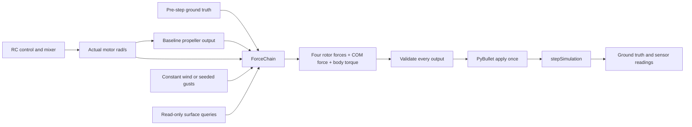

# Configurable aerodynamics

The default physics chain now includes body drag, rotor drag, angular damping,
rotor inflow, blade flapping, gyroscopic torque, ground effect and local propwash.
Each has its own calculation module under `bullet_drone.forces`, its own YAML
`enabled` flag, and independent tests. All new effects default to enabled.
Gravity/contact remain solver-owned; motor response is still ideal, with no
battery model. Coefficients are teaching approximations, not calibrated data.

## Ownership and data flow



`PropellerModel.calculate(speeds_rad_s)` remains the baseline interface, including
custom injected propeller models. `ForceChain.calculate(state, speeds, baseline,
surfaces)` consumes project-owned data and a `SurfaceQueries` contract and returns
an immutable `ForceOutput`. It never calls PyBullet. `SurfaceHit` records a finite
nonnegative distance and a finite unit outward world normal. `ForceOutput`
contains body-frame `rotor_forces_n`, `body_force_n` and `body_torque_nm`.

The physics adapter validates baseline and complete final output before applying
anything. It applies four rotor forces at their declared offsets, one COM force,
and one aggregate body torque. PyBullet supplies rotor lever-arm torque and
rigid-body inertia coupling. Reaction yaw torque is included once in the aggregate;
no mixer-predicted wrench is applied. Default PyBullet damping stays zero.

Mixer `achieved` output remains an ideal allocation estimate. Ground effect,
inflow, drag and gyroscopic coupling can change actual delivered forces. These
models do not feed mixer allocation or controller compensation directly.

## Frames and equations

World Z is up; body X is forward, Y left, Z up. All rotor speeds are **rad/s**.
Let `R` map body vectors to world, `Omega` be body angular velocity, and `r_i`
a body rotor offset. Ambient and wake velocities are world-frame air velocities:

```text
v_air_body = transpose(R) * (v_world - ambient_wind - local_wake)
v_air_rotor_i = v_air_body_at_rotor_i + Omega cross r_i
```

Body airflow samples wake at a configurable body offset `[0,0,-0.03] m`; body
velocity is still COM velocity and body forces are applied at the COM. This
explicit teaching approximation gives the coplanar asset exposure to downwash;
it does not move mass, collision geometry or rotor locations.

| Effect | Teaching calculation | Defaults |
| --- | --- | --- |
| Body drag | `-0.5*rho*CdA_axis*norm(v_air)*v_air_axis` | CdA `[.02,.02,.03] m²` |
| Rotor drag | `-k_axis*sum(actual_rad_s)*v_air_axis` | k `[1e-5,1e-5,1.1e-5] N/((rad/s)*(m/s))` |
| Angular damping | `-k_axis*Omega_axis` | k `[.002,.002,.001] N*m/(rad/s)` |
| Inflow | `clamp(1-k*horizontal_air_speed/(radius*speed), minimum, 1)` | k 1, minimum .5 |
| Flapping | Horizontal force `-k*modified_thrust/(radius*speed)*horizontal_air` | k .1 |
| Gyroscopic torque | Body reaction `-Omega cross H`; `H_z=sum(physical_spin*J*speed)` | J `1e-5 kg*m²` per rotor |
| Ground effect | `min(maximum, 1+k*(radius/(2*max(distance,floor)))²*alignment²)` | k .1, maximum 1.2, range 1 m, floor .01 m |

Shared density is `1.225 kg/m³`; rotor radius is `0.0635 m`. These explicit
settings do not silently reuse unused URDF aerodynamic properties whose intended
units/calibration are not established. Physical spin signs are the negatives of
body reaction-torque signs. Gyroscopic transport is modeled; motor-acceleration
reaction and motor lag are outside this milestone. Raw baseline in-plane custom
propeller forces are preserved; inflow/ground gain modify axial thrust only.
Stopped rotors have no inflow reduction or flapping contribution.

Surface queries cast in world -Z from each rotor, up to `query_range_m`, without
changing the scene. The adapter reserves collision-group bit 14 for the owning
drone and all its links; query masks exclude that group, while physical contact
masks still allow all groups. Missing hits give multiplier one. Positive
rotor-axis/surface-normal alignment is squared; inverted/unsupported alignment
gives no gain. The finite query range defines a teaching-model cutoff.

## Propwash and ambient wind

Propwash computes a quasi-steady expanding downstream wake for each rotor:

```text
induced = sqrt(baseline_thrust / (2*rho*pi*radius²))
width = radius + spread*downstream_distance
wake_speed = 2*induced*(radius/width)²*exp(-2*radial_distance²/width²)
```

Wake vectors follow rotor negative Z, rotate with the vehicle, add across source
rotors and are capped at combined speed `20 m/s`. Default spread is `.1`.
No wake is produced upstream, at the disk plane (within numerical tolerance),
or by stopped/zero-thrust sources. Each rotor excludes its own wake from local
inflow because static rotor thrust already includes self-induced flow. Baseline
thrust drives wakes, avoiding a circular dependency on modified thrust.

This is single-drone local airflow, not a separate propwash force. It affects
body/rotor drag and local rotor aerodynamics. Wake advection history, ground
recirculation and inter-drone coupling are not modeled. Empirical drag and
flapping coefficients are independently configurable; overlapping resistance
terms must be calibrated together for a physical vehicle.

`WindModel.velocity(simulation_time_s)` supplies constant world air velocity or
mean velocity plus correlated Gaussian gusts. The gust update is exact for the
configured interval: `a=exp(-dt/tau)`,
`gust_next=a*gust+sigma*sqrt(1-a²)*N(0,1)` per axis. The implementation uses
`expm1` for small intervals. Repeated reads at the same time do not advance the
random stream; backwards/nonfinite time is rejected. The stationary standard
deviation is sigma; reset starts from zero, so initial variance ramps up.

Wind defaults to enabled, constant `[0,0,0] m/s`, zero gust standard deviation,
correlation time 1 s and seed 2. Disabled wind removes ambient airflow only;
propwash has an independent switch. Reset restarts wind time, gust state and
seeded sequence. Identical timestep/sampling sequences reproduce the same gusts;
different timesteps preserve the OU statistics, not identical sample paths.

## Configuration and compatibility

See the fully commented `configs/basic.yaml`. Optional `forces` and `wind`
sections are loaded by `YamlConfigLoader`; omitted sections use enabled-effect,
calm-wind defaults. Python settings are `ForcesSettings`, individual effect
settings and `WindSettings` in `bullet_drone.config`. Reject unknown keys,
nonboolean switches, nonfinite/negative coefficients, nonpositive scales and
inconsistent bounds before opening physics resources.

```python
from dataclasses import replace
from bullet_drone.config import ForcesSettings, WindSettings, YamlConfigLoader

config = YamlConfigLoader().load('configs/basic.yaml')
# Disable one effect without changing the others.
config = replace(config, forces=replace(config.forces,
                 ground_effect=replace(config.forces.ground_effect, enabled=False)))
# Or select the old ideal force baseline explicitly.
ideal = replace(config, forces=ForcesSettings.ideal(), wind=WindSettings(enabled=False))
```

All three examples use new defaults but still own their loops and build Python
configuration; they do not load YAML or add CLI options. Altitude velocity PID
integral authority and response are tuned for touchdown through ground effect;
mission routes, settling criteria, altitude accuracy and duration limits remain
unchanged. Analytical ideal tests use the explicit ideal settings fixture.
New aerodynamic calculations can change trajectories of callers using defaults.

Sensor observations and motor/propeller injections remain intact;
[telemetry schemas](telemetry.md) describe future force/airflow capture. Physics
sampling, calculation, surface-query or output failures invalidate the episode;
reset is required and cleanup remains caller-owned. Seeded wind is reset with
physics. `tests/test_aerodynamics.py` covers independent effects, switches,
frames, wind statistics/reset, surface exclusion, physics torque/force application,
configuration and failure handling; full mission tests cover enabled defaults.
