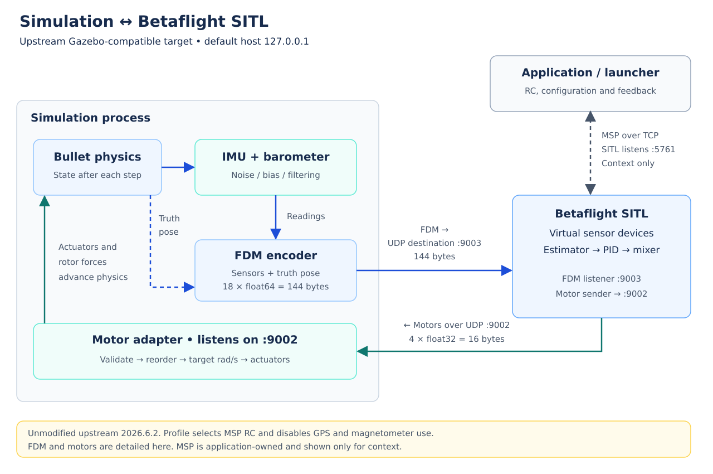
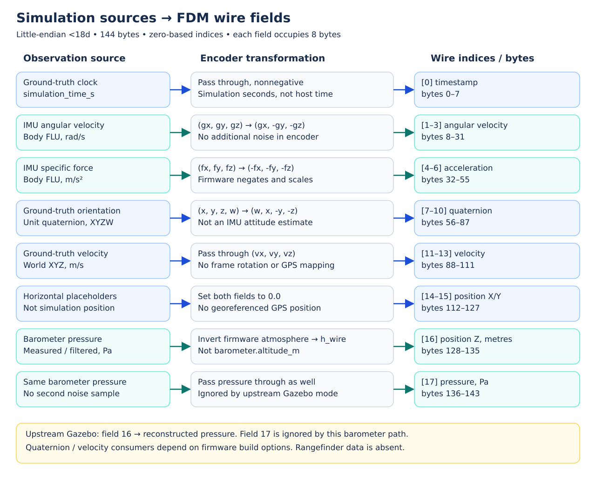
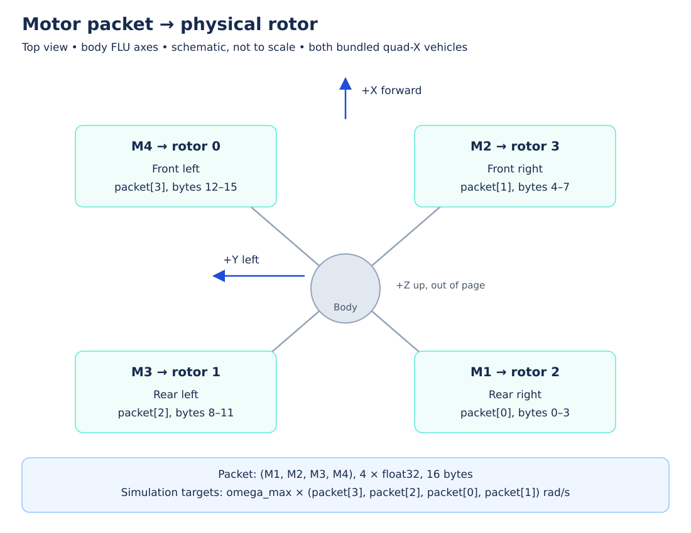
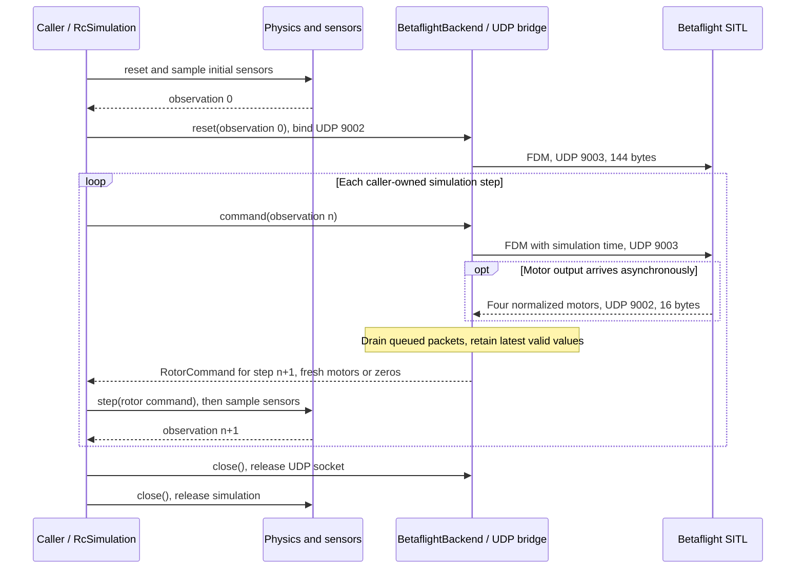

# Simulation ↔ Betaflight SITL bridge



The simulation owns rigid-body physics, actuators and simulated sensors.
Betaflight SITL (software in the loop) runs the flight controller against those
measurements and returns four motor outputs. FDM means *flight dynamics model*;
here it names the binary state/sensor packet, not a second physics engine.

This reference describes the **upstream Gazebo-compatible target** at Betaflight
2026.6.2, commit `e0b7bb01b17b21351057e9ead2d1ab39dd44fa16`, and the current
Python encoder. It does not require Gazebo: Bullet supplies the same wire layout.
By default the setup script builds **unmodified upstream firmware**, as recorded in
[plan 0054](../../plan/0054-remove-sitl-patch.md). The former sensor-only patch and
its build flag have been removed. Packet compatibility alone does not establish
that flight works end to end; verification results are recorded below.

## Connections and ownership

The default deployment uses loopback `127.0.0.1`. Port numbers below are
**destination/listening ports**, not a claim that replies use the same source
port. Upstream SITL binds its FDM listener to `0.0.0.0:9003` (all IPv4 interfaces);
Python binds its motor receiver specifically to loopback. These packets have no application
header, message ID or checksum beyond the UDP transport.

| Direction | Protocol / destination | Message and size | Ownership |
| --- | --- | --- | --- |
| Simulation → SITL | UDP `127.0.0.1:9003` | `fdm_packet`, 144 bytes | SITL listens; `UdpSitlBridge` sends from its socket bound to `127.0.0.1:9002`. |
| SITL → simulation | UDP `127.0.0.1:9002` | `servo_packet`, 16 bytes | Python listens; SITL sends four normalized motor values. |
| Application ↔ SITL, context only | TCP `127.0.0.1:5761` | MSP RC, configuration and estimator feedback | Application/launcher owned; outside the Python FDM/motor adapter. |
| SITL → legacy consumer, unused here | UDP `127.0.0.1:9001` | Raw PWM packet | Not read by this bridge. |
| Legacy RC sender → SITL, unused here | UDP `127.0.0.1:9004` | Legacy RC packet | Upstream opens this listener, but the profile disables `RX_UDP` and selects `RX_MSP`. |

`UdpSitlBridge` handles only datagrams. `pack_fdm()` translates observations into
bytes, and `BetaflightBackend` validates returned motors and constructs a
`RotorCommand`. `RcSimulation` and its caller own stepping and cleanup. MSP
commands do not travel inside FDM, and FDM contains no arming or flight-mode flag.

## Simulation sensors → FDM fields

`pack_fdm(observation, gps_enabled=False)` takes a `DroneObservation`: immutable ground truth plus
sensor readings. IMU and barometer must both be present, with episode, step and
simulation time matching ground truth. Noise, bias and configured filtering are
already applied by the sensor classes; encoding does not add them again.



The Python format is **`<18d`**: little-endian IEEE-754 float64 values, eight
bytes each, no padding, exactly **144 bytes per datagram**. Indices and byte
offsets are zero-based. Each offset below is the first byte of an eight-byte
field. Firmware's native C struct must have the matching layout and endianness
(the intended local Linux SITL build); this is not a portable negotiated format.

In the table, `state = observation.ground_truth`,
`imu = observation.sensors.imu`, and `barometer = observation.sensors.barometer`.
`g` denotes measured angular rate here, not gravitational acceleration.

| Index | Byte offset | Firmware field | Python source / transmitted value | Unit |
| --- | --- | --- | --- | --- |
| 0 | 0 | `timestamp` | `state.simulation_time_s` | s |
| 1 | 8 | `imu_angular_velocity_rpy[0]` | `+imu.angular_velocity_rad_s[0]` | rad/s |
| 2 | 16 | `imu_angular_velocity_rpy[1]` | `-imu.angular_velocity_rad_s[1]` | rad/s |
| 3 | 24 | `imu_angular_velocity_rpy[2]` | `-imu.angular_velocity_rad_s[2]` | rad/s |
| 4 | 32 | `imu_linear_acceleration_xyz[0]` | `-imu.specific_force_m_s2[0]` | m/s² |
| 5 | 40 | `imu_linear_acceleration_xyz[1]` | `-imu.specific_force_m_s2[1]` | m/s² |
| 6 | 48 | `imu_linear_acceleration_xyz[2]` | `-imu.specific_force_m_s2[2]` | m/s² |
| 7 | 56 | `imu_orientation_quat[0]` | `state.orientation_xyzw[3]` → `w` | dimensionless |
| 8 | 64 | `imu_orientation_quat[1]` | `state.orientation_xyzw[0]` → `x` | dimensionless |
| 9 | 72 | `imu_orientation_quat[2]` | `-state.orientation_xyzw[1]` → `-y` | dimensionless |
| 10 | 80 | `imu_orientation_quat[3]` | `-state.orientation_xyzw[2]` → `-z` | dimensionless |
| 11 | 88 | `velocity_xyz[0]` | Truth X, or GPS east velocity when enabled | m/s |
| 12 | 96 | `velocity_xyz[1]` | Truth Y, or GPS north velocity when enabled | m/s |
| 13 | 104 | `velocity_xyz[2]` | Truth Z, or GPS up velocity when enabled | m/s |
| 14 | 112 | `position_xyz[0]` | `0.0`, or GPS longitude when enabled | degrees |
| 15 | 120 | `position_xyz[1]` | `0.0`, or GPS latitude when enabled | degrees |
| 16 | 128 | `position_xyz[2]` | `h_wire` from pressure, or GPS MSL altitude when enabled | m |
| 17 | 136 | `pressure` | `barometer.pressure_pa` | Pa |

### IMU axes and firmware conversion

Simulation body axes are **FLU: X forward, Y left, Z up**. The world is Z-up;
vectors in `state.linear_velocity_m_s` stay in the simulation world frame.
The Gazebo protocol interprets velocity as ENU when virtual GPS is enabled, but
the default GPS-disabled bridge supplies zero longitude/latitude placeholders.
The opt-in GPS path defines X east, Y north and transmits geographic coordinates.

The accelerometer measures specific force `Rᵀ(a_world − gravity_world)`, not
world acceleration. The gyro measures body angular rate. The wire sign changes
are field-specific: negating every accelerometer component is the protocol's
accelerometer convention, not a generic FLU-to-FRD vector rotation.

| Quantity | Simulation → wire | Upstream Gazebo wire → virtual device |
| --- | --- | --- |
| Gyro | `(gx, -gy, -gz)` | Helper maps `(rx, ry, rz)` to `(rx, -ry, rz)`, then multiplies by `16.4 × 180/π` and clips to signed counts `[-32767, 32767]`. Combined signs are `(gx, gy, -gz)` before scaling. |
| Specific force | `(-fx, -fy, -fz)` | Negates again, multiplies by `256 / 9.80665`, clips to `[-32767, 32767]` and converts to integer device counts. |
| Orientation | Input XYZW → wire `(w, x, -y, -z)` | Gazebo branch undoes the Y/Z signs and rotates the world ENU → NWU by +90° about Z for the quaternion consumers. |

A level supported/hovering vehicle with zero noise reports approximately
`f_body = (0, 0, +9.81)` m/s². Its FDM acceleration is `(0, 0, -9.81)`, and the
virtual accelerometer receives approximately `(0, 0, +256)` counts. Free fall
reports approximately zero specific force. Reset assumes zero world acceleration
because there is no preceding velocity interval.

The packet quaternion and default velocity are **ground truth**, not noisy IMU estimates.
With GPS enabled, velocity comes from the ideal GPS reading.
Their presence does not mean the firmware always uses them. The default upstream target
is intended to keep the real IMU estimator, disable GPS/magnetometer feedback,
and avoid direct-attitude injection. Build options still matter:

| Consumer / firmware mode | Fields used | Consequence |
| --- | --- | --- |
| Virtual gyro and accelerometer | 1–6 | Supply measured rates and specific force to the flight controller. |
| Gazebo virtual barometer | 16 | Reconstructs pressure from `h_wire`; field 17 is ignored on this path. |
| Legacy bridge mode, historical context | 17 | Uses the supplied pressure directly; not the configured Gazebo path. |
| Real attitude estimator, no virtual mag | IMU feeds | Packet quaternion does not directly set attitude. |
| `SITL_ATTITUDE_DIRECT` / no `USE_IMU_CALC` | 7–10 | Quaternion can set attitude directly; outside the intended sensor-driven target. |
| `USE_VIRTUAL_MAG` | 7–10 | Synthesizes magnetic readings from truth orientation; disabling runtime fusion alone must not be confused with removing the feed. |
| `USE_VIRTUAL_GPS` | 11–16 | Interprets velocity as ENU and position as longitude/latitude/altitude. Zero horizontal placeholders are not a valid georeferenced simulation position. |

### Barometer pressure round trip

Upstream Gazebo mode ignores the pressure slot and reconstructs pressure from
`position_xyz[2]`. The encoder therefore inverts that exact atmosphere formula:

```text
p_sensor = barometer.pressure_pa
h_wire = (1 − (p_sensor / 101325.0)^(1 / 5.25588)) / 2.25577e-5
p_firmware = int32(101325.0 × (1 − 2.25577e-5 × h_wire)^5.25588)
```

`h_wire` is an encoding of measured pressure. It is neither ground-truth world Z
nor necessarily `barometer.altitude_m`: the simulation sensor uses a configurable
isothermal atmosphere, whereas this inverse matches the firmware's fixed
standard-atmosphere formula. Using the sensor's own altitude would generally
change the pressure seen by SITL. Bias, noise and filtering in the measured
pressure survive this round trip, subject to floating-point error and the
firmware's integer-Pa conversion. Firmware supplies a fixed temperature value
`2500` (25°C in its virtual barometer convention); no temperature sensor crosses
this bridge.

For example, `p_sensor = 100000 Pa` encodes approximately `h_wire = 110.9 m` and
reconstructs approximately the original pressure. Betaflight's estimated or
relative altitude can differ because it has its own filtering and reference.

Rangefinder readings, sensor configuration, sensor identity, episode IDs and
step indices are not transmitted. Episode/step identity is checked locally
before packing. Only simulation time crosses the wire as an identity/timing cue.

## Motor message → simulation actuators

The return packet is firmware `servo_packet`, Python **`<4f`**: four little-endian
IEEE-754 float32 values, **16 bytes**, no timestamp or sequence number. In normal
motor mode each value is finite and in `[0, 1]`. Negative 3D-mode outputs are
rejected by this adapter; this reference covers ordinary quad-X motor operation.



The order below is fixed by `RACER_TO_BETAFLIGHT = (3, 2, 0, 1)` and matches the
bundled racer and heavy-quad rotor geometry. M1–M4 are human-facing motor names;
the packet and simulation indices are zero-based. Positions are body-frame
coordinates in metres; the drawing is schematic.

| Packet index | Byte offset | Betaflight name | Physical location | Simulation index | Racer `(x, y, z)` m | Heavy quad `(x, y, z)` m |
| --- | --- | --- | --- | --- | --- | --- |
| 0 | 0 | M1 | Rear right | 2 | `(-0.085, -0.0675, 0)` | `(-0.240416, -0.240416, 0)` |
| 1 | 4 | M2 | Front right | 3 | `(+0.085, -0.0675, 0)` | `(+0.240416, -0.240416, 0)` |
| 2 | 8 | M3 | Rear left | 1 | `(-0.085, +0.0675, 0)` | `(-0.240416, +0.240416, 0)` |
| 3 | 12 | M4 | Front left | 0 | `(+0.085, +0.0675, 0)` | `(+0.240416, +0.240416, 0)` |

For packet values `u = (M1, M2, M3, M4)`:

```text
omega_max = sqrt(vehicle.max_thrust_per_rotor_n / vehicle.thrust_coefficient)
rotor_target_rad_s = omega_max × (u[3], u[2], u[0], u[1])
```

These are angular-speed targets, not newtons, RPM or a squared-thrust command.
For example, `u = (0.1, 0.2, 0.3, 0.4)` and `omega_max = 2000 rad/s` produce
`(800, 600, 200, 400) rad/s` in simulation rotor order. The simulation's actuator
and force components then turn these targets into rotor thrust and reaction
torque. PyBullet owns gravity and contacts; the bridge applies neither.

## Timing, validation and lifecycle



Sending FDM does not block waiting for its matching motor reply. The adapter
sends, drains currently queued packets and uses the most recently received valid
output. A later reply can be used on a later step. The first command can resend
the reset observation. There is no Python request/response correlation, and the
motor packet has no timestamp with which to establish sensor-to-motor latency.

| Check or lifecycle event | Current behavior |
| --- | --- |
| Missing IMU/barometer or mismatched local stamps | Encoder raises `ValueError`. |
| Pressure not positive/finite, nonfinite packed values or negative simulation time | Encoder raises `ValueError`; it does not normalize the truth quaternion. |
| Invalid motor length or value | Packet is discarded; a previous valid packet remains eligible until stale. Values are rejected, not clamped. |
| No valid packet, or local age outside `0 ≤ age ≤ 0.1 s` | All four speed targets are zero. This is an adapter timeout, separate from firmware RC failsafe. |
| Packet drain | Nonblocking, at most 256 datagrams per call, at most 256 bytes read per datagram; only the configured source IP is accepted. Source port is not checked. |
| Motor freshness timestamp | Host monotonic time when Python reads the datagram, not firmware production time or simulation time. A queued old packet can appear fresh when drained. |
| Reset | Closes/reopens the UDP socket, clears cached outputs, records local episode/step identity and sends initial FDM. It does not restart firmware itself. |
| Out-of-order observation, different episode or closed backend | Backend raises `LifecycleError`. |
| Managed episode preparation | Application/launcher restarts SITL separately so its internal timestamp/estimator state does not carry across episodes. |
| Pre-arm hold | `RcSimulation.hold()` continues feeding FDM and sampling stationary observations while discarding returned motor commands for physics motion. |
| Close | Caller closes the backend/transport and environment; launcher separately owns firmware termination. |

FDM is sent once per backend command plus reset. The external-RC default loop is
240 Hz, but YAML timestep and caller pacing determine the actual rate. This is
not a separate fixed-rate sensor network. Upstream uses FDM timestamps in its
scheduling, drops packets with decreasing simulation time, and has a 500 ms
host-time resynchronization branch that can return a cached motor update without
processing sensors. None of these mechanisms is an acknowledgement/retry layer.

## Firmware setup and configuration

Run `tools/setup_betaflight_sitl.sh` to fetch the pinned upstream release, verify
its commit, clean old SITL build artifacts and compile without project patches or
`SITL_SENSOR_ONLY`. Successful builds install an executable copy at
`bin/betaflight_SITL.elf`; source and compiler outputs remain under `.sitl/`.
The MAVLink setup script installs its distinct build at
`bin/betaflight_mavlink_SITL.elf`. Failed builds retain the previous installed copy. Do not rebuild while a
managed SITL session is running; start a new session afterward to import the
updated profile.

Setup refuses a dirty source checkout rather than discarding edits. For a former
patched checkout, preserve or move `.sitl/betaflight-source` outside that path and
rerun setup to clone clean upstream sources. The local migration in plan 0054
reversed only the known former patch before rebuilding.

| Setting | Value | Purpose |
| --- | --- | --- |
| Release / bridge | 2026.6.2, upstream default `ENABLE_GAZEBO_BRIDGE=1` | Consume barometer data through position Z. |
| Receiver | `feature -RX_UDP`, `feature RX_MSP` | Keep the application-owned MSP RC path. The unused UDP 9004 listener still exists. |
| GPS | `feature -GPS` | Prevent ground-truth packet position/velocity from entering GPS fusion. |
| Magnetometer | `set mag_hardware = NONE` | Disable magnetometer detection/fusion. Upstream virtual-feed code remains compiled. |
| Attitude | Default real IMU estimator, no `SITL_ATTITUDE_DIRECT` | Estimate attitude from virtual gyro/accelerometer readings. |
| Mixer / tuning | Existing quad-X profile and gains | Preserve motor order and controller settings. |

Field 17 remains populated for wire-layout compatibility; Gazebo mode ignores it.
There is no patched fallback or direct sensor-altitude option. MAVLink changes
are deferred; this bridge continues to use the existing MSP application path.

Verification results are recorded in [plan 0054](../../plan/0054-remove-sitl-patch.md).
Live upstream checks confirmed that a 100 Pa measured-pressure drop changed MSP
altitude by 8.34 m even with an intentionally conflicting field-17 value. Arming,
RC-loss disarming and the motor timeout passed. The managed hover check with
`configs/basic.yaml` completed a 20-second hold at a 20 m relative target with
0.28 m peak error. These are simulation checks, not hardware flight validation.

The independent [Betaflight Acro square](../../examples/position_square_acro/README.md)
uses the same unmodified firmware and FDM/motor adapter. Its application-owned
navigation converts XYZ targets to Acro body-rate/throttle MSP channels while
Betaflight closes the rate and motor loops. It owns the packaged viewer and SITL
process, waits for the first matching image, and then starts one automatic mission.

## Source map

| Subject | Source |
| --- | --- |
| Python packet layout and pressure inverse | [FDM encoder](../../src/bullet_drone/betaflight/fdm.py) |
| Sockets, ports and drain limits | [UDP bridge](../../src/bullet_drone/betaflight/bridge.py) |
| Motor validation, order and timeout | [Backend](../../src/bullet_drone/betaflight/backend.py), [focused tests](../../tests/test_betaflight_backend.py) |
| Sensor frames, noise and atmosphere | [Sensor design](sensors.md), [IMU](../../src/bullet_drone/sensors/imu.py), [barometer](../../src/bullet_drone/sensors/barometer.py) |
| Geometry and speed limits | [Vehicle loader](../../src/bullet_drone/vehicle.py), [racer URDF](../../src/bullet_drone/assets/racer/racer.urdf), [heavy-quad URDF](../../src/bullet_drone/assets/heavy_quad/heavy_quad.urdf) |
| Caller-owned stepping and observations | [Simulation](../../src/bullet_drone/simulation.py), [environment](../../src/bullet_drone/environment.py) |
| Clean upstream build and sensor configuration | [Setup script](../../tools/setup_betaflight_sitl.sh), [firmware profile](../../configs/betaflight.config) |
| Managed firmware lifecycle, context only | [Sibling SITL supervisor](../../../bullet_render/tools/sitl_supervisor.py), [external-RC example](../../examples/external_rc/main.py) |
| Pinned upstream structs and build options | [Betaflight target.h at e0b7bb0](https://github.com/betaflight/betaflight/blob/e0b7bb01b17b21351057e9ead2d1ab39dd44fa16/src/platform/SIMULATOR/target/SITL/target.h) |
| Pinned upstream field consumers, ports and motor output | [Betaflight sitl.c at e0b7bb0](https://github.com/betaflight/betaflight/blob/e0b7bb01b17b21351057e9ead2d1ab39dd44fa16/src/platform/SIMULATOR/sitl.c) |
| Pinned upstream UDP bind/send behavior | [Betaflight udplink.c at e0b7bb0](https://github.com/betaflight/betaflight/blob/e0b7bb01b17b21351057e9ead2d1ab39dd44fa16/src/platform/SIMULATOR/udplink.c) |
| Pinned upstream gyro signs | [Betaflight sitl_gyro.h at e0b7bb0](https://github.com/betaflight/betaflight/blob/e0b7bb01b17b21351057e9ead2d1ab39dd44fa16/src/platform/SIMULATOR/sitl_gyro.h) |

Upstream facts were checked against the local firmware checkout's **Git HEAD**.
The rebuilt checkout has no tracked source changes. Sibling links require the shared
workspace; the packet/adapter reference is contained in this repository.

## Example-owned MSP client

SITL examples use `examples.common.msp` for TCP MSP requests, RC streaming,
firmware identification and feedback. This standard-library-only helper preserves
MSP framing, deadlines, reconnect and cleanup behavior. Serial transport is excluded.
The core physics bridge remains independent of MSP. The `sitl` extra is retained
as an empty compatibility extra; examples do not require the sibling msp-link package.

## Opt-in GPS FDM

Build the compatible variants explicitly:

```bash
tools/setup_betaflight_sitl.sh --gps
tools/setup_betaflight_mavlink_sitl.sh --gps
```

The optional second argument selects an existing clean source checkout. Defaults
use separate `.sitl/betaflight-gps-source` and `.sitl/betaflight-mavlink-gps-source`
directories. Installed binaries are `bin/betaflight_gps_SITL.elf` and
`bin/betaflight_mavlink_gps_SITL.elf`. The scripts temporarily apply
`tools/patches/bullet-gps-fdm.patch`, build with `BULLET_GPS_FDM`, and reverse the
patch on success or failure. Dirty sources are refused; installation is atomic
and failed builds preserve the previously installed executable. The patch is
pinned to the same upstream commit as the default build.

The change keeps Gazebo IMU/attitude conventions, accepts GPS coordinates without
horizontal mirroring, and takes barometer pressure from field 17 independently
of GPS altitude. It does not change the 144-byte packet layout. The binary emits
and contains `BULLET_GPS_FDM_V1` as its compatibility marker.

Pair enabled GPS with `configs/betaflight-gps.config` or
`configs/betaflight-mavlink-gps.config` (virtual receiver), the corresponding GPS
binary, and `pack_fdm(observation, gps_enabled=True)`. `RcSimulation` selects the
encoder flag from sensor configuration. Missing/stale GPS readings are rejected,
as are accidental GPS readings passed to the default encoder. Managed example
sessions check binary/profile/settings pairing before starting. Direct library
users who own an external firmware process must call `validate_gps_firmware`
from `bullet_drone.betaflight.firmware` before launching it; UDP FDM has no
capability negotiation and cannot identify a separately launched binary.

With GPS disabled, retain the default upstream binary and GPS-disabled profile:
position X/Y are zero and Z encodes measured barometer pressure exactly as before.
With GPS enabled, position is `[longitude_deg, latitude_deg, altitude_MSL_m]`,
velocity is measured `[east, north, up]` m/s, and pressure remains independent.
Physics and renderer positions remain local metres.

In this pinned firmware, `VFR_HUD.alt` comes from the relative altitude estimator,
whose GPS/barometer offsets reset on arming transitions. It therefore represents
estimated height relative to the arming baseline, despite the MAVLink field's
standard MSL description. Raw GPS altitude remains MSL. This example's outer
altitude mission still uses ground-truth world Z, not VFR_HUD feedback.

Run repeatable live coordinate, course, pressure independence and restart checks
with `BULLET_TEST_GPS_SITL=1 uv run pytest tests/test_gps_sitl.py`. These checks
require both GPS binaries built and the simulation ports free.
