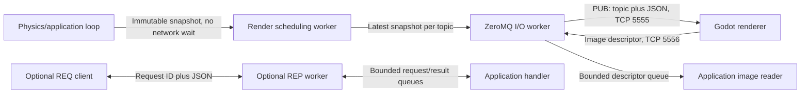

# Camera information and threaded ZeroMQ

`camera/front/camera_info` replaces `render/drone_1/config`. There is no legacy
publication or camera query. Betaflight transport and other message schemas are
unchanged. Rebuild the renderer and restart publisher/viewer together.

## Dataclass contract

The protocol package's `camera_info.py` owns frozen CameraInfoMessage, CameraInfo,
Header, Stamp and RegionOfInterest dataclasses. `from_config()` derives ideal
pinhole calibration from width_px, height_px and horizontal fov_x_deg.
`to_dict()` exports plain dictionaries and JSON arrays; `from_dict()` validates
incoming fields. This message no longer uses a JSON Schema file.

The JSON object is an envelope with `schema_version: 1`, `stream_id`,
`capture_fps_hz` and nested `camera_info`. The latter follows ROS CameraInfo field
names: header, width, height, distortion_model, d, k, r, p, binning_x, binning_y,
roi. It is ROS-shaped JSON, not ROS serialization, and requires no ROS installation.

For width W, height H and horizontal field of view theta:

```text
fx = fy = W / (2 * tan(theta/2))
cx = W/2, cy = H/2
K = [fx,0,cx, 0,fy,cy, 0,0,1]
P = [fx,0,cx,0, 0,fy,cy,0, 0,0,1,0]
```

Matrices are row-major; focal lengths/principal point are pixels. Distortion is
plumb_bob with five zeros; R is identity. Zero binning and ROI mean full image.
Only the ideal pinhole model is supported. Godot derives horizontal FOV from fx
and uses KEEP_WIDTH. The optical frame is camera_front_optical: X right, Y down,
Z forward. Static header stamp is zero, not an image acquisition timestamp.

## Configuration and scheduling

The render profile retains camera and fps settings and accepts an optional
`publish_rates_hz` object. Each supplied rate must be positive and finite; unknown
rate keys are rejected. Omitting keys uses these defaults:

| Field | Default | Behavior |
| --- | ---: | --- |
| `publish_rates_hz.camera_info` | 1 Hz | Immediate startup and periodic calibration |
| `publish_rates_hz.profile` | 1 Hz | Render profile metadata |
| `fps` | 30 in bundled profile | Pose/image capture scheduling in simulation time, existing maximum 240 Hz |

Periodic metadata uses monotonic wall time and continues while physics is paused.
CameraInfo does not change capture cadence. Its stream identity preserves readiness
and source association; image descriptor and SHM formats remain unchanged.

## I/O module

`bullet_simulation_protocol.transport` owns Python ZeroMQ sockets and serialization.
ZmqIo provides publish, receive, request, poll_request, reply, start and close. The wind example
now enables this request/reply transport as described in [wind protocol](wind-request-reply.md).
A dedicated worker owns context, sockets and poller; no handler runs in the worker.
The existing RenderPublisher remains responsible for observation selection and
publication cadence. Renderer adapters delegate image subscriptions to
ImageSubscription while retaining SHM reading and child-process ownership.



Publication caches one replaceable snapshot per topic, bounded to 16 topics.
Each subscription queue is bounded to 16 messages and drops the oldest on overflow.
Socket high-water marks bound internal queues. Exact multipart topics are checked
after ZeroMQ's prefix filtering. Images retain their existing single-frame prefix.
A slow subscriber never requires a physics step to wait for network delivery.
Threading avoids socket waits in physics but does not promise hard real-time
isolation from Python CPU/GIL contention.

Optional REQ/REP endpoints are disabled by default. Requests carry request_id and
payload, replies carry request_id, status and payload/error. The application drains
requests and supplies replies; a slow handler must not be run inside stepping.
Invalid requests receive errors; bounded queues report busy. Client timeouts
complete the future with outcome unknown and reset the REQ socket before the next
request. No automatic command retries occur. No lifecycle server or camera-info
query is enabled by the simulation examples.

## Sources

- [Camera dataclasses](../../libs/bullet_simulation_protocol/src/bullet_simulation_protocol/camera_info.py)
- [I/O worker](../../libs/bullet_simulation_protocol/src/bullet_simulation_protocol/transport.py)
- [Render scheduling](../../tools/zmq_render/publisher.py)
- [Bundled configuration](../../external_render/configs/physics.json)
- [ROS CameraInfo definition](https://github.com/ros2/common_interfaces/blob/rolling/sensor_msgs/msg/CameraInfo.msg)

Stopped pose refresh is local-only at 1 Hz via set_running(bool). No lifecycle state topic is published.

Publisher-only workers and idle request clients have no input sockets registered
with the poller. An empty ZeroMQ poll returns immediately, regardless of its
requested timeout. These workers wait on the stop event for `POLL_MS` instead,
so they do not busy-spin or contend with the physics/MSP threads. Workers with
SUB, REP, or an active REQ socket continue to use socket polling.
