# External renderer interface

Bullet Drone runs physics and owns the renderer process for examples that enable
external rendering. The renderer consumes published scene state and returns
camera images. It does not step physics or send flight commands through this
render interface.

## Components and message flow

```mermaid
flowchart LR
    App["Example loop<br/>observation + lifecycle"]
    Adapter["ExternalRenderer<br/>owns viewer and image reader"]
    Publisher["RenderPublisher<br/>pose scheduling + JSON"]
    ZMQ["ZeroMQ telemetry PUB<br/>default TCP 5555"]
    Godot["Godot renderer<br/>scene + camera"]
    ImagePUB["ZeroMQ image PUB<br/>default TCP 5556"]
    Reader["FrameReader<br/>shared memory slots"]

    App -->|DroneObservation| Adapter
    Adapter -->|consume / state| Publisher
    Publisher -->|config, profile, pose, state, feedback| ZMQ
    ZMQ -->|multipart topic + JSON| Godot
    Godot -->|image descriptor| ImagePUB
    ImagePUB -->|camera/front/image| Reader
    Reader -->|frame metadata + pixels| Adapter
    Adapter -->|matching stream and episode ready| App
```

The telemetry publisher binds the `telemetry_endpoint`. Godot subscribes to
that endpoint and binds `image_endpoint`; the Python adapter subscribes to the
image endpoint. The transport profile reserves control port 5557 for renderer
compatibility, but there is no local command receiver. The bundled profile uses
loopback TCP ports 5555, 5556, and 5557;
endpoints are configurable in `external_render/configs/transport.json`.

## Startup configuration

`external_render/configs/physics.json` selects a transport JSON file, camera
size and field of view, and pose capture rate. The transport JSON supplies the
ZeroMQ endpoints. The adapter validates local image and control ports, starts
its ZeroMQ image subscriber and render publisher, then launches Godot with the
transport file path. Startup readiness requires an image whose `stream_id` and
`episode_id` match the current publisher and observation.

| Setting | Type and units | Meaning |
| --- | --- | --- |
| `transport_config` | Relative path | Transport endpoint JSON, resolved against the physics profile. |
| `camera.width_px`, `camera.height_px` | Positive integers, pixels | Output image dimensions. |
| `camera.fov_x_deg` | Number, degrees | Horizontal camera field of view. |
| `fps` | Number, frames/s, at most 240 | Pose capture schedule in simulation time. |
| `telemetry_endpoint` | ZeroMQ endpoint | Publisher binds; Godot subscribes for scene/control state. |
| `image_endpoint` | ZeroMQ endpoint | Godot binds; Python subscribes for image descriptors. |

## Telemetry messages

Every ZeroMQ message is multipart: the first frame is a UTF-8 topic and the
second frame is a UTF-8 JSON object. The publisher emits the following topics
on the telemetry endpoint. Topic contracts shared with the renderer live in
`bullet_simulation_protocol`.

| Topic | Publisher cadence | Main fields and purpose |
| --- | --- | --- |
| `camera/front/camera_info` | Configured rate, default 1 Hz | `schema_version`, `stream_id`, `capture_fps_hz`, nested ROS-shaped `camera_info`. |
| `render/drone_1/profile` | Once per second | `schema_version`, `stream_id`, `profile_name`, `backend`, `drone_model`. |
| `render/drone_1/pose` | Camera schedule, default 30 Hz simulation time, stopped 1 Hz | `header` (fid and simulation sec/nanosec), configured `drone_id`, `position_m`, `orientation_xyzw` |

Pose position and velocity use world coordinates in metres and metres per
second. The orientation is body-to-world quaternion in XYZW order. World Z points
up. `step_index` and `simulation_time_s` identify the physics sample. Pose
capture is latest-only: a one-entry queue replaces stale poses rather than
blocking the simulation, and `publisher_drops` reports these replacements.

## Image delivery and readiness

Godot sends image descriptors on `camera/front/image`. The descriptor contains
frame metadata, including the publisher stream/episode source and a shared-memory
session/slot reference. Pixel bytes are stored in one of three POSIX shared
memory slots and read through `bullet_image_transport.shm.FrameReader`; the image bytes do
not travel in ZeroMQ. A frame is ready for the example only when its source
matches the active stream and episode. The adapter tracks slots created by its
owned Godot process and unlinks those slots during cleanup.

## Ownership and failure behavior

The example owns the `ExternalRenderer` context manager. It starts the publisher,
image subscriber, shared-memory reader, and Godot child, then closes them on
normal completion, interruption, or startup failure. Publisher worker failures
are logged and stop rendering updates without advancing or mutating physics;
Godot exit during an active rendered mission is an error. `--headless` skips the
renderer process and its transport resources.

See [Simulation I/O](../simulation/io.md) for the current direct interfaces.

See [CameraInfo and threaded I/O](camera-info-zmq.md) for the current dataclass
contract and configurable metadata publication rates. Socket ownership now lives
in the shared transport worker, while observation scheduling stays in RenderPublisher.

Wind now uses request/reply only in the wind example. See [wind protocol](wind-request-reply.md).

Legacy state.json and simulation/state publication are removed. The renderer sends no lifecycle state query. Command buttons use fresh wind/spawn identities, display correlated results, and let simulation reject invalid transitions. A timeout reports Outcome unknown without automatic retry or reconciliation queries.

Image descriptor version 3 copies the pose header and drone_id. See [minimal camera pose](minimal-camera-pose.md).
