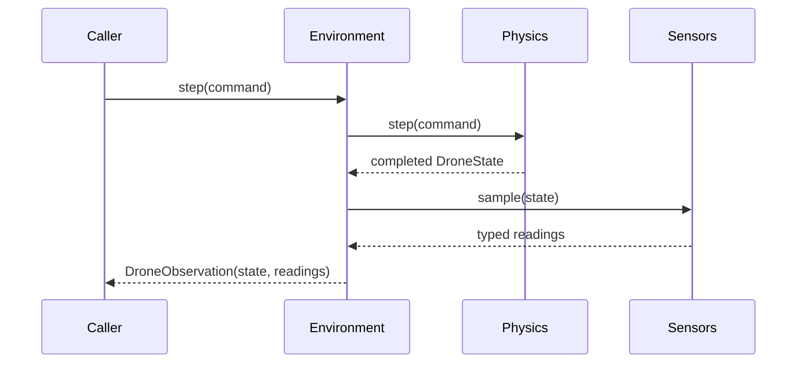

# IMU and barometer sensors

`RcSimulation.reset()` and `step()` return measurements in
`DroneObservation.sensors.imu` and `.barometer`. Both sensors are enabled with
zero noise by default. A disabled sensor returns `None`; rangefinder is not
implemented and remains `None`. Measurements are frozen dataclasses stamped with
`episode_id`, `step_index` and `simulation_time_s` matching their source state.
The containing observation supplies `ground_truth.drone_id`.

## Ownership and interfaces

`ImuSensor` and `BarometerSensor` live in `bullet_drone.sensors`. Their small
`Sensor[Reading]` contract provides `reset(state)` and `sample(state)`, each
returning a reading. They consume immutable project-owned `DroneState` values and
have no PyBullet or rendering dependency. They cannot apply forces or change
physics. No scene queries are needed for these two sensors.

`RcSimulation` builds sensors from `SimulationConfig.sensors` and passes them to
`DroneEnvironment`. Direct environment users explicitly inject sensor instances:

```python
from bullet_drone.environment import DroneEnvironment
from bullet_drone.sensors import BarometerSensor, ImuSensor

# physics is an existing PhysicsBackend; config is its SimulationConfig.
environment = DroneEnvironment(
    physics,
    imu=ImuSensor(config.simulation.gravity_m_s2, config.sensors.imu,
                  sample_period_s=config.simulation.timestep_s),
    barometer=BarometerSensor(config.sensors.barometer),
)
try:
    initial = environment.reset()
    observation = environment.step()
    imu = observation.sensors.imu
    barometer = observation.sensors.barometer
finally:
    environment.close()
```

Direct injection determines whether a sensor runs; the `enabled` configuration
flag controls assembly by `RcSimulation`. An environment without injected sensors
retains empty sensor slots. Internal flight controllers continue using ground truth. An IMU reading contains
no orientation; the optional complementary filter described below derives it. See
[VectorNav's IMU/INS/AHRS definitions](https://www.vectornav.com/resources/inertial-navigation-primer/theory-of-operation/theory-inertial).



## IMU measurement model

`ImuReading.specific_force_m_s2` and `.angular_velocity_rad_s` use body axes:
X forward, Y left, Z up. Mounting is aligned with the body at the center of mass.
Let `R` be the body-to-world orientation and `g_world` the configured physics
gravity vector:

```text
a_world = (velocity_current - velocity_previous) / (time_current - time_previous)
f_body = transpose(R_current) * (a_world - g_world)
gyro_body = transpose(R_current) * angular_velocity_world
```

At reset there is no velocity interval. The agreed initial assumption is zero
world acceleration, so a level drone in Earth gravity initially reports upward
specific force even if it starts airborne. Subsequent free-fall samples report
approximately zero specific force; stationary support/hover reports approximately
+9.81 m/s² on body Z. Gyro data comes from current world angular velocity rotated
to body axes. Noise and bias are applied in body axes after transformation.

The IMU uses [shared frame math](frame-math.md) from `bullet_drone.geometry`,
independently of controllers and command-private validation. Invalid source
vectors/quaternions raise `GeometryError` (a `ValueError`), rather than
`InvalidCommandError`; source-state geometry failures require environment reset.

Acceleration is an interval average expressed in the current frame. Contact
impulses can therefore produce large readings. Optional accel/gyro filtering is
described below. No clipping, lever-arm effects or magnetometer is modeled.
Attitude estimation is a separate optional component.

## Barometer measurement model

`BarometerReading.pressure_pa` is the sensor output pressure, optionally filtered;
`.altitude_m` is world Z inferred from that same output pressure. For reference
pressure `p_ref`, temperature `T_ref` and world height `z_ref`:

```text
H = R_air * T_ref / g_atmosphere
p_ideal = p_ref * exp(-(z_world - z_ref) / H)
p_measured = p_ideal + pressure_bias + Gaussian(0, pressure_stddev)
p_output = low_pass(p_measured) if filter_enabled else p_measured
z_measured = z_ref - H * (log(p_output) - log(p_ref))
```

Defaults are `p_ref = 101325 Pa`, `T_ref = 288.15 K`, `z_ref = 0 m`,
`R_air = 287.05 J/(kg K)` and `g_atmosphere = 9.80665 m/s²`. Atmospheric gravity
is fixed to Earth values independently of simulation gravity. This is a local
constant-temperature approximation for the low-altitude demos; it omits the
layers and temperature gradients in
[NASA's atmosphere model](https://www.grc.nasa.gov/WWW/K-12/airplane/atmosmet.html).
It does not feed density back into rotor physics. Weather, rotor wash and
thermal drift are outside this milestone.

Pressure noise is applied once; altitude has no independent noise. Nonpositive
or nonfinite measured/output pressure and unrepresentable model outputs raise errors;
they are not silently clipped or resampled.

### Optional pressure filter

`sensors.barometer.filter_enabled` is a strict boolean, default `false`.
`filter_time_constant_s` is positive finite seconds, default `0.1`, validated even
when filtering is disabled. The supplied `configs/basic.yaml` enables filtering.

The filter runs inside the sensor after noise and bias, before altitude inversion:

```text
dt = measurement_time - previous_measurement_time
alpha = 1 - exp(-dt / filter_time_constant_s)
p_output = (1 - alpha) * previous_output + alpha * p_measured
```

The first measurement seeds the filter directly. Reset clears its history and
restarts the seeded noise, including on spawn replacement. Invalid chronology is
rejected before updating the filter. There is no extra sample delay or altered
timestamp; a `0.1 s` time constant introduces roughly `0.1 s` response lag during
steady climb. Larger constants smooth more and respond more slowly. Disabling
the filter restores direct measured-pressure output.

`pressure_pa` and `altitude_m` stay consistent; no separate raw-pressure field is
added. Both rendering and app feedback receive the resulting altitude through
the existing path. The app's vertical estimator remains unchanged. This filter
reduces random noise, not fixed bias, drift or outliers.

## Configuration and noise

The supplied `configs/basic.yaml` profile uses 2.3 Pa pressure standard deviation,
the BMP388's typical high-resolution noise with IIR off ([Bosch datasheet, table 8](https://www.bosch-sensortec.com/media/boschsensortec/downloads/datasheets/bst-bmp388-ds001.pdf)).
In this atmosphere model that corresponds to approximately 0.19 m unfiltered
altitude standard deviation near sea level. With the enabled 0.1 s filter at
240 Hz, settled altitude noise is approximately 0.03 m. This matches a representative
noise amplitude with a generic first-order filter; it does not emulate the
device's sampling schedule, complete internal processing or drift.
Omitting the YAML noise setting still gives zero noise in the library.

All fields are optional. Python settings are `SensorsSettings`, `ImuSettings`
and `BarometerSettings` from `bullet_drone.config`. For example:

```python
from bullet_drone.config import BarometerSettings, ImuSettings, SensorsSettings

sensors = SensorsSettings(
    imu=ImuSettings(gyro_stddev_rad_s=(0.001, 0.001, 0.001), seed=0),
    barometer=BarometerSettings(pressure_stddev_pa=1.0, seed=1),
)
# Pass sensors=sensors when constructing SimulationConfig.
```

Equivalent YAML, with the remaining configuration fields shown:

```yaml
sensors:
  imu:
    enabled: true
    accelerometer_stddev_m_s2: [0.01, 0.01, 0.01]
    accelerometer_bias_m_s2: [0.0, 0.0, 0.0]
    gyro_stddev_rad_s: [0.001, 0.001, 0.001]
    gyro_bias_rad_s: [0.0, 0.0, 0.0]
    seed: 0
  barometer:
    enabled: true
    pressure_stddev_pa: 1.0
    pressure_bias_pa: 0.0
    # Optional boolean, default false; smooth pressure before altitude conversion.
    filter_enabled: false
    # Positive finite seconds, default 0.1; higher values smooth more and add lag.
    filter_time_constant_s: 0.1
    reference_pressure_pa: 101325.0
    reference_temperature_k: 288.15
    reference_altitude_m: 0.0
    seed: 1
```

These nonzero noise values illustrate configuration, not calibrated hardware.
Omitted standard deviations and biases are zero. Standard deviations are finite
and nonnegative, vectors have three finite components, reference pressure and
temperature are positive, `enabled` is strictly boolean, and seeds are integers
(excluding booleans). Unknown YAML keys are rejected.

Each measurement component receives additive fixed bias plus an independent
Gaussian draw before optional filtering. The existing standard-deviation fields
are **per sample**; changing timestep does not scale them. The IMU can instead
select the density-based model below. Each sensor owns a private standard-library
random generator. Default seeds differ between sensors; use distinct seeds across
drones when independent noise is wanted. Identical seeds and sampling patterns
produce identical random streams. Reset restarts both history and seeded noise.

## Lifecycle and telemetry

Reset returns fresh readings for both sensors. Each successful step produces
fresh readings after physics advances. No independent sampling rates, delivery
latency or wall-clock timing are involved; pressure smoothing adds response lag.
Direct sensor sampling requires reset,
matching drone/episode identities, and strictly increasing step and finite time.
Reset accepts a new identity and starts a new measurement history.

A sensor error during reset leaves the environment unready. A sensor error after
physics advances invalidates the current episode: reset is required before the
next step, and the failed observation is not returned. Callers still own cleanup
with `close()`. Sensor objects own no external resources.

The `simulation/sensors` schema uses the [shared telemetry header](telemetry.md)
and a `data` object with typed IMU/barometer slots and a null rangefinder slot.
Disabled readings remain null. Embedded readings retain their measurement episode,
step and simulation time. Schemas do not collect readings or start a recorder;
applications can convert the immutable sensor dataclasses to JSON-compatible data.

Tests cover physical formulas, frames, bias/noise statistics and repeatability,
configuration validation, lifecycle, payloads and unchanged physics with sensors
enabled/noisy/disabled. Run `uv run --locked pytest -q tests/test_sensors.py`.

## Sensor pose selection and attitude estimation

The external-RC runner accepts the existing physics YAML:

```sh
uv run --locked --extra render python -m examples.external_rc.main --config configs/basic.yaml
```

It uses the loaded sensor, mass, timestep, spawn, force and wind settings. Godot
remains the viewer, so this runner forces `simulation.gui` off. App configuration
must still match advertised mass, gravity, RC scales and rates; the bundled app
profile expects 240 Hz physics. `simulation.max_steps` remains a caller budget,
not an automatic limit in this externally controlled loop.

In that YAML, opt in and choose noise levels (these are illustrative, not calibrated):

```yaml
# Optional published-pose sources; omitting this section preserves existing defaults.
pose_sources:
  # Render Z: ground_truth (default) or barometer. X/Y remain ground truth.
  altitude: barometer
  # Render and app attitude: ground_truth (default) or imu.
  attitude: imu
# Optional filter settings, used only for IMU-selected attitude.
attitude_estimator:
  # Accelerometer correction gain in 1/s; finite, nonnegative, default 2.0.
  kp_s_inv: 2.0
  # Gyro bias adaptation in 1/s^2; finite, nonnegative, default 0.05.
  ki_s_inv2: 0.05
  # Allowed fractional deviation of acceleration magnitude from configured gravity.
  # Finite, strictly between 0 and 1; default 0.2.
  acceleration_rejection_fraction: 0.2
# Existing physics sensor settings; all omitted noise and bias values are zero.
sensors:
  # Body-aligned IMU; omitted enabled defaults to true.
  imu:
    # Per-sample XYZ acceleration Gaussian standard deviation, m/s^2, nonnegative.
    accelerometer_stddev_m_s2: [0.01, 0.01, 0.01]
    # Per-sample XYZ gyro Gaussian standard deviation, rad/s, nonnegative.
    gyro_stddev_rad_s: [0.001, 0.001, 0.001]
    # Fixed XYZ gyro bias, rad/s, finite; default [0, 0, 0].
    gyro_bias_rad_s: [0.0, 0.0, 0.0]
    # Integer seed, default 0; reset repeats the same sensor noise sequence.
    seed: 0
  # Pressure sensor; omitted enabled defaults to true.
  barometer:
    # Per-sample pressure Gaussian standard deviation, Pa, nonnegative.
    pressure_stddev_pa: 1.0
    # Fixed pressure bias, Pa, finite; default 0.
    pressure_bias_pa: 0.0
    # Integer seed, default 1; keep distinct from the IMU seed.
    seed: 1
```

`AttitudeEstimator` is a quaternion Mahony-style proportional/integral
complementary filter. The environment updates it after each physics sensor sample,
including disarmed steps, not at camera or feedback frequency. It seeds the known
body-to-world spawn quaternion once on reset and subsequently consumes only the
noisy IMU and configured gravity. It exposes a stamped immutable
`DroneObservation.attitude_estimate`, separate from `.ground_truth` and `.sensors`.
The estimate is `None` with the default ground-truth attitude selection. Direct
`DroneEnvironment` users can inject an estimator alongside their IMU.

For estimated body-to-world quaternion `q`, normalized measured specific force
`u`, and expected body-frame upward direction `v`:

```text
v = world_to_body(-gravity / |gravity|, q)
error = cross(u, v)
bias = bias - ki * error * dt
corrected_body_rates = measured_gyro - bias + kp * error
q_next = normalize(q * quaternion_rotation(corrected_body_rates * dt))
```

If specific-force magnitude lies outside `|gravity| * (1 +/- rejection_fraction)`,
use gyro propagation without accelerometer correction or bias adaptation. This
covers free fall and strong acceleration. The norm gate cannot detect all linear
acceleration; sustained acceleration can still distort tilt. Without a
magnetometer or another heading reference, yaw can drift even with tilt correction.
The filter does not subtract the configured sensor bias as privileged information.

Each successful reset, including spawn replacement, clears filter history and
bias. Invalid measurement chronology or numeric failure follows the existing
reset-required environment lifecycle. Selected-but-disabled sensors fail config
validation. Missing or mismatched readings fail pose resolution without a
substitution from ground truth.

`resolve_pose(observation, config.pose_sources)` returns a separate immutable
state for publication. Render X/Y and velocity remain true, selected Z is the
barometer's world-Z altitude, and selected attitude is the IMU estimate. Raw
measurements are not resampled or given additional output noise. App altitude
always remains the existing barometer reading. Internal stabilization remains on
its existing ideal feedback. For library publisher callers, pass
`pose_sources=config.pose_sources` to `RenderPublisher`.

Render and app attitude use the same estimate and original source stamp. Stopped
publication reuses cached values without integrating time or drawing new noise.
The flight config advertises `attitude_model=imu_complementary` when selected,
otherwise `ideal`. Deploy the updated shared `bullet_msgs` contract with publisher
and app. The old standalone UDP/render-profile API is unchanged.

No position estimator or magnetometer is modeled. Selected noisy render poses
change visual geometry and image-based collision reports, while Bullet physics
and contacts remain driven by ground truth.

## ICM-42688-P density-based IMU profile

`configs/basic.yaml` now selects `sensors.imu.noise_model: density` and enables
sensor filtering. The reference chip is used by the
[SpeedyBee F405 V4](https://www.speedybee.com/speedybee-f405-v4-bls-60a-30x30-fc-esc-stack/?setCurrencyId=2)
and [Holybro Pixhawk 6C](https://holybro.com/products/pixhawk-6c?variant=42420293599421).
TDK's [ICM-42688-P datasheet, tables 1-2](https://product.tdk.com/system/files/dam/doc/product/sensor/mortion-inertial/imu/data_sheet/ds-000347-icm-42688-p-v1.6.pdf)
gives gyro density 0.0028 deg/s/sqrt(Hz), and acceleration density 65/65/70
micro-g/sqrt(Hz) for X/Y/Z. Use standard gravity 9.80665 m/s^2 to convert micro-g,
independently of the configured simulated gravity.

| Setting under sensors.imu | Units | Demo value | Omitted default |
| --- | --- | --- | --- |
| `noise_model` | `per_sample` or `density` | `density` | `per_sample` |
| `accelerometer_noise_density_m_s2_sqrt_hz` | (m/s^2)/sqrt(Hz), XYZ | [0.00063743225, 0.00063743225, 0.0006864655] | [0, 0, 0] |
| `gyro_noise_density_rad_s_sqrt_hz` | (rad/s)/sqrt(Hz), XYZ | [0.00004886921906, 0.00004886921906, 0.00004886921906] | [0, 0, 0] |
| `filter_enabled` | strict boolean | true | false |
| `accelerometer_cutoff_hz` | Hz, digital -3 dB cutoff | 30 | 30 |
| `gyro_cutoff_hz` | Hz, digital -3 dB cutoff | 60 | 60 |
| `accelerometer_bias_random_walk_m_s2_sqrt_s` | (m/s^2)/sqrt(s), XYZ | [0, 0, 0] | [0, 0, 0] |
| `gyro_bias_random_walk_rad_s_sqrt_s` | (rad/s)/sqrt(s), XYZ | [0, 0, 0] | [0, 0, 0] |

Vectors require three finite nonnegative values. Cutoffs must be positive and
finite, even when filtering is disabled. Enabled filters require cutoffs strictly
below half the sampling rate. Density mode rejects nonzero per-sample standard
deviations; per_sample mode rejects nonzero densities, so a setting cannot be
silently ignored or counted twice. Fixed bias fields and seeds retain their
existing behavior.

The model uses the datasheet's **one-sided amplitude spectral density** convention.
For each axis and measurement interval `dt`:

```text
white_stddev = noise_density / sqrt(2 * dt)
residual_bias += random_walk_coefficient * sqrt(dt) * Gaussian(0, 1)
measurement = true_body_signal + fixed_bias + residual_bias + Gaussian(0, white_stddev)
```

The white variance integrates density squared over 0..Nyquist, `1/(2*dt)` Hz.
This factor must not be mixed with a two-sided continuous-time density convention.
Random-walk coefficients describe how bias standard deviation grows with the
square root of elapsed seconds; they are not the manufacturer's initial offset
limits. The demo uses zero fixed bias and drift as a calibrated baseline until
measured residual-bias data is available. No random-walk increment occurs on reset.

Filtering applies to each complete measured signal in its body frame. With
cutoff `fc`, the first-order digital filter is:

```text
s = sin(pi * fc * dt)
alpha = 2*s / (sqrt(1+s*s) + s)
output = (1-alpha)*previous_output + alpha*measurement
```

This coefficient places the discrete -3 dB point at `fc`. At constant sampling
rate `fs`, independent white input has settled output variance
`density^2 * (fs/2) * alpha/(2-alpha)` and lag-one correlation `1-alpha`.
At 240 Hz the demo's predicted settled standard deviations are approximately
0.00417/0.00417/0.00450 m/s^2 for acceleration and 0.000407 rad/s for each gyro axis.
These are theoretical model values; the 30/60 Hz cutoffs are simulation settings,
not claims about any particular Betaflight or Pixhawk firmware configuration.

Direct sensor users must provide `sample_period_s` when density noise or filtering
is selected. `RcSimulation` supplies its physics timestep automatically. The first
sample uses that nominal period and seeds filter history from the measured value;
subsequent samples use actual measurement intervals. A later interval violating
Nyquist is rejected before sensor state advances. Episode reset clears filter and
bias histories and reseeds noise, including on spawn replacement. Invalid source
chronology, numeric failures and lifecycle handling retain existing semantics.

`ImuReading` and sensor telemetry still contain only measured specific force and
body rates. The complementary attitude estimator consumes these outputs without
another noise draw. Internal stabilization and physics remain unchanged. Legacy
settings retain their exact seeded measurement sequences when new options are
omitted. Startup stdout includes all resolved IMU settings automatically.

This is an effective sensor feed at the physics sampling rate (240 Hz in the
demo), not a complete kHz firmware pipeline. Motor vibration, aliasing from
unmodeled high-frequency motion, temperature effects, quantization, saturation
and real hardware calibration/replay are outside this model.
