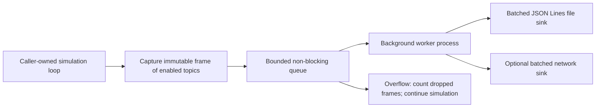

# Simulation telemetry schemas

The library telemetry package defines data contracts and topic selection only.
An optional [example-side sender](../../tools/telemetry_sender/README.md) now streams
ground truth through a bounded queue and child process to PlotJuggler over UDP/JSON.
The sender lives outside src; the library starts no workers or output. Applications
still own simulation loops. Mission targets, waypoint phases and mission controller
internals are outside these simulation contracts.

## Shared header and topic data

Every topic uses the same required header, defined in
`bullet_drone.telemetry.header.HEADER_SCHEMA`:

```json
{
  "header": {
    "schema_version": 1,
    "drone_id": "drone_1",
    "episode_id": "episode-uuid",
    "step_index": 120,
    "simulation_time_s": 0.5
  },
  "data": {}
}
```

`data` above is a placeholder: each topic requires its own fields. Schema version
1 covers the complete sample contract. `drone_id` is stable across resets;
`episode_id` changes on reset. Step zero is the initial observation. Simulation
time is in seconds, not a UTC timestamp. Every payload includes its own header,
so it remains identifiable outside a recording envelope.

Each module under `bullet_drone.telemetry.topics` exports `TOPIC` and `SCHEMA`.
A shared builder embeds independent copies of the header and payload fragments
into self-contained JSON Schema 2020-12 documents. No external `$ref` resolution
or transport-specific envelope is needed. `TOPIC_SCHEMAS` contains all ten schemas.

| Topic | Required data | Selection |
| --- | --- | --- |
| `simulation/ground_truth` | World position, body-to-world XYZW quaternion, world linear/angular velocities, actual rotor speeds | Mandatory |
| `simulation/config` | Initialized simulation configuration, vehicle parameters, stabilization settings, named random seeds, nullable Git commit | Mandatory |
| `simulation/events` | Event kind, detail text, cumulative dropped frames, recording completeness | Mandatory |
| `simulation/sensors` | Nullable typed IMU/barometer readings; unimplemented rangefinder is null | Optional |
| `simulation/rc_input` | Exactly 18 integer channel pulse widths, CH1..CH18, 1000–2000 microseconds | Optional |
| `simulation/control` | Mode, arming, RPY request, nullable yaw-rate override, collective thrust, source step/time | Optional |
| `simulation/allocation` | Nullable allocation: requested and predicted wrench, rotor targets/thrusts, saturation, torque scale | Optional |
| `simulation/forces` | Total modeled force output, named additive contributions, inflow/ground multipliers, source step/time | Optional |
| `simulation/airflow` | Total ambient wind, gust component, local body/rotor wake velocities, air-relative velocities, source step/time | Optional |
| `simulation/timing` | Simulation elapsed seconds, monotonic wall elapsed seconds, nullable real-time factor | Optional |

Config snapshots are JSON-compatible dictionaries of initialized settings. Their
contents can evolve with their owning configuration classes; the snapshot schema
requires these dictionaries but does not duplicate every configuration field's
validation. Capture the settings actually used by the episode, including any
caller-provided vehicle parameters and stabilization settings. Named `seeds`
records the seeds used by sensors and wind. `git_commit` is null when build
metadata is unavailable; schema imports never invoke Git.

Events are `reset`, `recording_complete`, `failure` or `recording_gap`. A completion
event marks recording termination, including an incomplete recording after data
loss; `complete` reports integrity. Reset is a simulation event, not a mission
phase. Header time/step identifies the observation associated with the event.

## Units, frames and sample alignment

World Z points up. Quaternions are body-to-world in XYZW order. Rotor arrays are
ordered prop0, prop1, prop2, prop3. All quantities use SI units: metres, seconds,
radians, N, N*m and Pa; RC channels use microseconds.

Control `rpy` contains requested Euler angles in Angle mode (rad), and requested
body rates in Acro mode (rad/s). `yaw_rate_rad_s` carries the Angle-mode override
or null. The schema identifies mode explicitly so the units are unambiguous.
Disarmed steps can have `allocation: null`. Mixer `achieved` is an ideal
prediction before motor dynamics and aerodynamics, not the delivered wrench.

For a completed step n, headers identify the resulting step n. Control, forces
and airflow also require `data.source` with `step_index` and `simulation_time_s`
of the pre-step state used for the calculation (normally n-1). Source inherits
drone/episode identity from the header. No source sample exists before the first
step, so omit these topics on reset rather than inventing a calculation. Sensor
readings retain their own source episode/step/time fields for measurement alignment.

Force output contains rotor forces applied at rotor positions, COM force, and
explicit body torque, all in body axes. It excludes gravity/contact handled by
PyBullet and excludes lever-arm torque already generated by applying rotor forces.
Named additive contributions sum to the modeled total. Inflow and ground effect
are thrust multipliers; apply them once to baseline thrust before decomposing
contributions, rather than counting them again as independent additive forces.
Schema validation checks shape/types, not cross-topic arithmetic or timing equality.

Ambient wind includes the gust component. Wake and relative velocity fields are
in body axes; relative velocity means vehicle/sample velocity minus local air
velocity. `real_time_factor` is simulation elapsed / wall elapsed: 1 means one
simulated second per real second. It is null before a positive wall interval.
Wall elapsed time uses a monotonic clock and is not an absolute date/time.

## Configuration and selection

`SimulationConfig.telemetry` holds `TelemetrySettings`. Seven strict boolean
fields select optional topics and default to true; see the commented
`configs/basic.yaml`. Unknown keys and non-booleans are rejected. Ground truth,
config and events cannot be switched off. Telemetry sensor flags select topics;
`sensors.imu.enabled` and `sensors.barometer.enabled` control measurements.

```python
from bullet_drone.config import TelemetrySettings
from bullet_drone.telemetry.topics import selected_schemas

schemas = selected_schemas(TelemetrySettings(forces=False, airflow=False))
# topic name -> complete JSON schema; no recording resources are started
```

The registry/selection helper exposes schema definitions, not a collector.
The optional Angle square sender captures ground truth only and does not use
optional-topic flags to imply that other topics are collected. Some
values, particularly per-effect forces and airflow intermediate values, are
currently local to the force calculation and are not exposed in observations.
A later collector must capture these values at calculation time. This milestone
does not instrument physics or claim that every topic is already recordable.

The old `telemetry.mcap` adapter, its dependency instructions and `physics/*`
topic names have been removed. No compatibility aliases or file-recording backend
are provided; the example-side UDP preview is independent of a recorder. Existing
recordings are not rewritten.

## Future centralized recording and performance

See the [recorder milestone](../todo.md). One recorder should own one bounded
queue, non-blocking submission, drop counters, worker lifecycle and shutdown.
Topic modules must not own queues.



Capture already-computed values and preserve whole-frame correlation by
identity/step. Never recalculate forces or advance a stateful wind model for
telemetry. Keep JSON encoding, schema validation, compression and blocking
file/network operations outside the simulation loop. Start with buffered JSON
Lines output; a later network sink can use the same worker interface.

Prefer a worker process for substantial encoding/compression work. Process queues
still serialize objects, so they add capture/IPC cost and cannot guarantee zero
overhead. Benchmark capture latency, queue submission latency, real-time factor
and drop counts with recording off/on before choosing queue capacity or claiming
performance targets. Measure under a slow sink and full queue too.

On overflow, continue simulation, count dropped frames and mark the recording
incomplete. Report recording gaps when capacity returns and expose final drop
counts even if an event cannot be queued. Mandatory means a topic cannot be
disabled, not a lossless delivery guarantee. Verify worker failures, draining and
bounded shutdown when implementing the recorder. The example-side sender already
implements bounded process shutdown for ground-truth live preview, not general recording.
