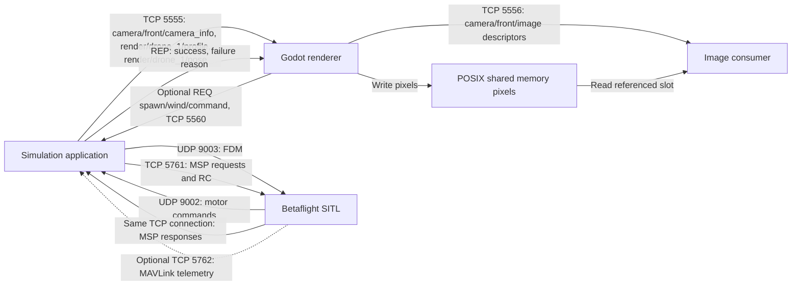

# Simulation I/O and subsystem connections

This reference inventories the simulation application's direct interfaces. The
core physics library exposes reset/step/close calls; application adapters own
network sockets and processes. Not every example enables every connection.

## Connection diagram

## Endpoint ownership

Defaults use loopback. ZeroMQ PUB binds and SUB connects; a subscriber does not
open another listening port. PUB/SUB traffic is multipart topic plus JSON.

| Endpoint | Binder / listener | Connecting or sending side | Purpose and configuration |
| --- | --- | --- | --- |
| ZeroMQ TCP 5555 | Simulation RenderPublisher, PUB | Godot, app and optional consumers, SUB | Scene and feedback; `telemetry_endpoint` |
| ZeroMQ TCP 5556 | Godot image publisher, PUB | Image readers, SUB | Image descriptors; `image_endpoint` |
| ZeroMQ TCP 5560, wind example only | Simulation wind service, REP | Godot wind client, REQ | Get/set wind, one JSON request and correlated reply; `request_endpoint` |
| UDP 9003 | SITL state listener | Simulation UdpSitlBridge | Binary FDM input |
| UDP 9002 | Simulation UdpSitlBridge | SITL | Binary motor output; simulation also sends FDM from this bound socket |
| TCP 5761 | SITL virtual UART1 | Application MSP client | RC, configuration and estimator queries |
| TCP 5762, optional | SITL virtual UART2 | Example MAVLink monitor | Firmware telemetry with matching MAVLink profile/binary |
| UDP 9870, optional | External viewer, if supplied | Library UdpRenderer | JSON snapshot and camera, no topics; `UdpSettings.host/port` |
| POSIX shared memory | Godot creates/writes slots | FrameReader opens referenced slots | Pixel bytes; session/slot names in image descriptor, no TCP/UDP port |

The packaged transport profile still reserves `control_endpoint` (TCP 5557) for
renderer compatibility, but this project no longer subscribes to it. There is no
external app RC receiver. Remaining publisher endpoints are configurable.

## Topic inventory

Topics below are exact current names, including fixed `drone_1` namespaces.
A changed YAML drone identity does not automatically rename every topic.
PUB/SUB endpoints carry UTF-8 topic and JSON payload as two frames. Wind REQ/REP carries one JSON object per request/reply, without a topic frame.

| Endpoint | Topic | Data / use | Cadence or trigger |
| --- | --- | --- | --- |
| 5555 | `camera/front/camera_info` | Stream identity, capture fps and ROS-shaped pinhole calibration | Every 1 s |
| 5555 | `render/drone_1/profile` | Backend, model and profile identity | Every 1 s |
| 5555 | `render/drone_1/pose` | World position/velocity and XYZW attitude, sample identity | Configured capture fps; stopped refresh 1 Hz |
| 5555 | `flight/drone_1/feedback` | Complete ground truth, all configured sensors and optional estimated attitude | Every observation offered, latest value under load |
| 5556 | `camera/front/image` | SHM descriptor, dimensions and capture/source metadata | Rendered captures |

The optional UDP renderer, MSP, MAVLink and FDM have their own framing and do not
use ZeroMQ topic names. Camera, tracking and recorder applications can subscribe
to relevant streams without owning physics. App status/bounding-box traffic on
5558 and downstream tracking/recorder connections are outside this direct-I/O
inventory; see the owning subsystem's configuration for those interfaces.

## Workflow, timing and compatibility

Automatic rendered examples own viewer startup and shutdown. Image readiness
requires the expected stream and episode. Poses use a bounded latest-only queue;
PUB/SUB delivery is not acknowledged. Configuration refresh lets late
subscribers recover current values. Camera pixels remain separate from descriptors.

The optional source metadata and validators remain available to image consumers.
The current motor adapter substitutes zeros after 0.1 seconds without fresh valid
input. Betaflight FDM/MSP paths are unchanged.

The external-RC workflow, its lease, spawn/collision control receivers and RC topic
have been removed. Sibling launchers importing the deleted example or RC contract
must be migrated separately. Transport profiles containing the removed RC command
endpoint key are rejected. This change does not add replacement external control.

## Source and detailed contracts

- [Publisher and topics](../../tools/zmq_render/publisher.py),
- [Shared protocol contracts](../../libs/bullet_simulation_protocol/src/bullet_simulation_protocol/)
- [Renderer adapter and image readiness](../../external_render/renderer.py)
- [Library UDP adapter](../../src/bullet_drone/rendering/udp.py)
- [SITL UDP bridge](../../src/bullet_drone/betaflight/bridge.py),
  [motor backend](../../src/bullet_drone/betaflight/backend.py)
- [MAVLink monitor](../../examples/terrain_following_mavlink/telemetry.py)
- [Render interface](../design/external-render-interface.md),
  [Godot control and camera](../design/zmq-rendering.md),
  [FDM and motor mapping](sitl_fd.md)

Wind now uses request/reply only in the wind example. See [wind protocol](../design/wind-request-reply.md).

Feedback uses [dataclasses and explicit measurement headers](../design/simulation-feedback.md), with no JSON Schema or lifecycle fields.

Start/Stop/Reset and `get_simulation_state` use the shared TCP 5560 REQ/REP service in the wind example. Command and heartbeat PUB/SUB are removed, while collision transport stays on TCP 5557. See [command lifecycle](../design/command-request-reply.md).

Legacy state.json and simulation/state publication are removed. The renderer sends no lifecycle state query. Command buttons use fresh wind/spawn identities, display correlated results, and let simulation reject invalid transitions. A timeout reports Outcome unknown without automatic retry or reconciliation queries.

The shared endpoint now accepts mutation-only spawn/wind/command topics. No getters or renderer polling remain. See [three-topic protocol](../design/three-request-topics.md).
