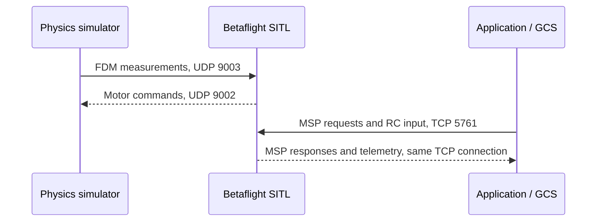

# Betaflight SITL flight dynamics message

Reviewed 2026-11-16 against upstream `master` commit
`09b90997425ba4fc6c77b0560b77f121dee25556`. This reference describes upstream
Betaflight, independently of this repository's simulation adapter or patches.

## Communication and ownership

The simulator owns physics, actuators and simulated measurements. SITL runs the
flight controller against virtual sensors and returns actuator commands. 
**FDM** means flight dynamics model; here `fdm_packet` names the state/sensor input datagram.



Ports label destinations/listeners, not sender source ports. SITL's default output
IP is 127.0.0.1, configurable with `--ip`. The state and legacy RC UDP listeners
bind all interfaces. MSP uses a configured virtual UART: UART1 is TCP 5761,
UART2 is 5762, and so on. UART configuration determines whether MSP is available.
Legacy UDP RC and MSP RX are separate receiver choices. Neither RC nor arming
commands are fields in FDM.

## Complete input layout

The declaration in `target.h` contains:

```c
typedef struct {
    double timestamp;
    double imu_angular_velocity_rpy[3];
    double imu_linear_acceleration_xyz[3];
    double imu_orientation_quat[4];
    double velocity_xyz[3];
    double position_xyz[3];
    double pressure;
} fdm_packet;
```

There are 18 doubles: normally 144 bytes with eight-byte IEEE-754 doubles and no
padding. UDP receives raw native struct bytes and checks the received size.
There is no serialization/endian conversion, header, version, field tags or
application checksum. Little-endian `<18d` matches the usual little-endian SITL
host, but portable byte order is not guaranteed by this interface.

### Sensor/state to field map

Offsets are zero-based on that 144-byte layout. Ranges include all bytes.

| Source | Field | Doubles | Bytes | Units / interpretation | Consumer |
| --- | --- | ---: | --- | --- | --- |
| Simulation clock | `timestamp` | 1 | 0–7 | Seconds, simulation time | Timing and scheduling |
| Gyroscope | `imu_angular_velocity_rpy` | 3 | 8–31 | rad/s, body angular rates, bridge-specific axes | Virtual gyro |
| Accelerometer | `imu_linear_acceleration_xyz` | 3 | 32–55 | m/s², body accelerometer input, negated by receiver | Virtual accelerometer |
| Truth orientation | `imu_orientation_quat` | 4 | 56–87 | W/X/Y/Z quaternion, bridge-specific convention | Synthetic magnetometer and optional direct attitude |
| Earth velocity | `velocity_xyz` | 3 | 88–111 | m/s, east/north/up for virtual GPS | GPS speed, course and NED velocity |
| Geographic position | `position_xyz[0]` | 1 | 112–119 | Longitude, degrees, for virtual GPS | Virtual GPS |
| Geographic position | `position_xyz[1]` | 1 | 120–127 | Latitude, degrees, for virtual GPS | Virtual GPS |
| Altitude | `position_xyz[2]` | 1 | 128–135 | Metres, geographic altitude for GPS, also atmosphere height in Gazebo mode | GPS and Gazebo barometer |
| Barometer | `pressure` | 1 | 136–143 | Pa, used only by legacy bridge branch | Virtual barometer |

The struct's historical position comment mentions **local NED metres**, but the
compiled **virtual-GPS consumer** interprets **X/Y as longitude/latitude**, not local
metres.

Coordinate conventions:

- **NED:** north/east/down.
- **ENU:** east/north/up.
- **NWU:** north/west/up.
- **FLU body axes:** forward/left/up.
- **FRD body axes:** forward/right/down.

Do not apply one **frame conversion** blindly to every field.

The FDM packet has no independent fields for:

- **Magnetometer** measurements.
- **Temperature** measurements.
- **Rangefinder** measurements.
- **Battery** measurements.
- **GPS quality**.
- **RC** input.
- **Sensor identity**.

These are **virtual-device inputs** rather than raw hardware bus packets.
**Sensor noise** must be modeled by the sender where independent measurement
fields exist.

## What updateState() does

1. **Check timing.** A host-time gap over 500 ms resynchronizes timing, sends
   cached motors and returns without applying the sample. Otherwise decreasing
   simulation timestamps are rejected; equal timestamps are not rejected.
2. **Feed acceleration.** Each wire component is negated, multiplied by
   `256 / 9.80665`, clipped to [-32767, 32767] and converted to int16 counts.
   A level supported vehicle therefore normally sends approximately Z=-9.80665
   to produce +256 virtual counts. Free fall should supply approximately zero
   specific force, not gravitational world acceleration.
3. **Feed angular rates.** The gyro helper applies bridge-dependent signs, then
   rad/s is multiplied by `180/pi * 16.4`, clipped to the same count range.
4. **Feed barometer.** Select altitude-derived pressure or supplied pressure.
   Both paths use fixed temperature 2500, representing 25°C.
5. **Convert orientation.** Reconstruct the body-to-NWU quaternion according to
   the selected bridge.
6. **Synthesize compass.** With `USE_VIRTUAL_MAG`, rotate a fixed NWU Earth field
   into the body using `R(q)^T`, then call `virtualMagSet`. Its nominal magnitude
   is 4096 counts, inclination 60°, declination 2° east. There is no independent
   magnetic measurement supplied by FDM.
7. **Optionally inject attitude.** Normally the real IMU estimator runs. With
   `USE_IMU_CALC` absent (for example `SITL_ATTITUDE_DIRECT`), orientation is set
   directly. The optional `SET_IMU_FROM_EULER` branch instead converts the raw
   packet quaternion to Euler angles and inverts pitch.
8. **Feed GPS.** With `USE_VIRTUAL_GPS`, compute horizontal/3D speeds and course
   `atan2(east, north)`, convert ENU velocity to NED `(north, east, -up)`.
   Coordinates outside ±90° latitude or ±180° longitude skip the GPS update.
   Optional GPX logging records positions separately.
9. **Advance bookkeeping.** Optional IMU synchronization runs, simulation-rate
   scaling updates for positive intervals below 20 ms, timestamps are recorded,
   periodic diagnostics print, and synchronization gates release for motor output
   and, optionally, the main loop. The function does not integrate physics.

## ENABLE_GAZEBO_BRIDGE

The actual spelling is `ENABLE_GAZEBO_BRIDGE`, not `ENABLED_GAZEBO_BRIDE`.
It is a compile-time boolean, defaulting to 1 in `target.h`; a static assertion
rejects values other than 0 or 1. Legacy X-Plane/RealFlight configurations select 0.
It does not require Gazebo itself: another simulator can implement its conventions.

| Behavior | 1: Gazebo-compatible | 0: legacy-compatible |
| --- | --- | --- |
| Gyro mapping, before count scaling | `(wx, -wy, +wz)` | `(wx, -wy, -wz)` |
| Barometer source | Derive pressure from position Z | Read `pressure` directly |
| Quaternion | Negate Y/Z, then rotate world ENU → NWU by +90° about Z | Use supplied body-to-world quaternion directly |
| GPS horizontal correction | `corrected = 2 * initial_origin - received` for latitude and longitude | Use received latitude and longitude |
| Struct layout, size and ports | Same | Same |

Gazebo gyro values originate in an IMU frame rotated 180° around X relative to
the FLU body, effectively FRD. The helper negates pitch for Betaflight's convention;
legacy inputs require the opposite yaw sign. Accelerometer negation is unchanged
by this selector.

Gazebo barometer pressure is reconstructed as:

```text
pressure_Pa = int32(101325 * (1 - 2.25577e-5 * position_Z_m)^5.25588)
```

> [!WARNING]
> **GPS altitude and barometer pressure share an input in Gazebo mode.**
> With `ENABLE_GAZEBO_BRIDGE=1`, `position_xyz[2]` supplies GPS altitude and
> determines barometer pressure. The separate `pressure` field is **ignored**,
> even when it conflicts with that altitude. Encoding a different barometric
> altitude in position Z also changes the altitude delivered to virtual GPS.
> Independent GPS altitude and barometer pressure therefore cannot be supplied
> through this upstream mode. With `ENABLE_GAZEBO_BRIDGE=0`, pressure is read
> independently, but gyro, quaternion and GPS-coordinate conventions also change.
> If independently supplied GPS and barometer measurements disagree, their effect
> on estimated altitude depends on the enabled sensors and fusion settings.

GPS mirroring compensates for the Gazebo plugin's horizontal inversion and
captures its origin on the first processed GPS-path sample. Attach at the spawn
position. A sender already supplying conventional geographic motion must account
for this correction. Velocity remains ENU in both branches.

**The flag changes semantics, not the FDM format.** Packet-size compatibility
alone cannot establish correct axes, pressure or geographic motion. Other build
flags and runtime sensor settings determine which virtual feeds are actually used.

## Quadcopter motor output

UDP 9002 carries `servo_packet`: four native float32 `motor_speed` values,
16 bytes total, in motor-channel order. These are drive commands, not measured
RPM, rad/s, thrust, or `[throttle, roll, pitch, yaw]`. The simulator defines how
these commands become rotor speed and force. No timestamp or sequence is included.

### Exact normalization

The pinned `sitl.c` implementation performs:

```text
motorsPwm[i] = mixer_motor_value[i] - idlePulse
motor_speed[i] = motorsPwm[i] / (FEATURE_3D ? 500.0 : 1000.0)
```

`motor.c` selects `idlePulse = mincommand` normally, or `neutral3d` when
FEATURE_3D is enabled. Brushed output selects zero instead.

| Mode | Example endpoints/reference | Nominal range | Interpretation |
| --- | --- | --- | --- |
| Ordinary quad | Values 1000…2000, mincommand=1000 | [0, 1] | Zero through full forward drive |
| Reversible 3D quad | Values 1000…2000, neutral3d=1500 | [-1, 1] | Full reverse, neutral, full forward |

The signed range is **[-1, 1]**. With the references above:

| Internal motor value | Normal output | 3D output |
| ---: | ---: | ---: |
| 1000 | 0 | -1 |
| 1250 | 0.25 | -0.5 |
| 1500 | 0.5 | 0 |
| 2000 | 1 | 1 |

**These ranges are nominal, not enforced by the serializer.** It subtracts a
reference and divides by a fixed scale, with no clamp or endpoint-aware
normalization. Configuration, motor protocol, idle and limits affect actual
outputs. Armed idle may produce a positive minimum; limiting may keep maximum
below one. Disarm yields zero when its value equals the reference.

An ordinary quad uses non-3D output even though adjacent motors have opposite
fixed CW/CCW directions. Negative values mean reversible drive, not the ordinary
rotor spin assignment. A value of 0.5 does not inherently mean half RPM, half
thrust or hover.

### Standard QUADX order

Viewed from above, with the nose forward:

| Array index | Bytes | Motor | Position |
| --- | --- | --- | --- |
| 0 | 0–3 | M1 | Rear right |
| 1 | 4–7 | M2 | Front right |
| 2 | 8–11 | M3 | Rear left |
| 3 | 12–15 | M4 | Front left |

For example, `[0.42, 0.44, 0.43, 0.41]` requests four different normal-mode motor
drives. Equal commands are possible in balanced flight; feedback corrections
create differences. The hover value depends on vehicle and actuator modeling.
Custom mixers/output mappings can change physical assignments, and the packet
contains no mapping metadata. This normalized path explicitly copies four
channels, even if another vehicle has more motors.

## This repository: SITL drive to rotor velocity and thrust

Unlike the upstream reference above, this section describes the current local
implementation and its default ideal motor/propeller models.

```mermaid
flowchart LR
    SITL["SITL: four motor drive values, UDP 9002"] --> Decode["Decode 16 bytes as little-endian float32 x4"]
    Decode --> Validate["Accept only finite values in 0 to 1"]
    Validate --> Cache["Latest valid packet, or zeros if absent or older than 0.1 s"]
    Cache --> Map["Reorder M1 M2 M3 M4 to M4 M3 M1 M2"]
    Map --> Speed["$$\omega_i^{\mathrm{target}} = u_i\,\omega_{\max}\quad [\mathrm{rad/s}]$$"]
    Speed --> Motors["IdealMotorDynamics: actual velocity equals target"]
    Motors --> Thrust["$$F_{z,i} = k_f\,\omega_i^2\quad [\mathrm{N}]$$"]
    Motors --> Reaction["$$\tau_z = \sum_i s_i\,k_m\,\omega_i^2\quad [\mathrm{N\,m}]$$"]
    Thrust --> Forces["Force chain: optional configured physical effects"]
    Reaction --> Forces
    Forces --> Bullet["PyBullet: rotor forces at rotor positions and body torque, then step"]
```



[BetaflightBackend](../../src/bullet_drone/betaflight/backend.py) rejects invalid
packet lengths, NaN/infinite values, negatives and values above one. Invalid
packets are discarded; the previous valid packet remains eligible until stale.
Thus this adapter **does not support negative 3D commands**. Freshness uses host
monotonic read time, not the firmware production timestamp. It drains queued
packets without waiting for a matching reply, so this is asynchronous feedback.

The conversion in simulation rotor order is:

```text
omega_max = sqrt(max_thrust_per_rotor_n / thrust_coefficient)
u_sim = (M4, M3, M1, M2)
omega_target[i] = u_sim[i] * omega_max
omega_actual[i] = omega_target[i]                 # default ideal dynamics
F_body[i] = (0, 0, k_f * omega_actual[i]^2)
tau_yaw = sum(sign[i] * k_m * omega_actual[i]^2)
```

[VehicleParameters](../../src/bullet_drone/vehicle.py) defines the maximum speed
in rad/s. [IdealMotorDynamics](../../src/bullet_drone/actuators.py) validates limits
and returns targets immediately: there is no default motor lag.
[IdealPropellerModel](../../src/bullet_drone/propellers.py) delegates to the
[thrust](../../src/bullet_drone/forces/thrust.py) and
[reaction torque](../../src/bullet_drone/forces/reaction_torque.py) models.
`k_f` has units N/(rad/s)² and `k_m` has units N·m/(rad/s)².

**The drive-to-speed mapping is linear, but the resulting ideal thrust is
quadratic:** `F_i = u_sim[i]^2 * max_thrust_per_rotor_n`.
A command of 0.5 gives half maximum angular speed and **one quarter maximum
ideal thrust**, not half thrust. For example, if maximum speed is 2000 rad/s,
SITL `(M1,M2,M3,M4)=(0.1,0.2,0.3,0.4)` produces simulation speeds
`(800,600,200,400)` rad/s. Thrust fractions in that order are
`(0.16,0.09,0.01,0.04)` of each rotor's maximum.

[PyBulletPhysics.step()](../../src/bullet_drone/physics.py) sends propeller output
through the configured force chain before applying forces. The ideal thrust
points along body +Z (FLU). Applying it at rotor positions generates roll/pitch
lever-arm torque automatically; yaw reaction is a separate body torque. PyBullet
owns gravity and contact. Optional aerodynamic effects can alter final forces,
so the quadratic expression describes the base ideal propeller thrust.

## Pinned upstream sources

- [Sensor consumers, timing, UDP ports and outputs](https://github.com/betaflight/betaflight/blob/09b90997425ba4fc6c77b0560b77f121dee25556/src/platform/SIMULATOR/sitl.c)

- [Packet structs and build defaults](https://github.com/betaflight/betaflight/blob/09b90997425ba4fc6c77b0560b77f121dee25556/src/platform/SIMULATOR/target/SITL/target.h)

- [Gyro axis conventions](https://github.com/betaflight/betaflight/blob/09b90997425ba4fc6c77b0560b77f121dee25556/src/platform/SIMULATOR/sitl_gyro.h)

- [Virtual UART TCP ports](https://github.com/betaflight/betaflight/blob/09b90997425ba4fc6c77b0560b77f121dee25556/src/main/drivers/serial_tcp.c)

- [UDP socket behavior](https://github.com/betaflight/betaflight/blob/09b90997425ba4fc6c77b0560b77f121dee25556/src/platform/SIMULATOR/udplink.c)

- [Motor reference selection](https://github.com/betaflight/betaflight/blob/09b90997425ba4fc6c77b0560b77f121dee25556/src/main/drivers/motor.c)

- [QUADX channel order](https://github.com/betaflight/betaflight/blob/09b90997425ba4fc6c77b0560b77f121dee25556/src/main/flight/mixer_init.c)
