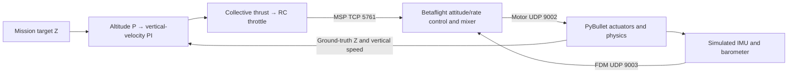
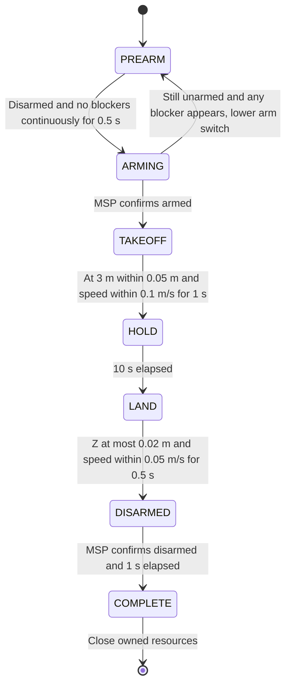

# Altitude hold with Betaflight SITL

`altitde_hold_bt` is an independent example: take off to **3 m**, hold for **10
simulated seconds**, land, disarm and exit. The directory preserves the requested
spelling. It has its own CLI, mission, loop and firmware lifecycle, and imports
no code from the other examples or the application/renderer.

PyBullet owns the physics. Unmodified Betaflight **2026.6.2** owns attitude/rate
control and motor mixing. The example owns the outer altitude/vertical-velocity
cascade and sends its throttle command over MSP.

## Run

From the `bullet_drone` repository root in the shared uv workspace:

```bash
# Build the pinned firmware once, before launching the example.
tools/setup_betaflight_sitl.sh
uv run --locked --extra sitl python -m examples.altitde_hold_bt.main
uv run --locked --extra sitl python -m examples.altitde_hold_bt.main --headless
uv run --locked --extra sitl python -m examples.altitde_hold_bt.main --help
```

Or use **Tasks: Run Task → Bullet: Run example → Altitude hold (Betaflight SITL)**.
The `sitl` extra supplies the existing workspace `msp-link` library. There is no
Godot/ZeroMQ requirement. The normal `altitude_hold` example remains independent
and uses the internal controller.

The default executable is
`.sitl/betaflight-source/obj/main/betaflight_SITL.elf`; override it with
`--sitl-binary /path/to/betaflight_SITL.elf`. A missing binary fails with the build
command rather than triggering an implicit firmware build. GUI mode requires a
desktop display. **Both GUI and headless mode limit FDM sends to 240 Hz** for
SITL's host-time scheduling and RC freshness checks. The physics timestep stays
1/240 s. Each packet deadline follows the previous actual send, so slow GUI,
status polling or callbacks can reduce RTF below 1 rather than trigger catch-up
bursts. This matters because upstream SITL derives its clock rate from packet
arrival intervals: a burst can make firmware timers run much faster than the
host's 50 Hz RC stream and produce a false RXLOSS/failsafe despite regular sends.

The example imports `configs/betaflight.config` into a private temporary firmware
working directory. Existing firmware settings are untouched. Occupied ports are
reported without terminating another process. Ctrl+C, errors and the 90-second
simulation-time deadline all trigger disarming and teardown of the owned MSP
connection, firmware process and physics. An unexpected firmware disarm aborts
the flight. No hardware/UART connection is made.

## Control and feedback



Like the original teaching example, the outer loop reads **ground-truth world Z
and vertical velocity**. MSP status is used for pre-arm readiness, actual arming,
disarming and connection freshness; MSP altitude is not the outer-loop feedback.
The simulated IMU/barometer still feed Betaflight through the existing FDM encoder,
including barometer-pressure encoding in `position_xyz[2]`.

| Loop | Gains | Output |
| --- | --- | --- |
| Altitude P | Kp 1.5 | Vertical-speed target, limited to 1 m/s in flight and 0.5 m/s during landing. |
| Vertical-velocity PI | Kp 6, Ki 4 | Acceleration correction, limited to ±3 m/s² with a 2 m/s² integral limit. |
| Gravity compensation | 1 kg, 9.81 m/s² | `thrust = mass × (gravity + acceleration)`, bounded by available thrust. |

The local PWM mapping accounts for thrust proportional to motor speed squared,
the pinned profile's normal-mode 5.5% motor idle, `min_check=1050` and linear
throttle curve. It sends neutral roll/pitch/yaw, AUX1 arming and AUX2 Angle mode.
The vehicle is a level 1 kg racer on flat ground, with default zero sensor noise
and the library's default aerodynamic models. No XY position hold, absolute yaw
hold or tilt compensation is added.

| Link | Default endpoint | Data |
| --- | --- | --- |
| Example → firmware | TCP `127.0.0.1:5761` | MSP RC at 50 Hz, identification and status polling. |
| Simulation → firmware | UDP `127.0.0.1:9003` | 144-byte IMU/barometer/pose FDM packet. |
| Firmware → simulation | UDP `127.0.0.1:9002` | 16-byte normalized motor packet. |
| Upstream legacy RC listener | UDP `127.0.0.1:9004` | Unused, with RX_UDP disabled by the profile. |

Only one SITL simulation can own these fixed ports. See the
[bridge reference](../../docs/design/betaflight-sitl-bridge.md) for packet fields.

## Mission states



During `PREARM` and `ARMING`, physics stays stationary while FDM timestamps and
sensor observations advance. After actual arming, every simulation step applies
Betaflight motor outputs. Hover/touchdown dwell timers restart when their
conditions fail. The controller integrators reset at takeoff, landing and
disarming. Completion does not require an external Start command.

If an arm request is blocked, the example returns to `PREARM` and sends AUX1 and
throttle at 1000. This lets firmware clear `NOT_DISARMED`/`ARM_SWITCH` after RC
recovery. It requests arming again only after MSP confirms disarmed with no
blockers for 0.5 continuous simulated seconds. A new blocker resets that timer.
Retries remain subject to the existing 90-second deadline. Unexpected disarming
after takeoff still aborts the run; it never triggers an in-flight re-arm attempt.

## Startup and flight diagnostics

The terminal prints timestamped startup messages (binary/profile, private working
directory, firmware PID/version and MSP endpoint). Every state change shows an
arrow and a distinct color: yellow `PREARM`, magenta `ARMING`, cyan `TAKEOFF`,
green `HOLD`, blue `LAND`, yellow `DISARMED`, green `COMPLETE`. Colors are enabled
when stderr is a terminal, including the VS Code task terminal; redirected logs
remain readable plain text.

A `STATUS` line is printed once per host second, immediately when the arming
blocker mask changes, and on phase changes or mission failures. For example:

```text
STATE STARTUP -> PREARM | sim=0.000s
STATUS phase=PREARM sim=0.100s wall=0.100s RTF=1.00x armed=False blockers=BOOTGRACE,CALIB (0x00001200) | arm_pwm=1000 throttle_pwm=1000 RC_sent=5 | Z=0.015m Vz=0.000m/s | motors=(0.0, 0.0, 0.0, 0.0) motor_age=0.004s MSP_age=0.002s
STATE PREARM -> ARMING | sim=1.000s
```

`armed` is the actual firmware status; `arm_pwm` is what the example requests.
`RC_sent` counts delivered RC frames, and `motor_age` is time since Python last
received valid motor output (`NONE` means none yet). `MSP_age` is the status age.
`RTF` compares accumulated simulation time with host time, helping identify a slow
GUI or scheduling stalls.

| Blocker | Meaning in the pinned firmware |
| --- | --- |
| `BOOTGRACE` | Firmware is still in its startup grace period. |
| `CALIB` | Sensor calibration is still running. |
| `RXLOSS` / `FAILSAFE` | Firmware is not receiving usable RC input or is in failsafe. Check whether `RC_sent` increases. |
| `THROTTLE` | Firmware considers throttle too high for arming. `PREARM`/`ARMING` should request 1000. |
| `ANGLE` | Firmware considers the vehicle too tilted to arm. |
| `ARM_SWITCH` | The arm switch was raised while another arming restriction was active. The example returns to `PREARM` with arm/throttle low and waits for stable readiness before retrying. |

All pinned arming flags are decoded; unknown bits retain their hexadecimal value.
If the vehicle stays on the ground, capture the latest `STATE` and `STATUS` lines.
On error/timeout the terminal also includes the recent firmware output before
teardown. These messages explain the wait; arming checks are never bypassed.

## Verification

```bash
uv run --locked --extra sitl pytest tests/test_altitde_hold_bt.py -q
# Requires the built firmware and exclusive ports; runs normal and stalled flights.
BULLET_RUN_SITL=1 uv run --locked --extra sitl pytest tests/test_altitde_hold_bt.py -q -s
```

The normal suite checks mission transitions, dwell interruptions, actual arm/
disarm gating, thrust/PWM mapping, CLI/import independence, missing binaries,
occupied ports and failure/interruption/timeout cleanup. The opt-in test flies
the real upstream binary with and without repeated 40 ms observer stalls,
measures the 10-second hover against ground truth and checks teardown of the
firmware process, MSP worker and private working directory. A fake-clock test
also verifies that blocked work never produces back-to-back catch-up FDM sends.
