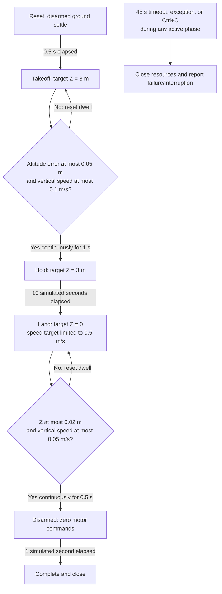

# Altitude hold in RC angle mode

This example owns the execution loop. It starts on the flat ground, takes off to
world Z = **3 m**, holds for **10 simulated seconds after settling**, descends,
disarms, and closes the PyBullet GUI after one second with motors off.

Run from the repository root with Python 3.12 and uv:

```bash
uv run --locked --extra render python -m examples.altitude_hold.main
uv run --locked --extra render python -m examples.altitude_hold.main --headless
uv run --locked --extra render python -m examples.altitude_hold.main --help
```

GUI mode requires a working desktop/X11 display and is paced to wall time.
The camera frames the ground and 3 m target together. Run this standalone demo
in its own process: its GUI framing assumes the demo owns PyBullet client 0.
Headless mode uses the same physics and simulation timing without pacing.
Ctrl+C closes the simulation. A mission exceeding 45 simulated seconds exits
with an error; interruption returns 130.

## Feedback and control

Example constants are grouped immediately after imports: flight defaults and PID
settings in `demo.py`, mission targets/timing/tolerances in `mission.py`, camera
framing in `gui.py`, and CLI exit statuses in `main.py`. Names include units where
applicable.

`demo.py` constructs the components and runs the loop; `gui.py` frames the viewer;
`mission.py` owns the
mission phases; `demo_cli.py` only parses options. Each iteration reads the latest
`DroneObservation.ground_truth` returned by reset or the previous simulation
step. World `position_m[2]` supplies altitude in meters and
`linear_velocity_m_s[2]` supplies vertical velocity in m/s. These are ideal
ground-truth measurements, not simulated sensors.

The existing `AltitudeController` cascades an altitude PID into a vertical-speed
PID. Gravity compensation converts the acceleration request to collective thrust
in newtons. `RcCodec` converts that thrust to integer throttle channels, so the
RC path introduces throttle rounding. Roll/pitch targets and yaw rate remain
zero, arm/mode AUX channels select armed angle mode during flight, and
`RcSimulation.step()` applies stabilization, mixing, rotor forces, and one
PyBullet physics step. PyBullet alone applies gravity and ground contact.

The fixed timestep is 1/240 s, mass is 1 kg, and gravity is 9.81 m/s². The body
starts at `(0, 0, 0.015)` m. Angle mode stabilizes level attitude; this demo has
**no horizontal position hold**, absolute heading control, or tilt compensation.

| Controller | Kp | Ki | Kd | Output limit | Integral contribution limit |
| --- | --- | --- | --- | --- | --- |
| Altitude → vertical speed | 1.5 | 0 | 0 | 1 m/s | 0 m/s |
| Vertical speed → acceleration | 6 | 4 | 0 | 3 m/s² | 2 m/s² |
| Body-rate → torque, each axis | 0.05 | 0 | 0 | 0.1 N·m | 0 N·m |

PID gain units follow their input/output units: Kp is output/input, Ki is
output/(input·s), and Kd is output·s/input. Attitude gains are 4 (rad/s)/rad on
each axis, with rate limits of 2 rad/s. Collective capacity comes from the
bundled racer vehicle parameters. Landing lowers the speed-target limit to
0.5 m/s; this bounds the commanded speed, not every transient measured speed.

## Sequence diagram

```mermaid
sequenceDiagram
    participant Loop as Demo loop
    participant Mission as Mission state machine
    participant PID as AltitudeController
    participant RC as RcCodec
    participant Sim as RcSimulation
    participant Physics as PyBullet
    Loop->>Sim: reset()
    Sim->>Physics: Initialize world
    Sim-->>Loop: Initial observation
    Loop->>Mission: reset(observation)
    loop Each fixed timestep until complete or timeout
        Loop->>Mission: command(latest observation, dt)
        Mission->>Mission: Update phase and simulation-time dwell
        opt Armed flight phase
            Mission->>PID: thrust(target Z, measured Z, vertical speed, dt)
            PID-->>Mission: Collective thrust (N)
        end
        Mission->>RC: encode(angle, neutral R/P/yaw, thrust, armed)
        RC-->>Mission: RcInput
        Mission-->>Loop: RcInput
        alt Mission complete
            Loop->>Loop: Finish without another step
        else Continue
            Loop->>Sim: step(RcInput)
            Sim->>Sim: RC decode, angle stabilization, motor mixing
            Sim->>Physics: Apply rotor forces and step physics
            Physics-->>Sim: Ground truth
            Sim-->>Loop: Next observation
            opt GUI mode
                Loop->>Loop: Pace to simulation time
            end
        end
    end
    Loop->>Sim: close() on success, error, or interruption
```

## State flow diagram

All phase timing uses simulation time. The takeoff and touchdown dwell timers
reset when their respective conditions stop being true. Once the hold begins,
its duration is 10 seconds while altitude feedback remains active.



## Verification

```bash
uv run --locked pytest -q tests/test_altitude_hold_example.py
```

Tests cover dwell interruptions, hold timing, angle-mode commands, a complete
headless flight, hover accuracy, landing, motors off, and cleanup on reset/step/
controller failures, timeout, and interruption. CLI tests verify help and imports
do not initialize PyBullet. GUI viewing remains a manual check.

## Real-time factor

Every wall-clock second, and once on successful completion, the example logs
cumulative simulation time, wall-clock time and their ratio:

```text
Timing: sim=10.000s wall=10.002s RTF=1.000x
Final Timing: sim=23.225s wall=23.227s RTF=1.000x
```

`RTF = elapsed simulation seconds / elapsed wall-clock seconds`:

- `1.0x`: one simulated second takes one real second.
- `2.0x`: two simulated seconds pass per real second (twice real-time speed).
- `0.5x`: one simulated second takes two real seconds (half real-time speed).

GUI mode already paces the loop toward `1.0x`; sustained values below one mean
execution is falling behind. Headless mode has no pacing and may run faster.
Measurements include control, physics, sensors, rendering overhead and pacing
sleep, starting after initialization and ending before cleanup. Values are
cumulative averages, so brief stalls may be smoothed out. If no wall time has
elapsed, the final ratio is `n/a`. This diagnostic measures execution speed,
not physical accuracy, and does not change stepping or pacing.

The examples enable the new teaching aerodynamic models with calm ambient wind.
The altitude velocity PID now uses Kp=6, Ki=4, output limit 3 m/s² and integral
contribution limit 2 m/s² to retain altitude accuracy and land through ground
effect. Mission routes, settling criteria and timeout limits are unchanged.
See [aerodynamic model details](../../docs/design/aerodynamics.md).

## Godot controls

Run this example with `uv run --locked --extra render python -m examples.altitude_hold.main --headless`.
The CLI initializes **Stopped** and waits for Godot's Start button; it no longer
runs a flight immediately. Stop ends the current episode and preserves the final
pose. Reset restores initial state at time zero and waits. Start always begins a
fresh episode. Completion leaves the process available for another run. Only one
physics example can own the shared ports at a time.

The default profile is `../bullet_render/configs/physics.json`; override it with
`--render-config`. Keep sibling bullet_msgs installed through the existing render
extra. Direct `run_demo()` calls without a control adapter remain one-shot and do
not need Godot. See [the transport/control design](../../docs/design/zmq-rendering.md).
