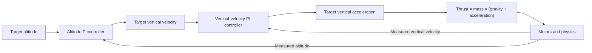
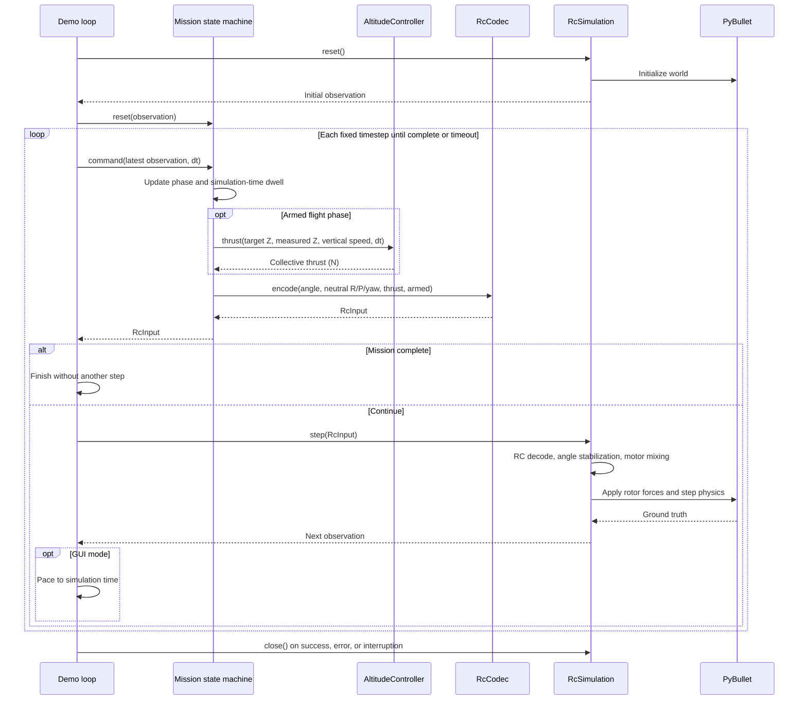
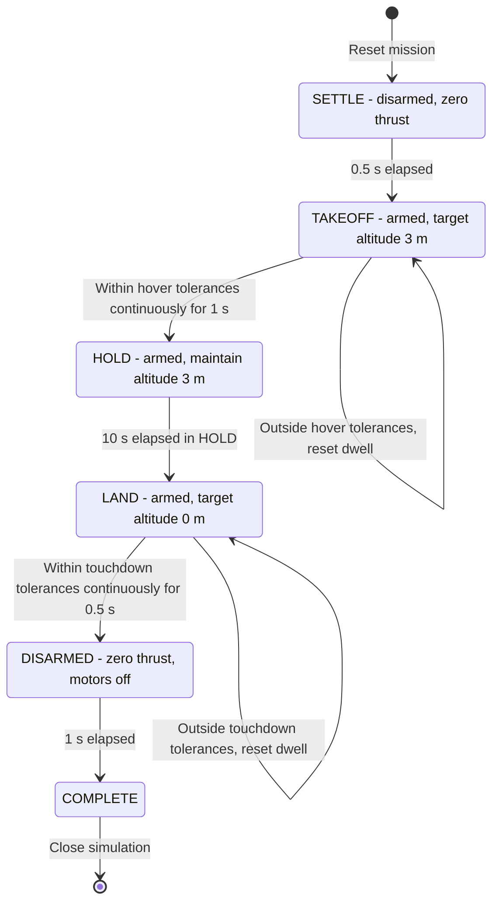

# Altitude hold in RC angle mode

This example owns the execution loop. It starts on the flat ground, takes off to
world Z = **3 m**, holds for **10 simulated seconds after settling**, descends,
disarms, and closes the PyBullet GUI after one second with motors off.

Run from the repository root with Python 3.12 and uv:

```bash
uv run --locked python -m examples.altitude_hold.main
uv run --locked python -m examples.altitude_hold.main --headless
uv run --locked python -m examples.altitude_hold.main --help
```

The mission starts automatically. No Godot, ZeroMQ, render extra or external Start
command is needed. GUI mode requires a working desktop/X11 display and is paced to wall time.
The camera frames the ground and 3 m target together. Run this standalone demo
in its own process: its GUI framing assumes the demo owns PyBullet client 0.
Headless mode uses the same physics and simulation timing without pacing.
Ctrl+C closes the simulation. A mission exceeding 45 simulated seconds exits
with an error; interruption returns 130.

## Feedback and control

Example constants are grouped immediately after imports: flight defaults and PID
settings in `demo.py`, mission targets/timing/tolerances in `mission.py`, camera
framing in `gui.py`, and CLI exit statuses in `main.py`. Names include units where
applicable.

`demo.py` constructs the components and runs the loop; `gui.py` frames the viewer;
`mission.py` owns the
mission phases; `demo_cli.py` only parses options. Each iteration reads the latest
`DroneObservation.ground_truth` returned by reset or the previous simulation
step. World `position_m[2]` supplies altitude in meters and
`linear_velocity_m_s[2]` supplies vertical velocity in m/s. These are ideal
ground-truth measurements, not simulated sensors.

The [AltitudeController](../../src/bullet_drone/controllers/altitude.py) contains
two cascaded feedback loops: **altitude control feeds vertical-velocity control**.
Both run once per physics step at **240 Hz**.



1. **Altitude loop:** compare the target Z with measured Z and calculate the
   desired climb/descent speed. The current altitude PID uses proportional action
   only (`Kp=1.5`, `Ki=Kd=0`). Limit the speed target to 1 m/s during takeoff/hold
   and 0.5 m/s during landing.
2. **Vertical-velocity loop:** compare that speed target with measured vertical
   speed. A PI controller (`Kp=6`, `Ki=4`, `Kd=0`) calculates an acceleration
   correction, limited to ±3 m/s². Its integral term compensates for sustained
   velocity error.
3. **Gravity compensation:** convert the acceleration correction to collective
   thrust in newtons and bound it to the vehicle's available thrust.

```text
altitude_error = target_Z − measured_Z
desired_vertical_velocity = clamp(altitude_PID(altitude_error), speed_limit)
velocity_error = desired_vertical_velocity − measured_vertical_velocity
desired_acceleration = vertical_velocity_PID(velocity_error)
thrust = clamp(mass × (gravity + desired_acceleration), 0, maximum_thrust)
```

At ideal steady hover, altitude and speed errors approach zero, and the required
acceleration correction approaches zero, so thrust approaches `mass × gravity`
(9.81 N for this 1 kg vehicle). Persistent physical effects can require a nonzero
integral correction. The mission selects **3 m** for takeoff/hold and **0 m** for
landing; it does not command motor speeds directly.

`RcCodec` converts that thrust to integer throttle channels, so the
RC path introduces throttle rounding. Roll/pitch targets and yaw rate remain
zero, arm/mode AUX channels select armed angle mode during flight, and
`RcSimulation.step()` applies stabilization, mixing, rotor forces, and one
PyBullet physics step. PyBullet alone applies gravity and ground contact.

The fixed timestep is 1/240 s, mass is 1 kg, and gravity is 9.81 m/s². The body
starts at `(0, 0, 0.015)` m. Angle mode stabilizes level attitude; this demo has
**no horizontal position hold**, absolute heading control, or tilt compensation.

| Controller | Kp | Ki | Kd | Output limit | Integral contribution limit |
| --- | --- | --- | --- | --- | --- |
| Altitude → vertical speed | 1.5 | 0 | 0 | 1 m/s | 0 m/s |
| Vertical speed → acceleration | 6 | 4 | 0 | 3 m/s² | 2 m/s² |
| Body-rate → torque, each axis | 0.05 | 0 | 0 | 0.1 N·m | 0 N·m |

PID gain units follow their input/output units: Kp is output/input, Ki is
output/(input·s), and Kd is output·s/input. Attitude gains are 4 (rad/s)/rad on
each axis, with rate limits of 2 rad/s. Collective capacity comes from the
bundled racer vehicle parameters. Landing lowers the speed-target limit to
0.5 m/s; this bounds the commanded speed, not every transient measured speed.

## Sequence diagram



## Mission states and transitions

All phase timing uses simulation time. The takeoff and touchdown dwell timers
reset when their respective conditions stop being true. Once the hold begins,
its duration is 10 seconds while altitude feedback remains active.



The states match `Phase` in [mission.py](mission.py). `Z` is world altitude and
`vz` is vertical velocity, both taken from ground truth.

| State | Action | Condition for the next state |
| --- | --- | --- |
| `SETTLE` | Remain disarmed on the ground. | After 0.5 s, enter `TAKEOFF`. |
| `TAKEOFF` | Arm, command 3 m, limit speed target to 1 m/s. | `abs(Z − 3) ≤ 0.05 m` and `abs(vz) ≤ 0.1 m/s` continuously for 1 s, then enter `HOLD`. |
| `HOLD` | Maintain 3 m using the altitude/velocity cascade. | After 10 s in this state, enter `LAND`. |
| `LAND` | Command 0 m, limit speed target to 0.5 m/s. | `Z ≤ 0.02 m` and `abs(vz) ≤ 0.05 m/s` continuously for 0.5 s, then enter `DISARMED`. |
| `DISARMED` | Disarm and command zero thrust. | After 1 s with motors off, enter `COMPLETE`. |
| `COMPLETE` | Finish the mission without another physics step. | Close simulation resources and exit successfully. |

The self-arrows mean **stay in the same phase and clear its settling timer**;
they do not restart the mission. A broken tolerance condition requires a fresh,
continuous dwell before advancing. `HOLD` has a fixed timer and does not return
to `TAKEOFF` when altitude drifts; the controller continues correcting it.

Mission reset clears both PID histories and selects `SETTLE`. Entering `TAKEOFF`,
`LAND` or `DISARMED` also resets the altitude and vertical-velocity PIDs. A timeout
(45 simulated seconds by default), exception or Ctrl+C ends the run and closes
resources through the demo runner; these are failure/interruption outcomes,
not additional mission phases.

## Verification

```bash
uv run --locked pytest -q tests/test_altitude_hold_example.py
```

Tests cover dwell interruptions, hold timing, angle-mode commands, a complete
headless flight, hover accuracy, landing, motors off, and cleanup on reset/step/
controller failures, timeout, and interruption. CLI tests verify help and imports
do not initialize PyBullet. GUI viewing remains a manual check.

## Real-time factor

Every wall-clock second, and once on successful completion, the example logs
cumulative simulation time, wall-clock time and their ratio:

```text
Timing: sim=10.000s wall=10.002s RTF=1.000x
Final Timing: sim=23.225s wall=23.227s RTF=1.000x
```

`RTF = elapsed simulation seconds / elapsed wall-clock seconds`:

- `1.0x`: one simulated second takes one real second.
- `2.0x`: two simulated seconds pass per real second (twice real-time speed).
- `0.5x`: one simulated second takes two real seconds (half real-time speed).

GUI mode already paces the loop toward `1.0x`; sustained values below one mean
execution is falling behind. Headless mode has no pacing and may run faster.
Measurements include control, physics, sensors, rendering overhead and pacing
sleep, starting after initialization and ending before cleanup. Values are
cumulative averages, so brief stalls may be smoothed out. If no wall time has
elapsed, the final ratio is `n/a`. This diagnostic measures execution speed,
not physical accuracy, and does not change stepping or pacing.

The examples enable the new teaching aerodynamic models with calm ambient wind.
The altitude velocity PID now uses Kp=6, Ki=4, output limit 3 m/s² and integral
contribution limit 2 m/s² to retain altitude accuracy and land through ground
effect. Mission routes, settling criteria and timeout limits are unchanged.
See [aerodynamic model details](../../docs/design/aerodynamics.md).
