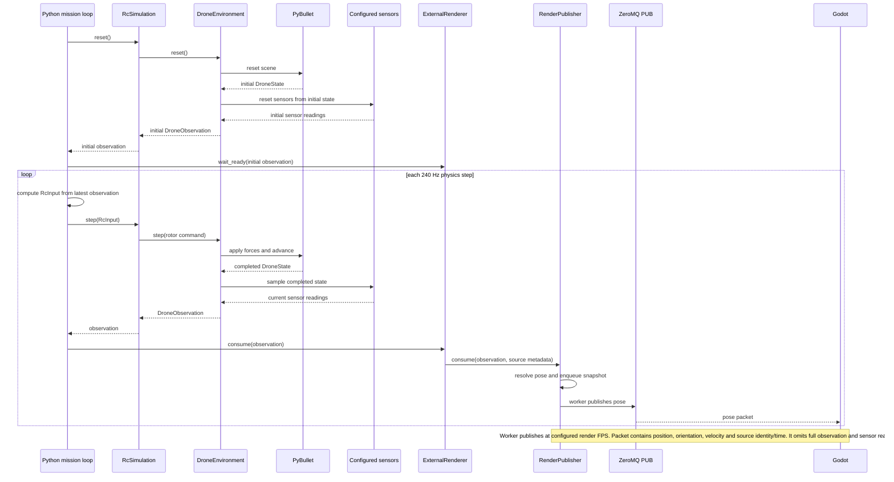
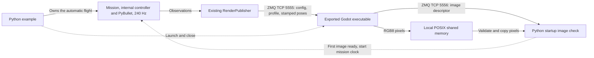
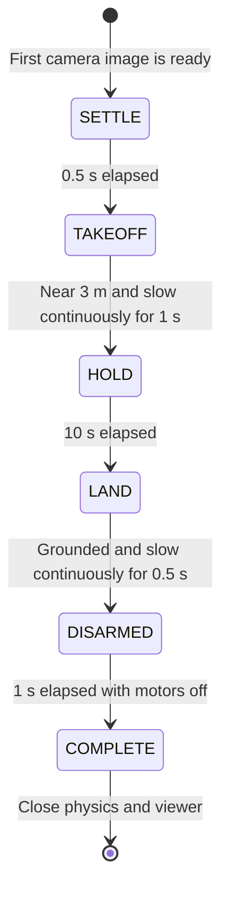

# Altitude hold with an external renderer

One command starts a headless PyBullet simulation and the packaged Godot viewer,
waits for a real camera image, then takes off automatically. The internal altitude
controller climbs to **3 m**, holds for **10 simulated seconds after settling**,
lands, disarms and exits. Godot displays the drone and camera; it does not control
the mission. No Godot editor, app, recorder or Betaflight process is launched.

## Build and run

From the repository root:

```bash
uv run --locked python external_render/build.py
uv run --locked --extra render python -m examples.altitude_hold_external_render.main
```

Alternatively, choose **Tasks: Run Task → Bullet: Run example → Altitude hold
(external renderer)**. Build the package first. A working desktop/OpenGL driver
is required. Physics is always paced at 240 Hz; the camera defaults to 30 Hz.

For a relocated package or alternative port profile:

```bash
uv run --locked --extra render python -m examples.altitude_hold_external_render.main \
  --renderer /path/to/linux-x86_64/render \
  --render-config /path/to/linux-x86_64/configs/physics.json
```

The camera profile points to its adjacent `transport.json`. Stop other processes
using TCP 5555, 5556 or 5557, or choose unused ports in that profile. No external
Start button is needed. Closing the renderer before completion ends the example
with an error; Ctrl+C closes both processes. Missing package, unavailable ports,
startup timeout or runtime failure also releases physics, sockets and the child.

## Observation to render pose

The example first resets the simulation to get its initial observation. On each
physics step, it gets the next `DroneObservation`, then passes that observation
to the external renderer adapter. The adapter publishes a selected pose to
Godot:



`DroneObservation` contains ground truth and configured sensor readings. The
render pose packet contains only the selected pose fields, with identity and
timing metadata. This keeps the render stream separate from full observation
full sensor observations.

### Click a method to open its source

The nodes in this flowchart link to the corresponding code. Link support
depends on the Markdown viewer allowing Mermaid links:

```mermaid
%%{init: {"securityLevel": "loose"}}%%
flowchart LR
    Observation["RcSimulation.step()<br/>returns DroneObservation"]
    Demo["demo.py<br/>reads observation and calls viewer.consume()"]
    Adapter["ExternalRenderer.consume()"]
    Publisher["RenderPublisher.consume()"]
    Pose["resolve_pose()<br/>selects position and orientation"]
    Packet["ZeroMQ pose packet<br/>render/drone_1/pose"]

    Observation --> Demo --> Adapter --> Publisher --> Pose --> Packet

    click Observation "https://github.com/robobe/bullet_drone/blob/main/src/bullet_drone/simulation.py#L105" "Open RcSimulation.step()" _blank
    click Demo "https://github.com/robobe/bullet_drone/blob/main/examples/altitude_hold_external_render/demo.py#L73" "Open the observation and viewer calls" _blank
    click Adapter "https://github.com/robobe/bullet_drone/blob/main/external_render/renderer.py#L97" "Open ExternalRenderer.consume()" _blank
    click Publisher "https://github.com/robobe/bullet_drone/blob/main/tools/zmq_render/publisher.py#L127" "Open RenderPublisher.consume()" _blank
    click Pose "https://github.com/robobe/bullet_drone/blob/main/tools/zmq_render/publisher.py#L132" "Open pose selection" _blank
    click Packet "https://github.com/robobe/bullet_drone/blob/main/tools/zmq_render/publisher.py#L269" "Open ZeroMQ pose publication" _blank
```



## Communication



| Path | Data and ownership |
| --- | --- |
| Simulation → renderer, TCP 5555 | Camera config/profile and selected poses, including position, quaternion, world velocity and source identity/time. The physics publisher binds; Godot subscribes. |
| Renderer → Python, TCP 5556 | A `camera/front/image` descriptor names the shared-memory slot, image shape, sequence and source stamp. Godot binds; the startup checker subscribes. |
| Renderer → shared memory | Actual RGB8 pixels remain local. The example verifies the first frame before starting its mission clock. The renderer continues updating its preview afterward. |
| Adapter control endpoint, TCP 5557 | Existing native adapter still binds this port and publishes heartbeats. The example does not subscribe or wait for Start/Stop/Reset. |
| Python → renderer process | Launch the exported package, watch for early exit and close the owned child on every exit path. |

Pose/image publication remains asynchronous and bounded; physics does not wait
for every rendered frame. Image source stamps identify their original physics
observation. Startup waits up to 10 host seconds for a matching stream/episode
image with readable pixels. Simulation time remains at zero during that wait.

## Mission and feedback



`mission.py` and `demo.py` are local to this example. No implementation is imported
from another example. Altitude P control produces vertical-speed targets, the
vertical-speed PI produces acceleration, and gravity compensation produces
collective thrust. The internal attitude/rate controller and motor mixer then
drive the simulated rotors. Feedback is ground-truth Z and vertical speed, with
no XY position hold or tilt compensation.

Takeoff/hold target Z is 3 m, with a speed-target limit of 1 m/s. Landing targets
0 m, with a speed-target limit of 0.5 m/s. Hover tolerance is 0.05 m and 0.1 m/s;
touchdown tolerance is 0.02 m and 0.05 m/s. A broken settling condition clears its
dwell timer. Default mission timeout is 45 simulated seconds. The viewer owns no
rigid-body flight dynamics and never applies forces to PyBullet.

See the [package README](../../external_render/README.md) for distribution contents,
build-time requirements and platform limits.

The process/transport adapter lives in `external_render/renderer.py` and is also
used by the automatic position-square CLI. Flight mission logic remains in each
example.
