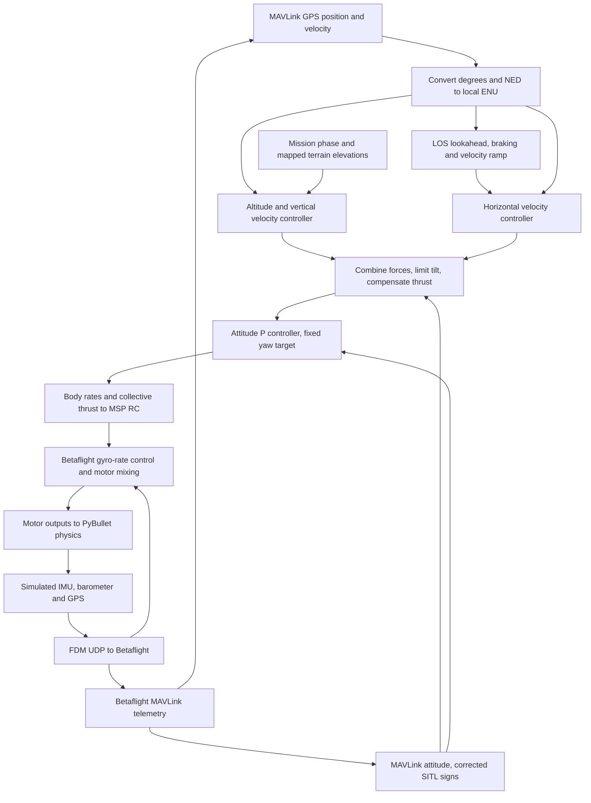

# GPS point-to-point flight: theory and control

This standalone example takes off 10 m above the starting terrain, follows a
400 m GPS route at a target of 5 m/s, and lands at B. MAVLink supplies measured
feedback; MSP carries Acro RC commands. Betaflight stabilizes body rates and
mixes motors. All example helpers are local; core controllers and the existing
external renderer are reused.

## Run the example

```bash
# Only needed if the GPS/MAVLink binary has not already been built:
bash tools/setup_betaflight_mavlink_sitl.sh --gps

# Headless, using the existing workspace lock without resolving dependencies:
uv run --frozen --extra mavlink python -m examples.gps_point_to_point_mavlink.main --headless

# External renderer:
uv run --frozen --extra mavlink --extra render python -m examples.gps_point_to_point_mavlink.main
```

On this hybrid-GPU workstation, the exported viewer requires the same NVIDIA
offload environment used by the existing VS Code task:

```bash
__NV_PRIME_RENDER_OFFLOAD=1 __GLX_VENDOR_LIBRARY_NAME=nvidia \
  uv run --frozen --extra mavlink --extra render python -m examples.gps_point_to_point_mavlink.main
```

Stop other SITL examples first. This example owns TCP 5761 (MSP), TCP 5762
(MAVLink), the bridge UDP ports, its firmware process and its temporary EEPROM.
`--sitl-binary`, `--renderer`, and `--render-config` override executable/config paths.
Ctrl+C disarms and releases resources. No commands configure your physical hardware.

## Coordinates: GPS degrees to local metres

The entry point defines a synthetic geographic origin `(32°, 35°, 100 m MSL)`.
World X is east, Y north and Z up. This places the terrain in a geographic frame;
it does not make the terrain a surveyed representation of those real locations.

| Point | Latitude, degrees | Longitude, degrees | Local east/north, m |
| --- | --- | --- | --- |
| A | 31.998941979585357 | 35.001727163237504 | (163.205, −117.321) |
| B | 32.00074562062305 | 34.998061181190316 | (−183.205, 82.679) |

[`GeographicFrame`](navigation.py) uses the same local tangent approximation as
the simulated GPS. Let origin latitude/longitude be φ₀, λ₀, measured coordinates
φ, λ, and MSL altitude h. **Angles in these equations are radians**: multiply
degrees by π/180 first.

```text
a = 6378137 m                         WGS84 semi-major axis
e² = 0.0066943799901413165             WGS84 eccentricity squared
c = 1 − e² sin²(φ₀)
M₀ = a(1 − e²) / c^(3/2)             meridional radius
N₀ = a / sqrt(c)                     prime-vertical radius

E = N₀ cos(φ₀) wrap(λ − λ₀)
N = M₀ (φ − φ₀)
U = h − h₀
```

`wrap` chooses the longitude difference in [−π, π). Radii are fixed at the
origin, not recalculated at each position. The model rejects horizontal positions
more than 1 km from the origin; origin latitude is restricted to ±85°.
It is a local approximation, not a long-distance geodesic solver.

MAVLink `GLOBAL_POSITION_INT` stores latitude/longitude in degrees × 10⁷,
MSL altitude in millimetres and NED velocity in centimetres/second.
[`Telemetry`](telemetry.py) divides by these scales and converts velocity:
`(vE, vN, vU) = (vy, vx, −vz)/100`.
Thus local U = 34.29 m means approximately 134.29 m MSL, **not** 34.29 m
above the terrain. The controller operates in metres; logs retain global degrees.

## Distance between two GPS points

Convert both GPS positions using the same origin, then calculate Euclidean
horizontal distance:

```text
D(P₁, P₂) = sqrt((E₂ − E₁)² + (N₂ − N₁)²)
```

For the configured endpoints, `B − A ≈ (−346.410, 200.000) m`, giving
`sqrt(346.410² + 200²) ≈ 400 m`.

Three quantities have different purposes:

| Quantity | Calculation | Meaning |
| --- | --- | --- |
| Route length L | ‖B − A‖ | Fixed horizontal route length |
| Logged distance d | ‖B − P‖ | Remaining horizontal distance from measured position P |
| Arrival error | sqrt(d² + (U − Utarget)²) | 3D error relative to the cruise waypoint |

The logged distance includes lateral displacement from the route; it is not
just remaining along-track distance. It approaches zero above B before descent.
For example, the recorded latitude `31.9995629°`, longitude `35.0004652°`
corresponds to about 262.30 m horizontally from B. Altitude is excluded from
that log field. Speed is the magnitude of measured 3D velocity.

## LOS guidance: position to desired velocity

The flight follows a fixed A–B line. It continuously aims toward a point ahead
on that line, rather than pointing directly at B from every location.

```text
                    P  measured position
                    |\
        cross-track | \ desired travel direction toward Q
              error |  \
A ----------------- H---Q ------------------------ B
                    projection   lookahead direction →
```

The sketch illustrates an interior projection. [`line_velocity`](navigation.py)
implements the following geometry, with all vectors horizontal:

```text
u = (B − A) / L                       route unit vector
s = (P − A) · u                       signed along-track projection
s_target = min(L, max(0, s) + 8 m)
Q = A + s_target u                    lookahead point, capped at B
e = Q − P                            lookahead error
```

For an interior projection, H = A + s u. The cross-track distance is
`abs((B_E−A_E)(P_N−A_N) − (B_N−A_N)(P_E−A_E))/L`.
Aiming toward Q creates both forward motion and lateral correction. Before A,
the implemented clamp places Q 8 m after A, or at B for a shorter route.
Beyond B, Q remains B so the drone can return toward it.

The raw horizontal velocity command is:

```text
speed = min(5 m/s, sqrt(2 a d), k ‖e‖)
a = 1 m/s², k = 0.8 s⁻¹
v_desired = speed e/‖e‖               zero when e is zero
```

The square-root term comes from stopping distance `d = v²/(2a)` and starts
braking as B approaches. The proportional term settles gently near Q. The 8 m
lookahead permits 5 m/s because `0.8 × 8 = 6.4 m/s`; a shorter lookahead can
unintentionally limit cruise speed.

[`Mission.cruise_velocity`](mission.py) limits each vector-command change to
`1 m/s² × dt`, preserving its direction of change. This avoids an abrupt step
from hover to 5 m/s. It resets on phase changes. This target ramp is separate
from the downstream controller acceleration limits.

LOS supplies a **travel direction**, not a yaw setpoint. The mission holds
world yaw at zero and can fly sideways or backwards along the route.

## From guidance to the closed control loop



Read the diagram as nested loops:

1. **Horizontal velocity:** desired minus measured ENU velocity feeds the
   [`VelocityController`](../../src/bullet_drone/controllers/velocity.py).
   Per-axis PIDs produce acceleration in m/s², with proportional gain 2 s⁻¹
   and output limits of 1.5 m/s² per axis. Multiplying by mass produces force.
2. **Altitude:** the [`AltitudeController`](../../src/bullet_drone/controllers/altitude.py)
   converts height error to vertical speed, then speed error to acceleration.
   Adding gravity compensation gives vertical force `Fz = m(g + az)`.
   Climb speed is limited to 1 m/s and descent to 0.3 m/s.
3. **Force to attitude:** horizontal forces are limited by `Fz tan(15°)`.
   Measured yaw rotates the request into desired roll/pitch, and collective
   thrust includes tilt compensation. Motor-capacity clipping still applies.
4. **Attitude to rates:** quaternion attitude error, scaled by proportional
   gains of 4 s⁻¹, gives bounded body-rate targets, up to 2 rad/s per axis.
   [`rc.py`](rc.py) inverts the configured ACTUAL rate curve and the nonlinear
   throttle/motor-speed curve into MSP PWM channels, with arm asserted.
5. **Inner stabilization and physics:** Betaflight compares requested body rates
   with its simulated gyro measurements, runs rate control and mixes motors.
   Motor outputs return over UDP; PyBullet advances the vehicle and produces
   new simulated measurements. FDM feeds those measurements back to firmware,
   which emits the MAVLink feedback used by the outer controller.

The caller-owned simulation/control loop runs at 240 Hz and uses the latest
available position/attitude messages, configured at 20 Hz. These are different
rates, not 240 fresh GPS measurements per second. MSP arm status is checked
separately. MAVLink attitude roll/yaw match this pinned SITL frame, while its
published pitch is negated. Its angular-rate fields are hardcoded zero and are
not used by the outer attitude controller; Betaflight uses its own gyro internally.

Only firmware MAVLink measurements enter navigation and attitude control.
Simulation truth is used for generating sensor/FDM data, rendering and independent
verification, not as a fallback measurement for this controller.

## Takeoff, terrain clearance and landing

Preflight queries the actual collision mesh across a 5 m-wide corridor at 0.5 m
spacing and requires at least 3 m clearance. A 10 m takeoff above A establishes
fixed cruise altitude near 134.29 m MSL, with checked corridor clearance of
8.41 m. This is fixed-altitude cruise, not terrain following.

The destination patch must vary by no more than 0.05 m between its center and
four samples 0.3 m away. The selected endpoints satisfy this check; an earlier
landing site slid after disarm and was replaced.

Phases are prearm → arming → takeoff → cruise → land → disarmed → complete.
Takeoff and cruise arrival require 3D error below 0.5 m and speed below 0.2 m/s
for 1 s. During takeoff the position controller holds A; during descent it holds
B. Only cruise uses LOS guidance. Landing targets mapped terrain height plus
the 0.015 m vehicle ground offset. Stable height within 0.12 m of that target
and speed below 0.1 m/s for 1 s trigger disarm. Firmware disarm confirmation
is required before completion. This is map-assisted ideal-GPS landing, not a
real-aircraft touchdown detector.

## Logs, checks and limits

Missing or invalid feedback prevents arming. Once telemetry is established,
position/attitude/fix data older than 0.5 s or heartbeat older than 3 s aborts the
simulation, sends disarm and stops SITL. There is no ground-truth fallback. This
abort behavior is for simulation, not a real-aircraft failsafe.

Run focused checks with `uv run --frozen pytest -q tests/test_gps_point_to_point.py`.
The completion log reports independent landing error, cross-track error, cruise
clearance, terrain contact and firmware arm state. For a repeatable full-flight
check (allow several minutes, with no other SITL running):

```bash
BULLET_TEST_GPS_POINT_TO_POINT=1 uv run --frozen --extra mavlink pytest -q tests/test_gps_point_to_point.py
```

The original 3 m/s version was verified with real pinned SITL in headless and rendered modes: about 208.5 s
simulation time, 0.011 m landing error, maximum cross-track error below 0.44 m,
and minimum measured cruise clearance above 9.95 m. Both runs confirmed terrain
contact and disarming. These measurements use the current ideal GPS and terrain.

Status logs show the received global GPS coordinates as `lat` and `lon` in
decimal degrees, and `alt_msl` in metres above mean sea level.
`distance_to_target` is horizontal distance to landing point B in metres, using
the same local tangent frame as navigation. It approaches zero above B, before
descent. `speed` is measured 3D speed in m/s. Global coordinates come directly
from MAVLink before conversion to the local frame. Example format:

```text
cruise GPS lat=31.9995629 deg lon=35.0004652 deg alt_msl=134.29 m distance_to_target=262.30 m speed=4.67 m/s blockers=0
```

Cruise targets 5 m/s with an 8 m lookahead and ramps the velocity command at
1 m/s² to avoid an abrupt acceleration transient. Actual speed depends on the vehicle
and existing controller limits. Existing controller acceleration, braking and landing limits are
unchanged.

The ramped 5 m/s version passed a complete headless SITL flight in 160.262 s
simulation time (about 23% shorter than the original). Actual cruise was around
4.67 m/s; maximum cross-track error was 0.152 m, landing error 0.019 m, and
minimum cruise clearance 9.952 m. Terrain contact and disarming were confirmed.
