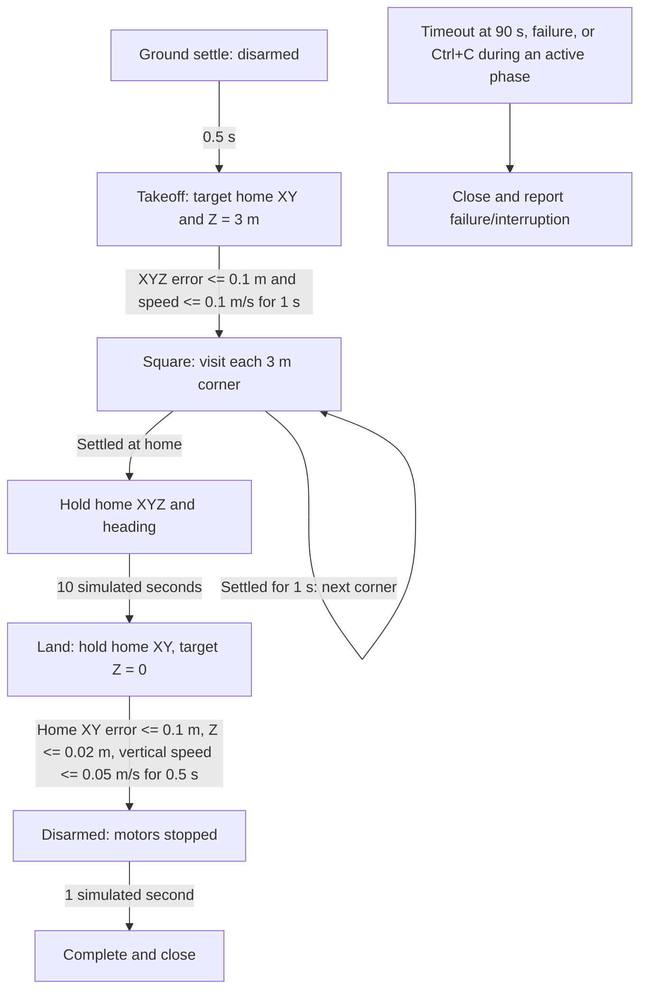

# Position-controlled 3 m square

This example owns its simulation loop and flies in RC angle mode. It takes off
to world Z = 3 m, flies a 3 m square, settles at every corner, returns home, holds
for 10 simulated seconds, then lands and disarms.

Run from the repository root:

```bash
uv run --locked --extra render python -m examples.position_square.main
uv run --locked --extra render python -m examples.position_square.main --headless
uv run --locked --extra render python -m examples.position_square.main --help
```

GUI mode uses PyBullet and wall-time pacing. It requires a desktop/X11 display.
The camera covers the square and its altitude range. Run it as a standalone
process; GUI framing assumes PyBullet client 0. Headless mode runs the same
physics without a display or pacing. Ctrl+C closes resources and returns 130.
Timeout or runtime failure returns 1; invalid configuration/arguments returns 2.

## Flight sequence

The drone starts at `(0,0,0.015)` m. It settles disarmed for 0.5 s, then visits
`(0,0,3) → (3,0,3) → (3,3,3) → (0,3,3) → (0,0,3)` in world meters.
The mission holds the heading captured at reset. Each arrival requires XYZ error
≤0.1 m and total speed ≤0.1 m/s continuously for 1 s. A failed condition resets
the dwell timer. The final home hold lasts 10 simulated seconds after arrival.

Landing targets home XY and Z = 0, retaining horizontal position control and
limiting the vertical speed target to 0.5 m/s. Touchdown requires XY home error
≤0.1 m, Z ≤0.02 m and vertical speed ≤0.05 m/s continuously for 0.5 s. Motors
then disarm; physics continues for 1 s before closing. The overall simulation-time
limit is 90 s, including the final permitted observation before deciding timeout.

## Control stages and tuning

`demo.py` wires the modules and owns the loop, `mission.py` owns flight phases,
`demo_cli.py` only parses, and `gui.py` frames the viewer. Constants are grouped
after imports in each owning module. The Acro square example reuses this mission logic with an upstream angle-to-rate converter.

Each iteration uses the latest reset/step `DroneObservation.ground_truth`:

1. `PositionController.velocity()` maps XY position error to world XY velocity.
2. `AltitudeController.thrust()` maps Z/vertical-speed feedback to vertical thrust.
3. `VelocityController.update()` maps XY velocity error to acceleration, then to
   yaw-aware roll/pitch angles and tilt-compensated collective thrust.
4. `heading_rate()` maps heading error to a bounded yaw rate.
5. `RcCodec.encode()` maps angles/yaw rate/thrust and arm state to 18 RC channels.
6. `RcSimulation.step()` stabilizes attitude/rates, mixes motors, applies rotor
   forces, and returns the next physics observation.

The simulation is 240 Hz, mass 1 kg, and gravity 9.81 m/s². Signals use ideal
ground truth rather than noisy sensors. RC encoding rounds to integer channels.
Thrust capacity comes from the bundled racer, with no scaling above motor limits.

| PID | Kp | Ki | Kd | Output limit | Integral contribution limit |
| --- | --- | --- | --- | --- | --- |
| XY position → velocity | 0.8 | 0 | 0 | 1 m/s, vector magnitude | 0 m/s |
| XY velocity → acceleration | 2 | 0 | 0 | 1.5 m/s², per axis | 0 m/s² |
| Altitude → vertical speed | 1.5 | 0 | 0 | 1 m/s | 0 m/s |
| Vertical speed → acceleration | 6 | 4 | 0 | 3 m/s² | 2 m/s² |
| Body rate → torque | 0.05 | 0 | 0 | 0.1 N·m, per axis | 0 N·m |

Kp units are output/input, Ki output/(input·s), Kd output·s/input. Maximum tilt
is 15°. Attitude gains are 4 (rad/s)/rad and rate limits are 2 rad/s. Collective
includes tilt compensation; if it saturates, vertical force can decrease.
The commanded descent-speed limit does not bound every transient measured speed.

## Sequence diagram

```mermaid
sequenceDiagram
    participant Loop as Example loop
    participant Mission as Square mission
    participant Position as XY position PID
    participant Altitude as Z altitude cascade
    participant Velocity as XY velocity PID + tilt conversion
    participant RC as RC codec
    participant Sim as RC simulation + PyBullet
    Loop->>Sim: reset()
    Sim-->>Loop: Initial ground truth
    Loop->>Mission: reset(observation), capture home and heading
    loop Until complete or timeout
        Loop->>Mission: command(latest observation, dt)
        Mission->>Mission: Update waypoint and simulation-time dwell
        alt Armed flight
            Mission->>Position: Target/measured XY position
            Position-->>Mission: XY velocity target (m/s)
            Mission->>Altitude: Target/measured Z and vertical speed
            Altitude-->>Mission: Vertical thrust (N)
            Mission->>Velocity: XY velocity target/feedback, vertical thrust, yaw
            Velocity-->>Mission: Roll/pitch (rad), collective thrust (N)
            Mission->>Mission: Heading error to yaw rate
            Mission->>RC: Encode angle mode, angles, yaw rate, thrust, armed
        else Disarmed
            Mission->>RC: Encode angle mode, zero thrust, disarmed
        end
        RC-->>Mission: RcInput
        Mission-->>Loop: RcInput
        alt Mission complete
            Loop->>Loop: Finish without another physics step
        else Continue within deadline
            Loop->>Sim: step(RcInput)
            Sim->>Sim: Angle P, rate PID, mixer, motors, propellers, physics
            Sim-->>Loop: Next ground-truth observation
            Loop->>Loop: Pace if GUI
        end
    end
    Loop->>Sim: close() on success, timeout, error, or interruption
```

## State flow diagram



## Verification and interface migration

```bash
uv run --locked pytest -q tests/test_position.py tests/test_position_square_example.py
```

Tests cover separated PIDs, frame conversion, limits, reset and validation; the
full RC/stabilization/mixer/forces chain; dwell interruptions; landing at home;
deadline boundaries; cleanup; safe imports and help. GUI framing is checked manually.

The old combined `PositionController.input()` and `PositionControlOutput` are
removed. See [the position-control design](../../docs/design/position-control.md)
for the new interfaces and composition. The altitude-hold example is unchanged.

## Real-time factor

Every wall-clock second, and once on successful completion, the example logs
cumulative simulation time, wall-clock time and their ratio:

```text
Timing: sim=10.000s wall=10.002s RTF=1.000x
Final Timing: sim=23.225s wall=23.227s RTF=1.000x
```

`RTF = elapsed simulation seconds / elapsed wall-clock seconds`:

- `1.0x`: one simulated second takes one real second.
- `2.0x`: two simulated seconds pass per real second (twice real-time speed).
- `0.5x`: one simulated second takes two real seconds (half real-time speed).

GUI mode already paces the loop toward `1.0x`; sustained values below one mean
execution is falling behind. Headless mode has no pacing and may run faster.
Measurements include control, physics, sensors, rendering overhead and pacing
sleep, starting after initialization and ending before cleanup. Values are
cumulative averages, so brief stalls may be smoothed out. If no wall time has
elapsed, the final ratio is `n/a`. This diagnostic measures execution speed,
not physical accuracy, and does not change stepping or pacing.

The examples enable the new teaching aerodynamic models with calm ambient wind.
The altitude velocity PID now uses Kp=6, Ki=4, output limit 3 m/s² and integral
contribution limit 2 m/s² to retain altitude accuracy and land through ground
effect. Mission routes, settling criteria and timeout limits are unchanged.
See [aerodynamic model details](../../docs/design/aerodynamics.md).

## Optional live telemetry

Use `--telemetry-config tools/telemetry_sender/config.yaml` to start a sender child
process for ground truth. Physics remains at 240 Hz; the default UDP send cap is
5 Hz wall-clock time. See the [PlotJuggler setup and layout](../../plotjuggler/README.md)
and [sender configuration/lifecycle](../../tools/telemetry_sender/README.md).
Without this flag no telemetry resources are started.

## Godot / ZeroMQ camera

Install `uv sync --extra render`, then run the square example with
`uv run --extra render python -m examples.position_square.main --headless --render-config ../bullet_render/configs/physics.json`
from the physics repository root. Rendering enables wall-time pacing even without
PyBullet GUI. See [the renderer](../../../bullet_render/README.md) for the native Godot and recorder commands.

## Godot controls

Run this example with `uv run --locked --extra render python -m examples.position_square.main --headless`.
The CLI initializes **Stopped** and waits for Godot's Start button; it no longer
runs a flight immediately. Stop ends the current episode and preserves the final
pose. Reset restores initial state at time zero and waits. Start always begins a
fresh episode. Completion leaves the process available for another run. Only one
physics example can own the shared ports at a time.

The default profile is `../bullet_render/configs/physics.json`; override it with
`--render-config`. Keep sibling bullet_msgs installed through the existing render
extra. Direct `run_demo()` calls without a control adapter remain one-shot and do
not need Godot. See [the transport/control design](../../docs/design/zmq-rendering.md).
