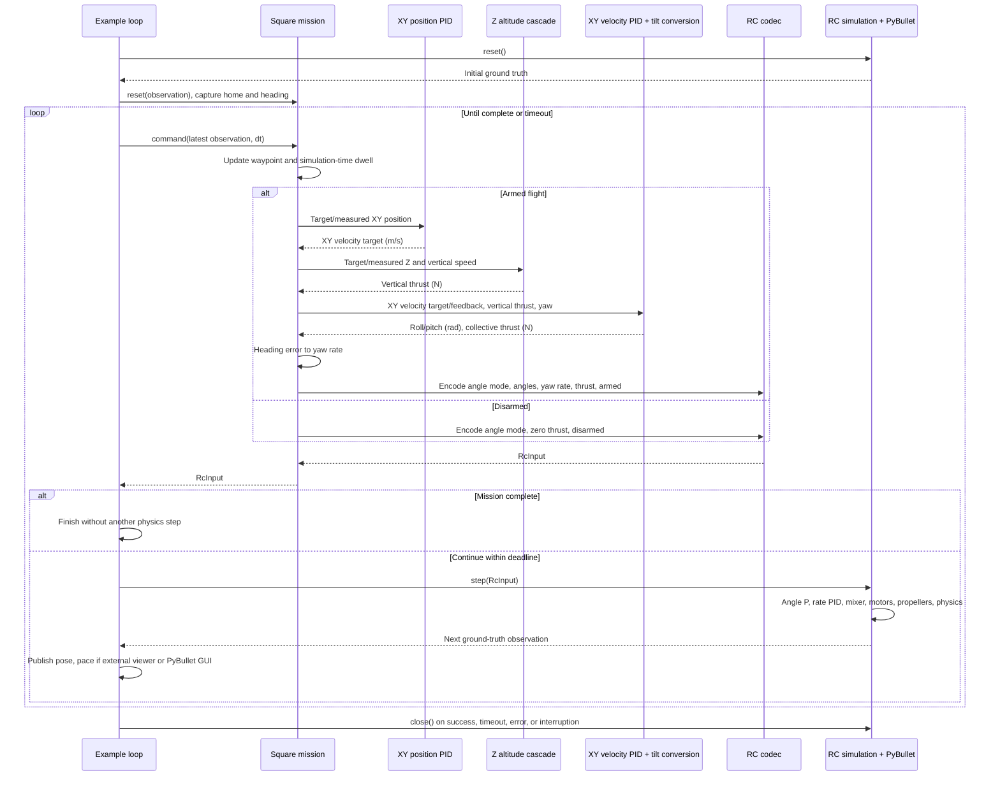
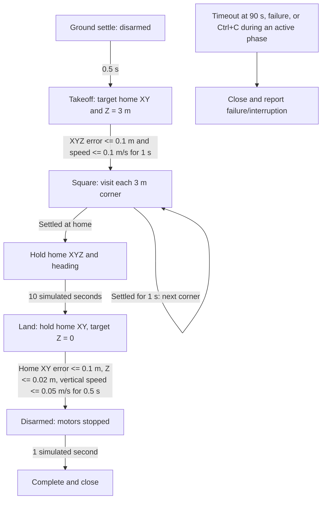

# Position-controlled 3 m square

This example owns its simulation loop and flies in RC angle mode. It takes off
to world Z = 3 m, flies a 3 m square, settles at every corner, returns home, holds
for 10 simulated seconds, then lands and disarms.

Run from the repository root:

```bash
uv run --locked --extra render python -m examples.position_square.main
uv run --locked --extra render python -m examples.position_square.main --headless
uv run --locked --extra render python -m examples.position_square.main --help
```

The default command opens the packaged Godot viewer with PyBullet headless,
waits for its first image, and starts the mission automatically. It needs a
working desktop/OpenGL display and an exported renderer. Build it once:

```bash
uv run --locked python external_render/build.py
```

Use `--renderer /path/to/render` to select another exported executable and
`--render-config /path/to/physics.json` for another camera/transport profile.
Defaults live under `external_render/dist/linux-x86_64/render` and
`external_render/configs/physics.json`. The shared adapter in
`external_render/renderer.py` owns Godot, ZeroMQ, and cleanup.

`--headless` runs the same complete flight without windows, rendering dependencies,
or pacing. Ctrl+C closes resources and returns 130. Timeout/runtime failure
returns 1; invalid configuration/arguments returns 2. Only one rendered example
can own the shared ports at a time. Closing the viewer stops the flight and
releases physics and transport resources.

## Flight sequence

The drone starts at `(0,0,0.015)` m. It settles disarmed for 0.5 s, then visits
`(0,0,3) → (3,0,3) → (3,3,3) → (0,3,3) → (0,0,3)` in world meters.
The mission holds the heading captured at reset. Each arrival requires XYZ error
≤0.1 m and total speed ≤0.1 m/s continuously for 1 s. A failed condition resets
the dwell timer. The final home hold lasts 10 simulated seconds after arrival.

Landing targets home XY and Z = 0, retaining horizontal position control and
limiting the vertical speed target to 0.5 m/s. Touchdown requires XY home error
≤0.1 m, Z ≤0.02 m and vertical speed ≤0.05 m/s continuously for 0.5 s. Motors
then disarm; physics continues for 1 s before closing. The overall simulation-time
limit is 90 s, including the final permitted observation before deciding timeout.

## Control stages and tuning

`demo.py` wires the modules and owns the loop, `mission.py` owns flight phases,
`demo_cli.py` only parses, and `gui.py` frames the viewer. Constants are grouped
after imports in each owning module. The Betaflight Acro square has an independent
mission and execution loop.

Each iteration uses the latest reset/step `DroneObservation.ground_truth`:

1. `PositionController.velocity()` maps XY position error to world XY velocity.
2. `AltitudeController.thrust()` maps Z/vertical-speed feedback to vertical thrust.
3. `VelocityController.update()` maps XY velocity error to acceleration, then to
   yaw-aware roll/pitch angles and tilt-compensated collective thrust.
4. `heading_rate()` maps heading error to a bounded yaw rate.
5. `RcCodec.encode()` maps angles/yaw rate/thrust and arm state to 18 RC channels.
6. `RcSimulation.step()` stabilizes attitude/rates, mixes motors, applies rotor
   forces, and returns the next physics observation.

The simulation is 240 Hz, mass 1 kg, and gravity 9.81 m/s². Signals use ideal
ground truth rather than noisy sensors. RC encoding rounds to integer channels.
Thrust capacity comes from the bundled racer, with no scaling above motor limits.

| PID | Kp | Ki | Kd | Output limit | Integral contribution limit |
| --- | --- | --- | --- | --- | --- |
| XY position → velocity | 0.8 | 0 | 0 | 1 m/s, vector magnitude | 0 m/s |
| XY velocity → acceleration | 2 | 0 | 0 | 1.5 m/s², per axis | 0 m/s² |
| Altitude → vertical speed | 1.5 | 0 | 0 | 1 m/s | 0 m/s |
| Vertical speed → acceleration | 6 | 4 | 0 | 3 m/s² | 2 m/s² |
| Body rate → torque | 0.05 | 0 | 0 | 0.1 N·m, per axis | 0 N·m |

Kp units are output/input, Ki output/(input·s), Kd output·s/input. Maximum tilt
is 15°. Attitude gains are 4 (rad/s)/rad and rate limits are 2 rad/s. Collective
includes tilt compensation; if it saturates, vertical force can decrease.
The commanded descent-speed limit does not bound every transient measured speed.

## Sequence diagram



## State flow diagram



## Verification and interface migration

```bash
uv run --locked pytest -q tests/test_position.py tests/test_position_square_example.py
```

Tests cover separated PIDs, frame conversion, limits, reset and validation; the
full RC/stabilization/mixer/forces chain; dwell interruptions; landing at home;
deadline boundaries; cleanup; safe imports and help. Viewer lifecycle and automatic startup have regression coverage.

The old combined `PositionController.input()` and `PositionControlOutput` are
removed. See [the position-control design](../../docs/design/position-control.md)
for the new interfaces and composition. The altitude-hold example is unchanged.

## Colored progress logs

Phase changes show `STATE previous -> current`: settle/disarmed in yellow,
takeoff in cyan, square in magenta, hold/complete in green, and landing in blue.
Waypoint status shows the zero-based waypoint index, target XYZ in meters, and
simulation time: cyan when active, green when settled. A new active waypoint
is logged when takeoff starts or the target changes. Colors appear in terminal
output; redirected logs remain plain text. Timing messages keep their usual format.

## Real-time factor

Every wall-clock second, and once on successful completion, the example logs
cumulative simulation time, wall-clock time and their ratio:

```text
Timing: sim=10.000s wall=10.002s RTF=1.000x
Final Timing: sim=23.225s wall=23.227s RTF=1.000x
```

`RTF = elapsed simulation seconds / elapsed wall-clock seconds`:

- `1.0x`: one simulated second takes one real second.
- `2.0x`: two simulated seconds pass per real second (twice real-time speed).
- `0.5x`: one simulated second takes two real seconds (half real-time speed).

External-viewer mode paces the loop toward `1.0x`; sustained values below one mean
execution is falling behind. Headless mode has no pacing and may run faster.
Measurements include control, physics, sensors, rendering overhead and pacing
sleep, starting after initialization and ending before cleanup. Values are
cumulative averages, so brief stalls may be smoothed out. If no wall time has
elapsed, the final ratio is `n/a`. This diagnostic measures execution speed,
not physical accuracy, and does not change stepping or pacing.

The examples enable the new teaching aerodynamic models with calm ambient wind.
The altitude velocity PID now uses Kp=6, Ki=4, output limit 3 m/s² and integral
contribution limit 2 m/s² to retain altitude accuracy and land through ground
effect. Mission routes, settling criteria and timeout limits are unchanged.
See [aerodynamic model details](../../docs/design/aerodynamics.md).

## Optional live telemetry

Use `--telemetry-config tools/telemetry_sender/config.yaml` to start a sender child
process for ground truth. Physics remains at 240 Hz; the default UDP send cap is
5 Hz wall-clock time. See the [PlotJuggler setup and layout](../../plotjuggler/README.md)
and [sender configuration/lifecycle](../../tools/telemetry_sender/README.md).
Without this flag no telemetry resources are started.

## External viewer and control compatibility

The default CLI runs one automatic mission and closes its owned viewer after
landing. No Start button is needed. The Betaflight Acro square also runs one
automatic mission with its own viewer and SITL process. Direct `run_demo()` calls still support an
optional control adapter and PyBullet GUI for existing Python callers.
See [transport ownership](../../docs/design/zmq-rendering.md).
