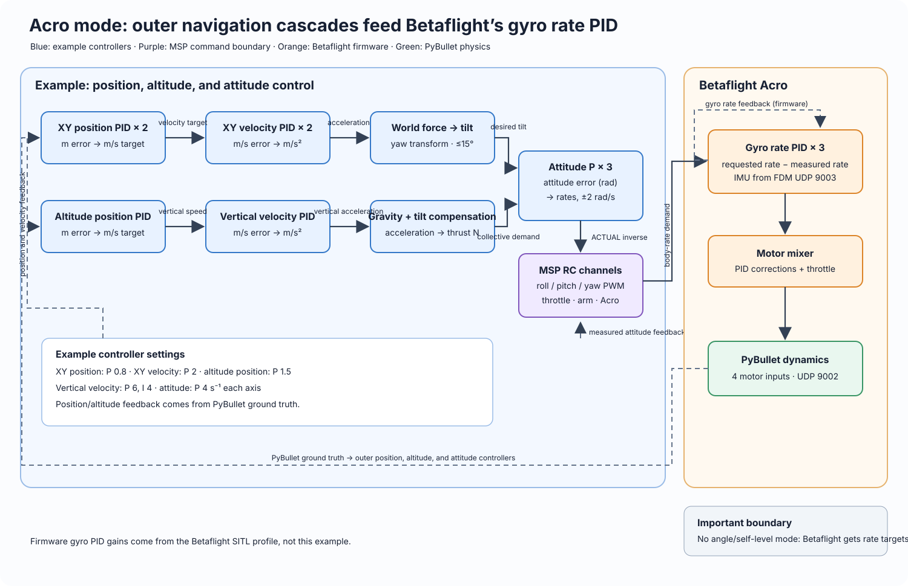
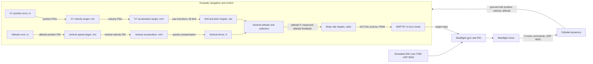
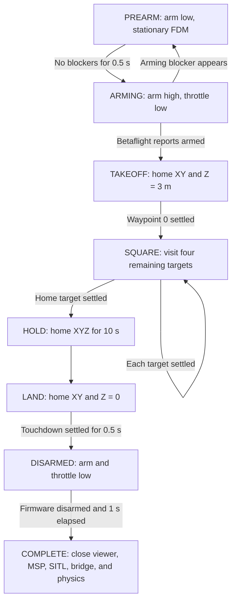

# Betaflight SITL position square in Acro mode

This example automatically launches unmodified Betaflight 2026.6.2 SITL and the
packaged Godot viewer, takes off to world Z = 3 m, flies a settled 3 m square,
holds home for 10 simulated seconds, lands, disarms, and closes every owned
process. It does not wait for a Godot Start command.

The implementation is self-contained under `examples/position_square_acro`: its
mission, SITL/MSP session, renderer adapter, diagnostics, CLI, and execution loop
do not import another example. Project library components still provide physics,
sensors, controllers, and the FDM/motor bridge.

## Run

Build firmware and the renderer once:

```bash
tools/setup_betaflight_sitl.sh
uv run --locked python external_render/build.py
```

Then run from the repository root:

```bash
uv run --locked --extra render --extra sitl python -m examples.position_square_acro.main
uv run --locked --extra render --extra sitl python -m examples.position_square_acro.main --headless
```

The default command opens the exported Godot viewer, waits for its first image,
then starts the flight. `--headless` skips Godot and ZeroMQ but still runs the
paced SITL flight. Use `--renderer`, `--render-config`, or `--sitl-binary` to
override their packaged paths. A desktop/OpenGL display is required for the
viewer. Only one SITL/rendered example can own TCP 5555–5557, TCP 5761, and UDP
9002–9004 at a time.

## Control chain

The controller is a cascade. Each outer loop turns a slower, larger-scale error
into a target for the next inner loop. The example runs the position, velocity,
altitude, and attitude stages. Betaflight receives body-rate demands in Acro
mode, closes the fast gyro rate loops, mixes the result, and produces motor
outputs. It does not receive an angle target and does not run an angle/self-level
loop for this example.





The diagram’s two cascades have distinct outputs. For XY, two independent
position PIDs turn world position error into a velocity target, bounded to a
1 m/s vector. Two velocity PIDs turn velocity error into world acceleration,
bounded to 1.5 m/s² per axis. The velocity controller rotates horizontal force
using measured yaw and limits combined tilt to 15 degrees. For Z, the altitude
PID outputs a vertical speed target bounded to 1 m/s in flight (0.5 m/s while
landing); the vertical-speed PID outputs acceleration, bounded to 3 m/s². Adding
gravity compensation and applying tilt compensation produces collective thrust.

The attitude P controller compares desired roll, pitch, and held heading with
measured attitude. Its gain is 4 s⁻¹ on each axis, and each resulting body-rate
target is limited to ±2 rad/s. The mission inverts Betaflight’s configured ACTUAL
rate curve to express those targets as centered MSP roll, pitch, and yaw PWM
channels. Throttle carries collective demand. AUX1 carries arm; AUX2 stays low
to select Acro.

Betaflight’s rate PID compares each requested body rate with gyro-measured body
rate from simulated IMU data. That firmware PID—not the example’s attitude P—
corrects roll, pitch, and yaw rates before the mixer sends four motor commands
back to PyBullet. PyBullet then advances the vehicle and supplies ground-truth
position, velocity, and attitude to the example’s outer loops. Separately,
Betaflight uses the same simulated IMU through its FDM input for its own rate
feedback. The renderer only displays simulation state.

Configured example gains and output limits:

| Stage | PID gains (P, I, D) | Input → output | Limit |
|---|---:|---|---:|
| XY position, each axis | (0.8, 0, 0) | position error (m) → velocity target (m/s) | 1 m/s vector |
| XY velocity, each axis | (2, 0, 0) | velocity error (m/s) → acceleration (m/s²) | 1.5 m/s² per axis |
| Altitude position | (1.5, 0, 0) | altitude error (m) → vertical speed (m/s) | 1 m/s flight, 0.5 m/s landing |
| Vertical velocity | (6, 4, 0) | vertical speed error (m/s) → acceleration (m/s²) | 3 m/s² output, 2 m/s² I contribution |
| Attitude P | (4, 4, 4) s⁻¹ | attitude error (rad) → body rates (rad/s) | 2 rad/s per axis |

The firmware profile selects ACTUAL rates: 70 deg/s center sensitivity, 670 deg/s
maximum, and zero expo. The firmware-owned gyro rate PID gains are in the
Betaflight SITL profile; they are not configured by the example. FDM carries
simulated IMU and barometer data; returned Betaflight motor outputs alone drive
PyBullet.

## Mission states



The targets are `(0,0,3) → (3,0,3) → (3,3,3) → (0,3,3) → (0,0,3)` m relative
to reset XY. A waypoint requires position error ≤ 0.1 m and total speed ≤ 0.1 m/s
for one continuous second. Landing holds home XY, limits vertical target speed to
0.5 m/s, and requires home XY error ≤ 0.1 m, Z ≤ 0.02 m, and vertical speed
≤ 0.05 m/s. The overall simulation-time limit is 120 seconds.

## Diagnostics and cleanup

Phase transitions and active/settled waypoints are colored. Once per wall-clock
second the status line reports phase, waypoint, simulation/wall time, RTF,
firmware armed state and blockers, RC channels, XYZ, motor outputs, and MSP/motor
ages. Renderer loss, stale MSP status, firmware exit, unexpected disarming,
timeout, or Ctrl+C closes the viewer, disarms MSP, terminates the owned SITL
process, releases ports/shared memory, and closes PyBullet.

## Verification

```bash
uv run --locked --extra render --extra sitl pytest -q tests/test_position_square_acro_example.py
```

The suite checks example independence, mission/arming states, all five targets,
ACTUAL-rate and throttle mappings, cleanup, renderer readiness, CLI errors, and
headless import isolation. A real paced SITL run is required to verify firmware
arming, motor feedback, waypoint flight, landing, and process cleanup.
