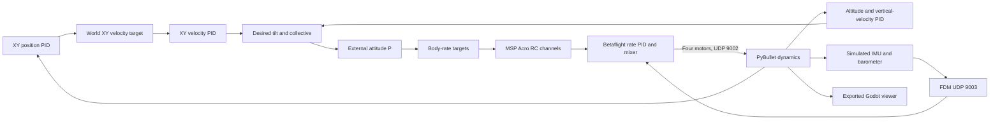
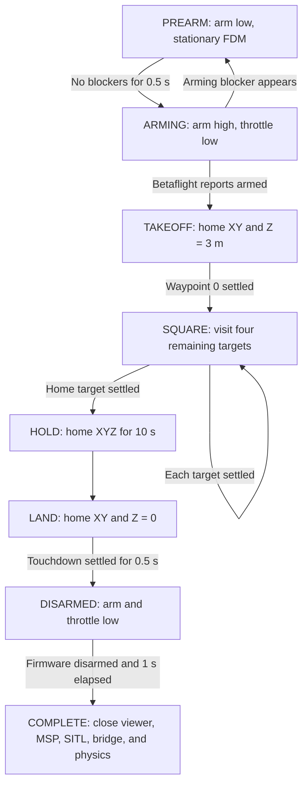

# Betaflight SITL position square in Acro mode

This example automatically launches unmodified Betaflight 2026.6.2 SITL and the
packaged Godot viewer, takes off to world Z = 3 m, flies a settled 3 m square,
holds home for 10 simulated seconds, lands, disarms, and closes every owned
process. It does not wait for a Godot Start command.

The implementation is self-contained under `examples/position_square_acro`: its
mission, SITL/MSP session, renderer adapter, diagnostics, CLI, and execution loop
do not import another example. Project library components still provide physics,
sensors, controllers, and the FDM/motor bridge.

## Run

Build firmware and the renderer once:

```bash
tools/setup_betaflight_sitl.sh
uv run --locked python external_render/build.py
```

Then run from the repository root:

```bash
uv run --locked --extra render --extra sitl python -m examples.position_square_acro.main
uv run --locked --extra render --extra sitl python -m examples.position_square_acro.main --headless
```

The default command opens the exported Godot viewer, waits for its first image,
then starts the flight. `--headless` skips Godot and ZeroMQ but still runs the
paced SITL flight. Use `--renderer`, `--render-config`, or `--sitl-binary` to
override their packaged paths. A desktop/OpenGL display is required for the
viewer. Only one SITL/rendered example can own TCP 5555–5557, TCP 5761, and UDP
9002–9004 at a time.

## Control chain

The example owns world XYZ navigation. Betaflight owns body-rate stabilization,
motor mixing, and motor output:



The firmware profile selects ACTUAL rates: 70 deg/s center sensitivity, 670 deg/s
maximum, and zero expo. The mission inverts that curve to encode bounded ±2 rad/s
body-rate targets as PWM. AUX1 arms; AUX2 stays low so Betaflight remains in Acro.
Throttle uses the same motor-speed-squared inversion as the standalone Betaflight
altitude example. FDM carries simulated IMU and barometer data; returned Betaflight
motor outputs alone drive PyBullet.

## Mission states



The targets are `(0,0,3) → (3,0,3) → (3,3,3) → (0,3,3) → (0,0,3)` m relative
to reset XY. A waypoint requires position error ≤ 0.1 m and total speed ≤ 0.1 m/s
for one continuous second. Landing holds home XY, limits vertical target speed to
0.5 m/s, and requires home XY error ≤ 0.1 m, Z ≤ 0.02 m, and vertical speed
≤ 0.05 m/s. The overall simulation-time limit is 120 seconds.

## Diagnostics and cleanup

Phase transitions and active/settled waypoints are colored. Once per wall-clock
second the status line reports phase, waypoint, simulation/wall time, RTF,
firmware armed state and blockers, RC channels, XYZ, motor outputs, and MSP/motor
ages. Renderer loss, stale MSP status, firmware exit, unexpected disarming,
timeout, or Ctrl+C closes the viewer, disarms MSP, terminates the owned SITL
process, releases ports/shared memory, and closes PyBullet.

## Verification

```bash
uv run --locked --extra render --extra sitl pytest -q tests/test_position_square_acro_example.py
```

The suite checks example independence, mission/arming states, all five targets,
ACTUAL-rate and throttle mappings, cleanup, renderer readiness, CLI errors, and
headless import isolation. A real paced SITL run is required to verify firmware
arming, motor feedback, waypoint flight, landing, and process cleanup.
