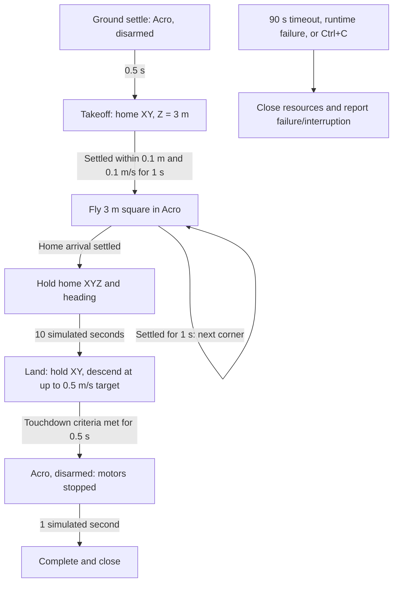

# Position square in Acro mode

This example owns its simulation loop and flies the same settled 3 m square as
the Angle example, using **Acro RC commands on every step**, including disarmed
ground settling and the final motors-off period.

```bash
uv run --locked --extra render python -m examples.position_square_acro.main
uv run --locked --extra render python -m examples.position_square_acro.main --headless
uv run --locked --extra render python -m examples.position_square_acro.main --help
```

Run from the repository root. GUI mode uses PyBullet with wall-time pacing and
requires a desktop/X11 display. Headless mode runs the same physics without
pacing. GUI framing assumes a standalone process owning PyBullet client 0.
Ctrl+C releases resources and returns 130; timeout/runtime errors return 1.

## How Acro position control works

The position and velocity PIDs still calculate desired roll/pitch angles and
tilt-compensated thrust. An **upstream attitude P controller** compares those
angles with ground-truth orientation and produces bounded body roll/pitch rates.
The held-heading controller supplies yaw rate. These three body rates and
collective thrust are encoded as Acro RC channels.

Inside `RcSimulation`, Acro bypasses the internal attitude P controller and
passes the requested body rates directly to rate PID → mixer → motors/propellers
→ PyBullet. Collective thrust bypasses attitude/rate PID. There is exactly one
angle-to-rate calculation for each armed step, performed upstream of RC encoding.
The autonomous navigation closes the attitude loop; Acro mode itself adds no
automatic leveling. Changing only the RC mode while passing angle values as
rates would produce a different, incorrect position-control chain.

`demo.py` owns composition and reset/step/pacing/cleanup; `main.py` owns diagnostics
and CLI entry; `demo_cli.py` only parses; `gui.py` frames the flight. The example
reuses `examples/position_square/mission.py` for route, state transitions, dwell
and landing behavior, explicitly selecting `flight_mode='acro'` and injecting
an upstream `AttitudeController`. Both examples retain their own execution loops.
All tuning defaults are named constants after module imports.

## Route and defaults

Start at `(0,0,0.015)` m, settle disarmed for 0.5 s, then visit
`(0,0,3) → (3,0,3) → (3,3,3) → (0,3,3) → (0,0,3)` in world meters.
Each waypoint requires XYZ error ≤0.1 m and speed ≤0.1 m/s for 1 continuous second.
Hold the heading captured at reset, hold home XYZ for 10 s, and land while keeping
XY position control active. The descent speed target is limited to 0.5 m/s.
Touchdown requires home XY error ≤0.1 m, Z ≤0.02 m and vertical speed ≤0.05 m/s
for 0.5 s. Disarm for 1 s before closing. Overall timeout is 90 simulated seconds.

The timestep is 1/240 s, mass 1 kg and gravity 9.81 m/s². XY position PID gains
are `(0.8,0,0)` with a 1 m/s vector speed limit; XY velocity PID gains are
`(2,0,0)` with a 1.5 m/s² per-axis acceleration limit. Maximum tilt is 15°.
Altitude PIDs remain `(1.5,0,0)` for position and `(6,4,0)` for vertical velocity,
with limits 1 m/s and 3 m/s² and a 2 m/s² integral contribution limit.
Upstream attitude gain is 4 (rad/s)/rad; body-rate targets are bounded to 2 rad/s.
Internal rate PIDs are `(0.05,0,0)`, limited to 0.1 N·m per axis. Yaw-heading
gain is 4 s⁻¹, limited to the same 2 rad/s yaw rate. RC channels introduce rounding
of the rate and thrust requests. All feedback is ideal ground truth.

## Sequence diagram

```mermaid
sequenceDiagram
    participant Loop as Acro example loop
    participant Mission as Shared square mission
    participant Position as XY position PID
    participant Z as Altitude cascade
    participant Velocity as XY velocity PID and tilt conversion
    participant Attitude as Upstream attitude P
    participant RC as RC codec
    participant Sim as RcSimulation in Acro mode
    Loop->>Sim: reset()
    Sim-->>Loop: Initial ground truth
    Loop->>Mission: reset(observation), capture home/heading
    loop Each fixed timestep until complete or timeout
        Loop->>Mission: command(latest observation, dt)
        Mission->>Mission: Update waypoint/dwell/flight phase
        alt Armed flight
            Mission->>Position: Target/measured XY position
            Position-->>Mission: XY velocity target
            Mission->>Z: Target/measured altitude and vertical speed
            Z-->>Mission: Vertical thrust
            Mission->>Velocity: XY target/measured velocity, vertical thrust, yaw
            Velocity-->>Mission: Desired roll/pitch, tilt-compensated thrust
            Mission->>Attitude: Desired tilt and measured orientation
            Attitude-->>Mission: Bounded body roll/pitch rates
            Mission->>Mission: Heading error to yaw rate
            Mission->>RC: encode(acro, body rates, thrust, armed)
        else Disarmed
            Mission->>RC: encode(acro, zero thrust, disarmed)
        end
        RC-->>Mission: 18-channel RcInput
        Mission-->>Loop: RcInput
        alt Complete
            Loop->>Loop: Finish without another physics step
        else Within deadline
            Loop->>Sim: step(RcInput)
            Sim->>Sim: Bypass internal attitude P
            Sim->>Sim: Rate PID, mixer, motors, propellers, PyBullet step
            Sim-->>Loop: Next ground-truth observation
            Loop->>Loop: Pace if GUI
        end
    end
    Loop->>Sim: close() on success, timeout, failure, or interruption
```

## State flow diagram



## Verification

```bash
uv run --locked pytest -q tests/test_position_square_acro_example.py
```

Tests check every RC frame is Acro, upstream conversion matches attitude feedback,
internal attitude control is never called, the rate PID/mixer/motor chain works,
and the mission settles, holds heading, lands and disarms. Deadline boundaries,
timeout, injected failures/interruptions, and import/help safety are covered.

## Real-time factor

Every wall-clock second, and once on successful completion, the example logs
cumulative simulation time, wall-clock time and their ratio:

```text
Timing: sim=10.000s wall=10.002s RTF=1.000x
Final Timing: sim=23.225s wall=23.227s RTF=1.000x
```

`RTF = elapsed simulation seconds / elapsed wall-clock seconds`:

- `1.0x`: one simulated second takes one real second.
- `2.0x`: two simulated seconds pass per real second (twice real-time speed).
- `0.5x`: one simulated second takes two real seconds (half real-time speed).

GUI mode already paces the loop toward `1.0x`; sustained values below one mean
execution is falling behind. Headless mode has no pacing and may run faster.
Measurements include control, physics, sensors, rendering overhead and pacing
sleep, starting after initialization and ending before cleanup. Values are
cumulative averages, so brief stalls may be smoothed out. If no wall time has
elapsed, the final ratio is `n/a`. This diagnostic measures execution speed,
not physical accuracy, and does not change stepping or pacing.

The examples enable the new teaching aerodynamic models with calm ambient wind.
The altitude velocity PID now uses Kp=6, Ki=4, output limit 3 m/s² and integral
contribution limit 2 m/s² to retain altitude accuracy and land through ground
effect. Mission routes, settling criteria and timeout limits are unchanged.
See [aerodynamic model details](../../docs/design/aerodynamics.md).

## Godot controls

Run this example with `uv run --locked --extra render python -m examples.position_square_acro.main --headless`.
The CLI initializes **Stopped** and waits for Godot's Start button; it no longer
runs a flight immediately. Stop ends the current episode and preserves the final
pose. Reset restores initial state at time zero and waits. Start always begins a
fresh episode. Completion leaves the process available for another run. Only one
physics example can own the shared ports at a time.

The default profile is `../bullet_render/configs/physics.json`; override it with
`--render-config`. Keep sibling bullet_msgs installed through the existing render
extra. Direct `run_demo()` calls without a control adapter remain one-shot and do
not need Godot. See [the transport/control design](../../docs/design/zmq-rendering.md).
