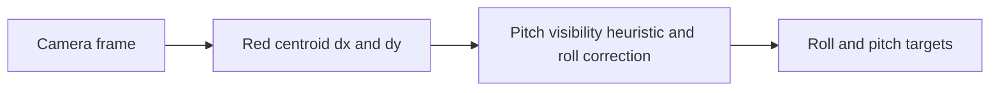
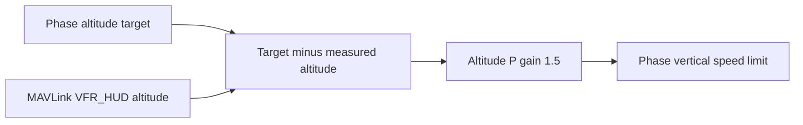
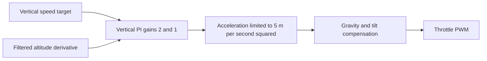
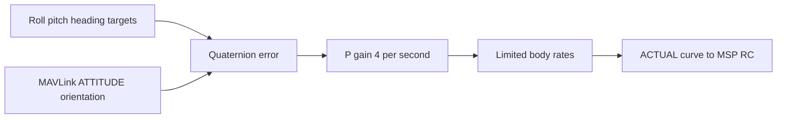
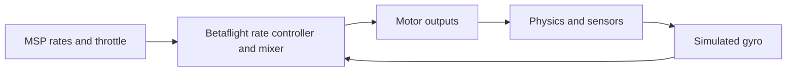
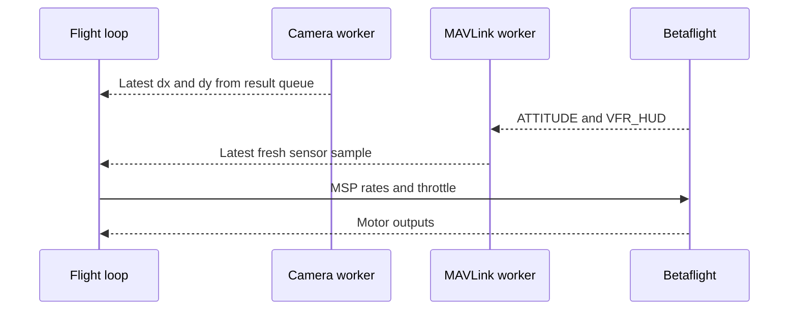

# Red truck camera approach with MAVLink feedback

The mission reads Betaflight attitude and barometer altitude over MAVLink on TCP
5762. A dedicated worker owns the connection and publishes a capacity-one queue.
Each sensor has an independent timestamp, with a 0.5 s freshness limit. Missing,
invalid or stale telemetry stops the mission. There is no ground-truth fallback.

PyBullet truth remains in simulation, rendering, frame IDs and contact validation.
It is not passed into the mission controller. MSP on TCP 5761 carries arm status
and Acro RC commands. The package owns its SITL wrapper and firmware profile.

## Run

```bash
bash tools/setup_betaflight_mavlink_sitl.sh
uv run --locked --extra render --extra mavlink python -m examples.red_truck_visual.main
```

Requires the packaged Godot renderer and an available display. Default firmware:
`bin/betaflight_mavlink_SITL.elf`. GPS is disabled. The MAVLink build must support
ATTITUDE and VFR_HUD. Pinned firmware publishes zero climb and angular-rate
fields, so climb is estimated from altitude changes and angular-rate fields are
not used by the outer controller. Betaflight closes its gyro loop internally.

## Camera steering

Forward pitch increases toward 18 degrees when horizontal camera error is small,
and decreases as horizontal error grows. Vertical error adds pitch correction.
Final pitch stays between 5 and 30 degrees and slews at 45 degrees/s. Roll combines 12 degrees times normalized horizontal error with a filtered
30 degree-second error-rate term, limited to 30 degrees. This is an
image-based pitch heuristic: no horizontal speed is measured or controlled.
Maximum physical forward velocity cannot be established from these sensors.

Positive dx means target right, positive dy means target down. On target loss,
the mission levels pitch and yaws to reacquire. Leveling does not guarantee
horizontal braking without a horizontal motion estimate.

## Individual control loops

### Camera steering



### Altitude position



### Vertical thrust



### Attitude



### Firmware stabilization



### Concurrent data flow



## Parameters and logs

| Setting | Default |
|---|---|
| Launch position | (0, -8, 0.015) m, body/world Y points left |
| Takeoff | 20 m altitude target, 4 m/s climb cap |
| Approach | descent request = altitude-scaled 3.0–3.5 + 4 × dy m/s, limited to ±8 m/s |
| `dy` pitch scaling | 50% at 20 m and below, rising to 100% at 40 m |
| Landing | 1.5 m/s descent cap |
| Search/reacquire yaw | 0.35 / 0.25 rad/s |
| Takeoff settling | within 1 m, vertical speed within 1.5 m/s, for 0.3 s |
| Initial search deadline | 30 simulation seconds |
| Mission landing deadline | 150 simulation seconds |
| Body rate limits | (2, 2, 1) rad/s |
| Camera | 640 by 480, 90 degrees horizontal FOV, 30 FPS per simulation second |
| Detector | R >= 120, G and B <= 105, R >= 1.35G, minimum 8 pixels |
| Vision freshness | 120 physics steps |
| Physics / MSP RC | 240 Hz / 50 Hz |
| MAVLink attitude / altitude | 20 Hz / 20 Hz |

Colored STATE logs show transitions. VISION logs at 10 Hz report image error,
MAVLink altitude, estimated climb, commanded pitch/thrust and RC. TIMING logs at
1 Hz report simulation speed, FDM rate, capture rate, SHM and detector FPS.

Earlier contact results used ground-truth velocity control and do not validate
this sensor-only camera controller.

## Validation

The MAVLink-only sensor controller achieved renderer-confirmed truck contact
from the 20 m takeoff at 17.167 s and from the 40 m takeoff at 22.225 s. All 17
focused tests passed. Different launch points, wind, telemetry delays and image
noise remain unverified. Pitch adaptation is a visibility heuristic, not a
measured maximum-speed optimizer.
