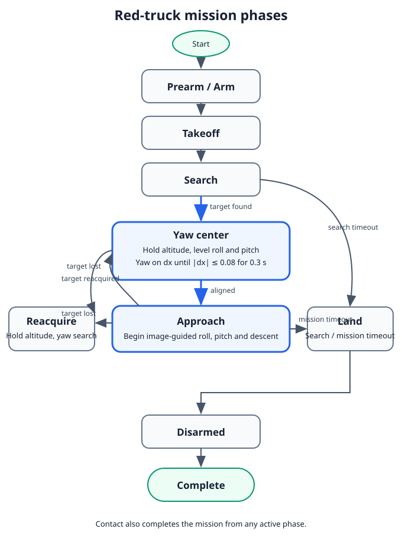
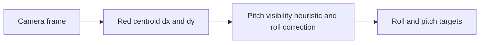
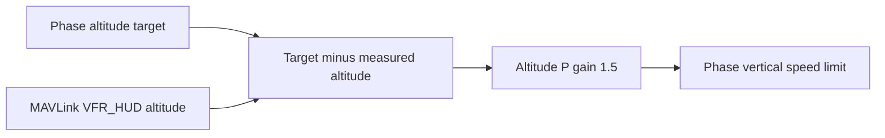
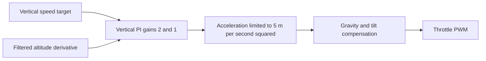
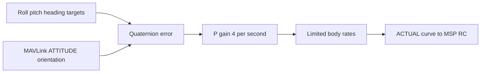
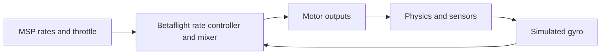
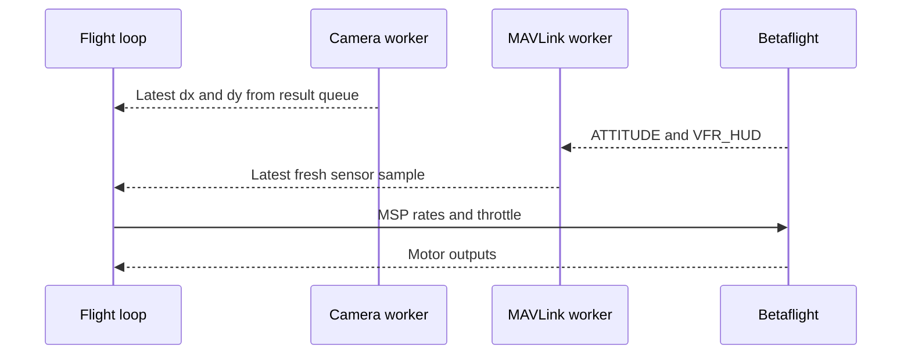

# Red truck camera approach with MAVLink feedback

The mission reads Betaflight attitude and barometer altitude over MAVLink on TCP
5762. A dedicated worker owns the connection and publishes a capacity-one queue.
Each sensor has an independent timestamp, with a 0.5 s freshness limit. Missing,
invalid or stale telemetry stops the mission. There is no ground-truth fallback.

PyBullet truth remains in simulation, rendering, frame IDs and contact validation.
It is not passed into the mission controller. MSP on TCP 5761 carries arm status
and Acro RC commands. The package owns its SITL wrapper and firmware profile.

## Run

```bash
bash tools/setup_betaflight_mavlink_sitl.sh
uv run --locked --extra render --extra mavlink python -m examples.red_truck_visual.main
```

Requires the packaged Godot renderer and an available display. Default firmware:
`bin/betaflight_mavlink_SITL.elf`. GPS is disabled. The MAVLink build must support
ATTITUDE and VFR_HUD. Pinned firmware publishes zero climb and angular-rate
fields, so climb is estimated from altitude changes and angular-rate fields are
not used by the outer controller. Betaflight closes its gyro loop internally.

## Camera steering

Forward pitch increases toward 22 degrees when horizontal camera error is small,
and decreases as horizontal error grows. Vertical error adds pitch correction.
Final pitch stays between 5 and 30 degrees and slews at 40 degrees/s. Roll combines 12 degrees times normalized horizontal error with a filtered
30 degree-second error-rate term, limited to 30 degrees. This is an
image-based pitch heuristic: no horizontal speed is measured or controlled.
Maximum physical forward velocity cannot be established from these sensors.

Positive dx means target right, positive dy means target down. On target loss,
the mission levels pitch and yaws to reacquire. Leveling does not guarantee
horizontal braking without a horizontal motion estimate.

## Detailed control loop

The controller is a cascade rather than a direct world-position controller.
MAVLink supplies measured attitude and altitude, the camera supplies target
error, the mission produces RC commands, and Betaflight closes the fast gyro and
motor loop. The mission never receives the simulated world position or velocity.

<p align="center">
  
</p>

### Camera error convention

The detector reports the red-pixel centroid relative to the image center. Both
axes are normalized, so the center is `(0, 0)` and the approximate image edges
are `-1` and `+1`.

```text
                         dy = -1
                    target above center
                            ↑
                            │
        dx = -1  ←──────── (0,0) ────────→  dx = +1
       target left         image center       target right
                            │
                            ↓
                    target below center
                         dy = +1
```

<p align="center">
  
</p>

- Positive `dx` means the truck is right of center; negative `dx` means left.
- Positive `dy` means the truck is below center and more descent is needed.
- Negative `dy` means the truck is above center, so descent is reduced and can
  reverse into a climb.
- `dx` affects lateral roll and reduces forward pitch when the target is far
  from the horizontal center. `dy` affects both pitch and vertical thrust.

### 1. MAVLink input and validation

`SensorWorker` connects to `tcp:127.0.0.1:5762` and accepts only `ATTITUDE` and
`VFR_HUD` messages. `ATTITUDE` roll, pitch and yaw are converted to a quaternion;
the pitch sign is changed to match the project coordinate convention. `VFR_HUD`
provides barometric altitude in meters.

The pinned firmware does not provide useful climb data, so vertical speed is
estimated from successive altitude messages and low-pass filtered:

```text
raw vertical speed = (altitude now - altitude previous) / elapsed time
filtered speed += elapsed / (0.2 + elapsed) * (raw speed - filtered speed)
```

Attitude and altitude have independent receive timestamps. A combined
`SensorSample` is timestamped with the older of the two, ensuring that a fresh
attitude message cannot hide stale altitude. Non-finite values fail the worker,
and a sample older than 0.5 seconds stops the mission. A capacity-one queue
keeps only the newest complete sample.

### 2. Inputs collected by the flight loop

The caller-owned loop runs at 240 Hz. Every iteration collects:

- arm state and arming blockers from MSP status;
- MAVLink attitude, altitude and filtered vertical speed;
- the latest fresh camera `dx` and `dy`;
- renderer-confirmed truck contact; and
- simulation time and step index for lifecycle and freshness checks.

These inputs are passed to `RedTruckMission.command()`. Ground-truth pose is used
only by physics, rendering, frame matching and contact validation; it is not a
mission-control input.

### Controller modules

- `controllers/image.py` maps camera `dx`/`dy` to roll, pitch and altitude
  targets, including filtered horizontal error and pitch slew state.
- `controllers/altitude.py` holds PID settings for the shared
  `AltitudeController`.
- `controllers/attitude.py` holds gains and body-rate limits for the shared
  `AttitudeController`.
- `mission.py` selects targets by phase, composes the shared controllers and
  maps their outputs to RC channels.

### 3. Mission phase selects the targets

<p align="center">
  
</p>

The phase determines the outer-loop targets:

- **Takeoff:** hold level and climb to the configured altitude, limited to
  4 m/s.
- **Search:** hold the measured altitude and rotate at 0.35 rad/s.
- **Center:** hold measured altitude with level roll/pitch, and yaw toward the
  visible truck until horizontal image error remains within the alignment band.
- **Approach:** use `dx` and `dy` for roll, pitch and vertical guidance.
- **Reacquire:** slew pitch back to level, hold measured altitude and rotate at
  0.25 rad/s.
- **Land:** target ground altitude with descent limited to 1.5 m/s.

Search and reacquisition no longer enter the descending approach directly. Both
route a detected target through the center phase. While centering, the yaw-rate
request is `-1.5 rad/s per dx` and is capped at ±0.6 rad/s; a positive `dx`
therefore turns the nose right toward the target. Inside `abs(dx) <= 0.08`, yaw
stops; the target must stay in that band for 0.3 s before approach starts. Pitch
remains level and the altitude target remains the measured altitude throughout
this phase, so `dy` cannot request pitch or descent until horizontal alignment
is confirmed. Losing the target during centering returns to reacquisition.

### 4. Image guidance produces roll, pitch and altitude targets

During approach, horizontal image error produces a roll target:

```text
roll target = 24 deg * dx + 30 deg-s * filtered change of dx
```

The derivative term damps rapid lateral movement in the image. Roll is limited
to 30 degrees.

#### Control idea, gains and filtering

This is image-based visual servoing. The detector measures where the truck is
relative to the image center; the outer controller converts that error into a
desired tilt and descent. MAVLink attitude and altitude close the attitude and
vertical cascades. There is no horizontal position or velocity feedback, so the
controller steers the truck in the image without estimating its world-space
distance or speed.

The gains are hand-selected tuning values in `controllers/image.py`, with these
roles:

| Setting | Value | Effect |
|---|---:|---|
| `IMAGE_ROLL_GAIN_RAD` | 24 degrees per unit `dx` | Proportional lateral steering toward the image center. |
| `IMAGE_ROLL_D_GAIN_RAD_S` | 30 degree-seconds per unit `dx` rate | Adds damping when horizontal image error is changing quickly. |
| `MAX_FORWARD_PITCH_RAD` | 22 degrees | Forward-pitch baseline when `dx` is centered. |
| `IMAGE_PITCH_GAIN_RAD` | 10 degrees per unit `dy` | Adds vertical image correction to pitch. |
| `IMAGE_DESCENT_GAIN_M_S` | 4 m/s per unit `dy` | Changes requested vertical speed from vertical image error. |

The `dx` derivative is the change in normalized image error per second. The
vision worker carries the source simulation step with each target sample. The
controller updates the derivative only when that step changes, using elapsed
camera-frame time instead of the faster mission-loop timestep:

```text
frame dt = (frame step now - frame step previous) * physics timestep
raw dx rate = (dx now - dx previous) / frame dt
filtered rate += frame dt / (0.2 s + frame dt) * (raw rate - filtered rate)
```

`IMAGE_D_FILTER_S = 0.2` s is the filter time constant. With the configured
30 fps camera, a typical frame interval is about 1/30 s, so each new frame moves
about 14% of the way toward the new raw rate. Repeated mission ticks that use
the same image do not create artificial derivative updates. The proportional
roll term responds to current error; the derivative term responds to its
camera-frame-to-camera-frame movement.

These gains are starting tuning choices, not gains derived from a vehicle model.
The roll proportional gain is 24 degrees per unit `dx`; increasing it makes
lateral correction stronger. Too much
proportional gain can cause overshoot, while too much derivative gain can turn
image noise into roll commands. The filter trades noise rejection for delay, so
it should be tuned together with derivative gain and camera update timing.

Forward pitch combines a baseline and the vertical image correction:

```text
forward baseline = 22 deg * max(0.2, 1 - abs(dx))
pitch target = forward baseline + 10 deg * dy * altitude scale
```

These values come from `controllers/image.py`. The 22-degree forward baseline
and 10-degree `dy` gain are tuning choices, not values calculated from the
camera geometry. The detector normalizes `dx` to approximately `[-1, 1]`, so
`1 - abs(dx)` makes the baseline decrease as the target moves away from image
center. `MIN_FORWARD_PITCH_FACTOR = 0.2` prevents that baseline from falling
below 20% of 22 degrees (4.4 degrees); the final 5-degree pitch floor still
applies. For example, at `dx = 0` the baseline is 22 degrees, and at `dx = 0.5`
it is 11 degrees, before adding the `dy` correction.

The altitude scale is 0.5 at 20 m and below, rises linearly, and reaches 1.0 at
40 m. Thus `dy` adds half as much pitch at 20 m as at 40 m. Final pitch is
limited to 5–30 degrees and slew-limited to 40 degrees/s.

#### Command limits

The limits prevent image guidance from requesting arbitrarily large commands:

- Roll target is clamped to ±30 degrees. Pitch is clamped to 5–30 degrees and
  can change by at most 40 degrees per second. During reacquisition it slews
  back toward level using the same rate limit.
- The altitude controller clamps its requested vertical speed symmetrically:
  to ±8 m/s during approach, ±4 m/s during takeoff, and ±1.5 m/s during
  landing. Search and reacquisition use ±1 m/s while holding current altitude.
- Attitude error is converted to body-rate requests with 4/s proportional gain
  and per-axis limits `(2, 2, 1)` rad/s for roll, pitch and yaw. Search and
  reacquisition replace only the yaw request with their fixed search rate.
- The altitude controller bounds collective thrust between zero and maximum
  motor thrust. Tilt compensation divides by `max(0.5, cos(roll) cos(pitch))`,
  so the divisor floor caps compensation at 2. With both tilt targets limited
  to 30 degrees, the current maximum factor is about 1.33; the maximum-thrust
  clamp still applies afterward.

These limits apply at different stages: image angles are bounded first, then
attitude error becomes bounded body rates, altitude error becomes bounded
vertical speed, and the final thrust is bounded by motor capacity.

Vertical guidance deliberately keeps full `dy` authority at both altitudes:

```text
descent request = base descent + 4 * dy
```

The coefficient is `IMAGE_DESCENT_GAIN_M_S = 4.0` in `controllers/image.py`.
Since `dy` is a normalized, unitless image error, this tuning value means a
four-meter-per-second change in requested descent for each full unit of `dy`.
It is selected to tune the camera response; it is not derived from altitude or
camera field of view. The base descent is separately interpolated from 4.0 to
4.5 m/s as altitude guidance scales from 0.5 to 1.0.

Base descent is 4.0 m/s at 20 m and below, rises linearly, and reaches 4.5 m/s
at 40 m. Positive descent means down. For a 20 m approach:

| `dy` | Calculation | Requested vertical motion |
|---:|---:|---|
| `+0.5` | `4.0 + 4 × 0.5 = 6.0` | descend at 6.0 m/s |
| `0.0` | `4.0 + 4 × 0.0 = 4.0` | descend at 4.0 m/s |
| `-0.5` | `4.0 - 4 × 0.5 = 2.0` | descend at 2.0 m/s |
| `-0.9` | `4.0 - 4 × 0.9 = 0.4` | descend at 0.4 m/s |

The vertical-speed request is converted into an equivalent altitude target for
the existing altitude cascade:

```text
altitude target = measured altitude - descent request / altitude position gain
```

The position gain is `ALTITUDE_POSITION_PID.kp = 1.5 /s`, configured in
`controllers/altitude.py`. Dividing the requested speed by this gain converts
meters per second into meters. For example, at 20 m with `dy = +0.5`, the
request is `4.0 + 4.0 × 0.5 = 6.0 m/s` down, so the target becomes
`20 - 6.0 / 1.5 = 16.0 m`. The altitude position loop then requests
`1.5 × (16.0 - 20) = -6.0 m/s`, matching the desired descent direction and
magnitude before phase limits.

This is how `dy` influences thrust: it does not directly set throttle. It moves
the altitude target, and the altitude controller decides the required thrust.

### 5. Altitude target becomes collective thrust

<p align="center">
  
</p>

The position controller converts altitude error to target vertical velocity.
The velocity controller converts vertical-speed error to acceleration. Thrust is
then `mass × (gravity + acceleration)`, bounded by available motor thrust.

#### Calculating the altitude position gain

The altitude position controller is proportional. It converts altitude error in
meters into a vertical-speed target in meters per second:

```text
altitude error = target altitude - measured altitude
vertical-speed target = position gain * altitude error
```

The configured position gain is `1.5 /s`. Its units are `(m/s)/m`, which reduce
to inverse seconds. Before phase limits are applied, the current gain produces:

| Altitude error | Calculation | Vertical-speed target |
|---:|---:|---:|
| `+10 m` | `1.5 × 10` | `+15 m/s`, then phase-limited |
| `+2 m` | `1.5 × 2` | `+3 m/s` climb |
| `+0.5 m` | `1.5 × 0.5` | `+0.75 m/s` climb |
| `-1 m` | `1.5 × -1` | `-1.5 m/s` descent |

Select a starting gain by choosing the vertical speed desired at a representative
altitude error:

```text
position gain = desired vertical speed / representative altitude error
```

For example, requesting 3 m/s at 2 m error gives `3 / 2 = 1.5 /s`. A simple
first-order interpretation is `time constant approximately 1 / gain`; a gain of
`1.5 /s` corresponds to approximately `0.67 s` before speed limits, the velocity
loop and vehicle dynamics are considered.

Approach guidance starts with a desired descent speed rather than a fixed
altitude. It therefore converts that speed into an equivalent altitude target:

```text
altitude target = measured altitude - descent request / position gain
```

For a 3 m/s descent with a `1.5 /s` gain, the altitude target is 2 m below the
measurement. The position controller then reconstructs the requested speed:

```text
vertical-speed target = 1.5 * (-2) = -3 m/s
```

A higher position gain reacts faster but is more sensitive to barometer noise
and MAVLink delay. A lower gain is smoother but takes longer to remove altitude
error. Tune it together with the vertical-speed PI loop rather than in isolation.

Because a tilted vehicle directs part of its thrust horizontally, collective
thrust is divided by `cos(roll) × cos(pitch)`. The divisor is bounded so extreme
tilt cannot request unbounded thrust.

### 6. Attitude targets become body-rate commands

The attitude controller compares the requested roll, pitch and heading with the
MAVLink quaternion. Quaternion attitude error is multiplied by a gain of 4/s and
limited to body rates of `(2, 2, 1)` rad/s.

Search and reacquisition override only yaw rate. Roll and pitch still use the
attitude controller, allowing the vehicle to remain level while rotating.

### 7. Body rates and thrust become RC channels

The requested body rates are inverted through Betaflight's configured ACTUAL
rate curve. Collective thrust is mapped through the motor model to throttle PWM.
The resulting channel order is:

| Channel | Value | Meaning |
|---:|---|---|
| 1 | 1000–2000 PWM | roll-rate stick |
| 2 | 1000–2000 PWM | pitch-rate stick |
| 3 | 1000–2000 PWM | throttle stick |
| 4 | 1000–2000 PWM | yaw-rate stick |
| 5 | 1000 or 2000 PWM | arm switch |
| 6 | 1000 PWM | Acro mode selection |

Neutral roll, pitch and yaw are 1500 PWM. Disarmed throttle and arm are 1000
PWM. All channel values are validated before transmission.

### 8. MSP delivery and Betaflight inner loop

The 240 Hz mission loop stores the newest RC tuple in `RcStream`. The stream
sends the latest tuple at 50 Hz as an MSP `SET_RAW_RC` request over TCP port
5761. Intermediate 240 Hz updates are intentionally replaced, not queued.

Betaflight interprets the RC values using its configured Acro rate curve. Its
internal gyro PID closes the fast body-rate loop, and its mixer converts
collective thrust plus roll, pitch and yaw corrections into four normalized
motor outputs. Python does not calculate individual motor commands.

### 9. Motor outputs advance physics and close the loop

At every 240 Hz physics step, the backend sends simulated FDM sensor data to
Betaflight on UDP port 9003 and receives four normalized motor outputs on UDP
port 9002. The outputs are validated, reordered to the project rotor layout and
multiplied by maximum motor speed.

PyBullet applies motor dynamics, calculates propeller forces, applies rotor
thrust and body effects, and advances one simulation step. The new simulated
sensor values return to Betaflight; Betaflight publishes the next MAVLink
measurements; and the loop repeats.

The three important update rates are therefore:

| Loop | Rate | Responsibility |
|---|---:|---|
| Physics and outer mission | 240 Hz | simulation, guidance and target generation |
| MSP RC stream | 50 Hz | deliver newest roll, pitch, throttle and yaw request |
| MAVLink attitude and altitude | 20 Hz | measured outer-loop feedback |

The outer controller must tolerate the slower MAVLink feedback. If measurements
become stale, the mission fails instead of falling back to simulator truth.

## Individual control loops

### Camera steering



### Altitude position



### Vertical thrust



### Attitude



### Firmware stabilization



### Concurrent data flow



### Worker threads and what they do

The main thread owns the 240 Hz simulation and mission loop. Blocking reads and
frame processing run in dedicated workers so they do not stall physics:

| Worker | Input and work | Output to the main loop | Why it is separate |
|---|---|---|---|
| `red-truck-vision` | Polls renderer shared memory every 20 ms, checks frame IDs, detects red pixels and computes normalized `dx`/`dy`. | Capacity-one queue containing the newest `(frame_id, target)` result; stale frame results are ignored. | Frame polling and image detection can take longer than a physics step. |
| `red-truck-mavlink` | Owns TCP `5762`, requests 50 Hz `ATTITUDE` and `VFR_HUD`, validates messages and estimates filtered vertical speed. | Capacity-one queue with the newest complete attitude/altitude sample; samples older than 0.5 s are rejected. | MAVLink reads block and arrive asynchronously. |
| `red-truck-status` | Reads MSP arming and status flags initially, then polls status every 0.1 s. | Latest status object plus any polling error. | MSP request/response latency must not pause FDM and physics stepping. |
| `example-msp` | Owns the MSP TCP transport, processes queued MSP requests and sends latest RC frames at 50 Hz. | Request futures/results, connection state, and RC delivery records. | Serial-like firmware processing and acknowledgements are asynchronous; RC updates are kept latest-value instead of queued. |

The worker results are snapshots rather than histories. Each producer replaces
an older queued result if the main loop has not consumed it, keeping control
focused on recent measurements. Worker failures are surfaced to the caller, and
the workers are stopped and joined during normal resource cleanup.

## Parameters and logs

| Setting | Default |
|---|---|
| Launch position | (-20, -18, 0.015) m, body/world Y points left |
| Takeoff | 20 m altitude target, 4 m/s climb cap |
| Approach | descent request = altitude-scaled 4.0–4.5 + 4 × dy m/s, limited to ±8 m/s |
| `dy` pitch scaling | 50% at 20 m and below, rising to 100% at 40 m |
| Landing | 1.5 m/s descent cap |
| Search/reacquire yaw | 0.35 / 0.25 rad/s |
| Takeoff settling | within 1 m, vertical speed within 1.5 m/s, for 0.3 s |
| Initial search deadline | 30 simulation seconds |
| Mission landing deadline | 150 simulation seconds |
| Body rate limits | (2, 2, 1) rad/s |
| Camera | 640 by 480, 90 degrees horizontal FOV, 30 FPS per simulation second |
| Detector | R >= 120, G and B <= 105, R >= 1.35G, minimum 8 pixels |
| Vision freshness | 120 physics steps |
| Physics / MSP RC | 240 Hz / 50 Hz |
| MAVLink attitude / altitude | 20 Hz / 20 Hz |

Colored STATE logs show transitions. VISION logs at 10 Hz report image error,
MAVLink altitude, estimated climb, commanded pitch/thrust and RC. TIMING logs at
1 Hz report simulation speed, FDM rate, capture rate, SHM and detector FPS.

Earlier contact results used ground-truth velocity control and do not validate
this sensor-only camera controller.

## Validation

The MAVLink-only sensor controller achieved renderer-confirmed truck contact
from the 20 m takeoff at 17.167 s and from the 40 m takeoff at 22.225 s. All 17
focused tests passed. Different launch points, wind, telemetry delays and image
noise remain unverified. Pitch adaptation is a visibility heuristic, not a
measured maximum-speed optimizer.
