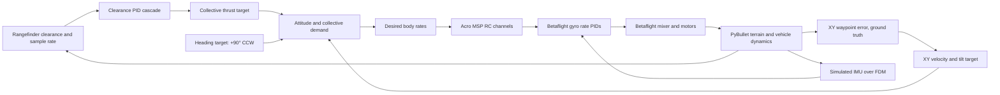

# Betaflight SITL terrain following

This independent example uses the simulated rangefinder to follow uneven ground
at a target clearance of **3 m**. During takeoff it yaws **90° counterclockwise**
from world +X to face world +Y, then follows the rising hill to its crest near
Y = 65 m and returns home on a parallel lane. The example computes horizontal navigation
and clearance demands; unmodified Betaflight SITL closes the gyro rate loops and
produces motor commands. PyBullet applies those motor outputs to the racer model
and provides simulated IMU, barometer, and rangefinder readings.

The example uses the tracked heightmap and collision mesh in `custom/terrain/`.
World Z is up and positive yaw is counterclockwise. At Y = 0 m the drone takes
off, turns to +90°, and follows this route to the hilltop before retracing it.
It holds the +90° heading throughout the route. The uphill leg follows the
existing +Y route at up to **3 m/s**. A continuous 4 m lookahead target replaces the
stop-and-settle behavior at intermediate points. At the crest, a 4 m radius
half-circle turns the path onto a return lane 8 m to the +X side; the return
curve merges back to home near the bottom. The speed remains subject to the
existing 1.5 m/s² acceleration cap and may be lower on the steep face or turn.

```text
(0, 0) → (0, 15) → (0, 30) → (0, 45) → (0, 60) → (0, 65)
                                                   ╰── 4 m radius U-turn ──╮
(0, 65)                                                   (8, 65) → (8, 60)
        → (8, 45) → (8, 30) → (8, 15) → smooth merge → (0, 0)
```

Coordinates are world metres. Approximate terrain height and resulting world
altitude at a constant 3 m clearance are:

| Y (m) | Terrain height (approx. m) | Drone Z target (approx. m) |
| ---: | ---: | ---: |
| 0 | 0 | 3 |
| 15 | 0 | 3 |
| 30 | 1.1 | 4.1 |
| 45 | 11.7 | 14.7 |
| 60 | 20.7 | 23.7 |
| 65, crest | 22.0 | 25.0 |

The outbound heights are estimates from the terrain mesh. In flight, the rangefinder
measurement controls the vertical loop. Its rate is estimated from consecutive
sensor samples, so the aircraft climbs as the ground rises and descends as it
falls. The controller requires a valid, current-step rangefinder reading and
aborts if the sensor has no return; it never substitutes ground-truth altitude.
Horizontal waypoint guidance uses ground-truth position. Betaflight receives the
simulated IMU and barometer through the existing SITL FDM bridge. The steepest
face and crest turn can cause brief clearance dips before the rangefinder loop
recovers. The rendered run showed readings near 2.9 m during the turnaround;
the example does not currently aggregate an exact minimum-clearance metric.

## Run

Build Betaflight and the external viewer once:

```bash
tools/setup_betaflight_sitl.sh
uv run --locked python external_render/build.py
```

Run with the packaged viewer or headless:

```bash
uv run --locked --extra render --extra sitl python -m examples.terrain_following_bt.main
uv run --locked --extra render --extra sitl python -m examples.terrain_following_bt.main --headless
```

The flight arms, takes off to 3 m rangefinder clearance, follows the route out
and back, lands at the home point, disarms, and closes its owned processes. The
viewer waits for an image from the active simulation before flight begins.
`--sitl-binary`, `--renderer`, and `--render-config` override the default paths.
Only one SITL/rendered example can own TCP 5555–5557, TCP 5761, and UDP 9002–9004
at a time. The crest is about 22 m above the starting ground, so the planned
world altitude there is about 25 m while holding 3 m clearance.

## Control chain



The route follows the terrain profile but does not detect or avoid separate
obstacles. The terrain itself is collision geometry, so contact and landing are
physical PyBullet events. State changes and outbound/return waypoint arrivals are logged with color. Each
status line includes world position, actual and target yaw, measured clearance,
clearance rate, arming blockers, motor outputs, and feedback age.

## Verification

```bash
uv run --locked --extra sitl pytest -q tests/test_terrain_following_bt_example.py
```

The automated tests cover the clearance loop, route state transitions, invalid
rangefinder data, cleanup, and CLI import behavior. A real paced SITL run checks
firmware arming, terrain tracking, return, landing, and disarm.

Status requests run on one owned worker so MSP response latency does not block
the 240 Hz physics loop. The loop uses the latest completed status, aborts on
request errors or status older than 0.5 s, and waits for the worker before closing
SITL. FDM pacing still enforces a full timestep between commands after stalls,
without catch-up bursts. Camera captures target 30 frames per simulation second;
wall-clock camera FPS therefore follows the achieved realtime factor.
