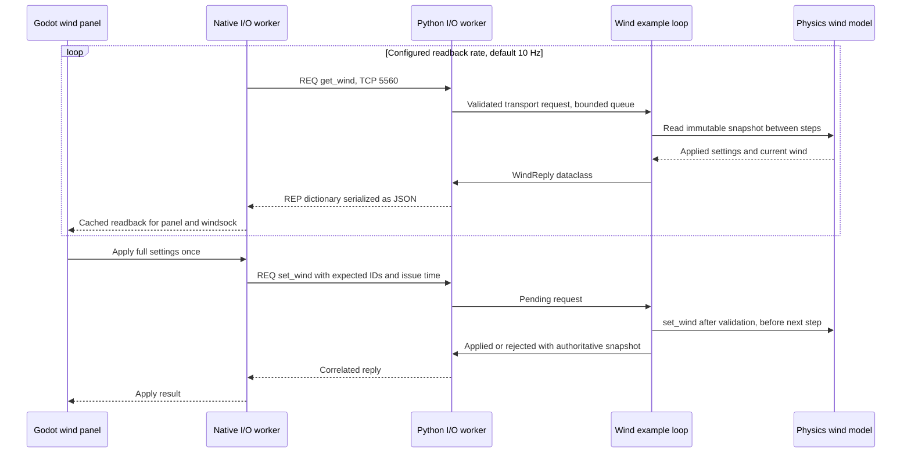

# Godot wind control

Build firmware-independent renderer assets, then run the automatic internal-control
mission with the existing Godot wind panel:

```bash
uv run --locked python external_render/build.py
uv run --locked --extra render python -m examples.wind_control.main
```

The default render profile is `external_render/configs/wind.json`, selecting
`wind_transport.json`. Only this example starts the shared wind/spawn service. No Tk window
or Python GUI dependency is used. The example starts stopped: use Scenario to apply a spawn and relative climb height, then press Start. The drone takes off, holds and lands;
the Wind button lets you apply settings during that mission. Viewer closure or
Ctrl+C closes transport, renderer and physics resources. After landing the
application exits; Start begins the mission, with spawn changes restricted to the stopped setup phase.

## Request/reply flow



Networking and JSON conversion run in I/O workers; wind and spawn share this endpoint, and at most one request is handled
between steps. The physics library has no sockets. Reads do not advance time or
consume gust RNG samples. There is no wind PUB/SUB topic. A timeout means outcome
unknown: the UI reconciles with get_wind and never automatically resends Apply.

See [wind protocol and timing](../../docs/design/wind-request-reply.md).

See [spawn request/reply](../../docs/design/spawn-request-reply.md).
