# Rendered takeoff with live wind controls

```bash
uv run --locked python external_render/build.py
uv run --locked --extra render python -m examples.wind_control.main
```

Godot shows the flight while a separate Tk window edits constant world X/Y/Z
wind velocity in m/s. Set values and press **Apply wind**. **Enable wind** controls
whether airflow is active. Values must be finite numbers; calm wind is the default.
Tkinter and a desktop display are required. The mission takes off to 3 m, holds
for 10 seconds and lands. It controls altitude, not XY position: horizontal wind
can cause drift, and large wind may prevent mission completion.

The caller pumps the UI and invokes `RcSimulation.set_wind` between physics steps.
The panel displays applied values. Invalid drafts do not change physics. Closing
the control window or pressing Escape interrupts the mission and closes physics,
Godot, UI and publisher resources. Normal completion also closes all resources.

## How the renderer learns about wind

```mermaid
flowchart LR
    subgraph Python["Python simulation process"]
        direction LR
        GUI["Tk wind GUI<br/>Enable + world XYZ velocity"]
        Apply["Validate WindSettings<br/>Apply between physics steps"]
        Sim["RcSimulation<br/>Physics owns wind + forces"]
        Pub["RenderPublisher"]
        Pose["ExternalRenderer adapter"]
        GUI -->|"Apply wind, local call<br/>No network port"| Apply
        Apply -->|"RcSimulation.set_wind()"| Sim
        Sim -->|"Applied wind readback<br/>simulation.wind, local call"| GUI
        Sim -->|"Wind snapshot<br/>RenderPublisher.set_wind()"| Pub
        Sim -->|DroneObservation| Pose
        Pose -->|"Position + attitude"| Pub
    end

    subgraph Godot["Godot renderer process"]
        direction LR
        Receiver["ZeroMQ subscriber<br/>JSON receiver"]
        Sock["Windsock<br/>Direction + speed label"]
        Drone["Drone + camera pose"]
        Receiver -->|Wind state| Sock
        Receiver -->|Pose| Drone
    end

    Pub -->|"simulation/wind_state<br/>ZeroMQ PUB/SUB, TCP 5555<br/>Every 0.1 s"| Receiver
    Pub -->|"render/drone_1/pose<br/>ZeroMQ PUB/SUB, TCP 5555<br/>Configured capture rate"| Receiver
```



Both JSON topics share `tcp://127.0.0.1:5555` by default: Python binds
the publisher and Godot subscribes. The endpoint is configurable in the transport
profile. The GUI and physics share a Python process and use local calls.

Physics owns wind and its resulting forces. The example publishes authoritative
`simulation/wind_state` through `RenderPublisher.set_wind`; the existing publisher
sends the latest state over ZeroMQ every 0.1 seconds. It includes settings, current
world velocity, episode identity and the application result. The renderer already
subscribes to that topic. Drone movement independently arrives in pose messages.
No wind force is applied by the renderer.

Godot's built-in editable wind panel requires external-RC controller ownership.
This automatic example uses its own Tk panel and publishes with no controller
owner. The windsock updates its direction and speed label in viewer-only mode,
while the Godot wind editor remains disabled.

`--renderer` and `--render-config` select the existing renderer executable and profile.
In VS Code, choose **Wind control (rendered takeoff + live UI)** in **Bullet: Run example**.
