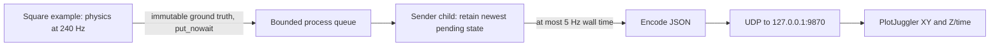

# PlotJuggler sender process

This optional tool streams the Angle square example's ground truth. Sender code
and its YAML live outside the simulation library. No recording file is produced.

Start the [PlotJuggler layout](../../plotjuggler/README.md) first, configure/start
its UDP input, then run from the repository root:

```bash
uv run --locked python -m examples.position_square.main \
  --telemetry-config tools/telemetry_sender/config.yaml
```

The equivalent VS Code task is **Run position square with telemetry**. Omit the
flag for ordinary simulation. `--headless` is supported but runs without pacing;
a fast flight will produce fewer samples because the sender is wall-clock limited.

## Configuration and ownership

Every field in [config.yaml](config.yaml) has units, accepted values and defaults.
The entire mapping is optional (`{}` selects defaults), but the opt-in CLI flag
requires a readable YAML file. Unknown keys and invalid fields are rejected
before acquiring physics resources. Destination host is a literal IPv4 address;
there is no DNS work in the simulation loop.

The example launcher owns `TelemetrySender`, which creates one bounded
`multiprocessing.Queue` and starts one child with the `spawn` context before
physics. The demo's optional `on_observation` callback receives the reset
observation and every successful step, including the final step. Normal runs
have no sender resources. The library under `src` has no sender dependency.



`send_rate_hz: 5.0` means at most one new sample per 200 ms of real time. The
sender drains older pending states instead of transmitting a stale backlog.
It never repeats an unchanged sample or sends a catch-up burst. The same cap
applies to the final pending state during normal shutdown. A very low rate may
make that final send miss the shutdown deadline; it is reported as unsent.

The queue carries frozen `DroneState` objects. The child constructs the shared
header/full ground-truth payload and performs JSON encoding and non-blocking UDP
output. Queue IPC still incurs object serialization and synchronization overhead;
this is not a zero-overhead integration. Runtime schema validation remains in tests.

## Wire format

One UDP datagram contains one JSON object. `sample` conforms to the existing
`simulation/ground_truth` schema; the outer fields belong to the transport:

```json
{
  "timestamp": 0.5,
  "topic": "simulation/ground_truth",
  "sample": {
    "header": {
      "schema_version": 1,
      "drone_id": "drone_1",
      "episode_id": "episode-id",
      "step_index": 120,
      "simulation_time_s": 0.5
    },
    "data": {
      "position_m": [1.0, 2.0, 3.0],
      "orientation_xyzw": [0.0, 0.0, 0.0, 1.0],
      "linear_velocity_m_s": [0.0, 0.0, 0.0],
      "angular_velocity_rad_s": [0.0, 0.0, 0.0],
      "rotor_speeds_rad_s": [400.0, 400.0, 400.0, 400.0]
    }
  }
}
```

The outer timestamp equals the header's simulation timestamp in seconds. UDP
packets carry no JSON Schema registration handshake: PlotJuggler's JSON parser
reads numeric fields directly. UDP provides no delivery acknowledgement; a
successful send does not prove the viewer received or plotted the sample.

## Failures and shutdown

A full queue rejects the incoming submission immediately. Sender startup/runtime
failure disables streaming, reports one diagnostic error and lets the flight
continue. Closing runs after completion, simulation failure or interruption.
It requests orderly completion with an end marker, allows up to
`shutdown_timeout_s` for pending output, then terminates an unresponsive child.
Termination/reaping has an additional bounded grace of up to one second.

Final statistics distinguish:

- `submitted`: accepted queue submissions.
- `sent`: datagrams successfully handed to the socket, not acknowledged delivery.
- `rate skips`: accepted states superseded by newer states before transmission.
- `overflow drops`: rejected submissions because the queue was full.
- `unsent`: accepted submissions neither confirmed sent nor superseded, including
  pending data lost on worker failure/timeout.
- `errors`: reported worker/lifecycle failure count.

Final worker counters are returned on a status pipe. If the worker must be killed,
its unavailable counters are not guessed; `unsent` conservatively includes all
unconfirmed submissions. This live preview intentionally samples ground truth
only; it is separate from the future mandatory-topic recording pipeline.

## Verification measurements

On the development machine (Python 3.12, 240 Hz example, 5 Hz sender), a complete
paced GUI flight ran 54.371 simulated seconds at reported RTF 1.000. It accepted
13,050 states, sent 272 datagrams, superseded 12,778 states and reported zero
queue overflow, unsent samples or errors. Both native PlotJuggler panels were
visually checked, including the final altitude at simulation time 54.371 s.

Two paired accelerated headless runs measured parent submission medians of
10.07–10.11 microseconds, p95 of 15.09–17.86 microseconds and observed maxima up
to 3.53 milliseconds. Headless RTF ranged 11.85–12.93 without streaming and
14.27–14.54 with streaming in this small, noisy sample; these results are not
evidence of a speedup or a portable overhead bound. Startup/shutdown of the
sender was excluded from those loop timings. Accelerated runs overflowed the
queue but continued without sender errors, as expected for a best-effort preview.
Normal shutdown retries the final rejected state within its deadline; overflow
counters count rejected submission attempts even if that final state is retried.
